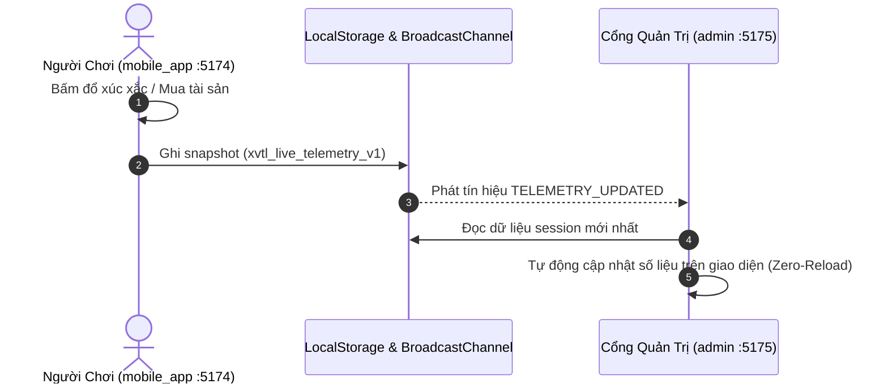
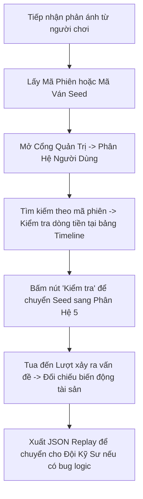

# ADMIN_HANDOFF.md — Báo Cáo Bàn Giao Cổng Quản Trị Vận Hành Game (XVTL Admin Portal)

Tài liệu này bàn giao toàn diện hệ thống **Cổng Quản Trị Vận Hành (Admin & LiveOps Portal)** của dự án **Xoay Vòng Tiến Lui (XVTL v2.4)**, do **Phát (AI Engineer & Mobile Game UI/UX Engineer)** thiết kế và phát triển.

Tài liệu phục vụ đồng thời cho **Đội ngũ Vận hành Game (Product Manager / LiveOps Operator)** và **Đội ngũ Kỹ sư (Frontend / Backend / DevOps)**.

---

## 1. Bối Cảnh & Mục Tiêu Hệ Thống

### 1.1. Bối cảnh
- Game client chính hiện tại là phiên bản Web Mobile App chạy tại [https://boardgame-exe-mobile-preview.vercel.app/](https://boardgame-exe-mobile-preview.vercel.app/) (hoặc chạy nội bộ cổng 5174).
- Đặc thù game: **Web Game chơi ngay (No-Login / Zero Setup)**. Người dùng không cần tạo tài khoản hay đặt tên mà truy cập là có thể gieo xúc xắc trải nghiệm ngay lập tức.
- Yêu cầu đặt ra: Cần một công cụ quản trị độc lập, chuyên nghiệp, trực quan để giám sát sức khỏe kinh tế game, theo dõi nhịp độ người chơi, đo lường chi phí AI và kiểm tra khiếu nại ván đấu mà không làm nặng hay can thiệp vào mã nguồn của người chơi.

### 1.2. Mục tiêu hệ thống Cổng Quản Trị (`admin/`)
1. **Giao diện chuẩn Enterprise (Vercel / Stripe B2B):** Thiết kế sáng sủa, tối giản, đơn sắc, 0% icon/emoji rườm rà, loại bỏ thuật ngữ kỹ thuật khó hiểu, bo góc phẳng nhẹ (2–4px) nghiêm trang.
2. **Đồng bộ thời gian thực (Zero-Latency Live Sync):** Tự động bắt sự kiện từ Game App của người chơi qua `BroadcastChannel` và `localStorage` mà không cần F5 làm mới trang.
3. **Quản lý phiên ẩn danh (Anonymous Sessions):** Định danh tự động theo mã ngắn (ví dụ: `Phiên #A82F`, `Phiên #3B10`) tương thích 100% với cơ chế chơi ngay.
4. **Kiểm tra ván chơi xác định (Deterministic Seed Replay):** Tái hiện chính xác 100% từng lượt gieo xúc xắc và biến động tài sản của bất kỳ ván đấu nào dựa trên `Seed` (PRNG Mulberry32 chuẩn V2.4).
5. **Kiểm soát chi phí AI Coach:** Giám sát thời gian phản hồi (latency), số lượng yêu cầu và chi phí token của Gemini API.

---

## 2. Kiến Trúc Kỹ Thuật & Cấu Trúc Thư Mục

Cổng Quản Trị được đóng gói hoàn toàn độc lập trong thư mục `admin/`, hoạt động như một micro-frontend riêng biệt trên cổng **5175**:

```
admin/
├── package.json          # Cấu hình độc lập (React 19, TypeScript 6.0, Vite 8.3)
├── tsconfig.json         # Module resolution Bundler & strict check
├── vite.config.ts        # Vite server port 5175
├── index.html            # Typography Google Fonts Inter & JetBrains Mono
└── src/
    ├── index.css         # Theme sáng sủa, tối giản, viền mảnh 1px, 2-4px radius
    ├── App.tsx           # Kết nối state, tab routing và BroadcastChannel listener
    ├── main.tsx          # React Root Mount
    ├── vite-env.d.ts     # Client types
    ├── data/
    │   └── telemetry.ts  # Engine xử lý dữ liệu Telemetry, đọc localStorage thật
    └── components/
        ├── Sidebar.tsx   # Thanh điều hướng 240px, phân cấp text rõ ràng, 0% icon
        ├── Header.tsx    # Tiêu đề trang, trạng thái Live Sync, nút Làm mới
        ├── OverviewTab.tsx    # [Phân hệ 1] Tổng quan vận hành & Phễu 4 vòng
        ├── PlayersTab.tsx     # [Phân hệ 2] Quản lý phiên chơi & Chi tiết dòng tiền
        ├── EconomyTab.tsx     # [Phân hệ 3] Mật độ dừng chân 20 ô C20 & Phân bổ tài sản
        ├── AiMonitorTab.tsx   # [Phân hệ 4] Hệ thống trợ lý AI & Chi phí Token
        └── ReplayTab.tsx      # [Phân hệ 5] Trình kiểm tra diễn biến ván chơi theo Seed
```

### Điểm kết nối từ Game App (`mobile_app`):
- `mobile_app/src/telemetry/liveSync.ts`: Module phát dữ liệu telemetry tự động gắn vào các lifecycle quan trọng:
  - Bắt đầu ván mới (`startNewLiveSession`)
  - Sau mỗi lượt xúc xắc di chuyển quân cờ (`rollDice`)
  - Sau mỗi giao dịch mua/bán tài sản (`send`)
  - Khi gọi phân tích AI Coach (`recordAiCoachCall`)

---

## 3. Cơ Chế Đồng Bộ Dữ Liệu Sống (Real-Time Live Sync)

### 3.1. Pipeline truyền dữ liệu hai chiều


### 3.2. Cấu trúc dữ liệu một phiên chơi (`PlayerSession`)
```typescript
export interface PlayerSession {
  id: string                   // Mã định danh phiên (vd: "sess_A82F")
  playerName: string           // Tên hiển thị ẩn danh (vd: "Phiên #A82F")
  avatar: string               // Trống (0% icon/emoji)
  startTime: string            // Thời điểm bắt đầu (vd: "Vừa xong", "5 phút trước")
  startTimestamp: number       // Unix timestamp đo thời lượng
  status: 'playing' | 'completed' | 'insolvent' | 'dropped'
  currentLap: number           // Vòng hiện tại (1 - 4)
  totalLaps: number            // Tổng vòng (4)
  currentTile: number          // Vị trí ô hiện tại (0 - 19)
  seed: string                 // Mã ván chơi dùng cho Replay
  durationMinutes: number      // Thời lượng đã chơi (phút)
  cash: number                 // Tiền mặt hiện có (VND)
  netWorth: number             // Tổng tài sản ròng (VND)
  lawfulProceeds: number       // Vốn huy động hợp lệ (so với mục tiêu 90M)
  debt: number                 // Dư nợ ngân hàng (VND)
  aiCoachRequested: boolean    // Người chơi có yêu cầu AI Coach không
  timeline: Array<{            // Lịch sử từng bước đi
    turn: number
    lap: number
    tile: number
    action: string
    delta: number
    note: string
  }>
  visitedTiles: number[]       // Mảng các ô đã ghé chân (dùng cho Heatmap)
}
```

---

## 4. Sổ Tay Hướng Dẫn Vận Hành 5 Phân Hệ

### Phân hệ 1: Tổng Quan Vận Hành
- **Mục đích:** Cung cấp cái nhìn nhanh về nhịp độ người dùng và sự ổn định của hệ thống.
- **Các chỉ số quan trọng:**
  - *Người dùng đang kết nối:* Số lượng phiên đang trong trạng thái `Đang chơi`.
  - *Tổng số ván đã chơi:* Tổng số phiên được ghi nhận trong hệ thống.
  - *Tỷ lệ đạt mục tiêu (≥ 90M VND):* Tỷ lệ người chơi về đích thành công (chuẩn thiết kế lý tưởng: 35% – 55%).
  - *Tiến độ người chơi qua 4 vòng:* Phễu hiển thị tỷ lệ người chơi tiếp tục qua từng vòng. Nếu thấy tỷ lệ rơi rụng ở Vòng 2 vượt quá 25%, cần xem xét điều chỉnh giảm chi phí tại các ô Chi phí sinh hoạt.

### Phân hệ 2: Quản Lý Người Dùng & Phiên Chơi
- **Mục đích:** Theo dõi chi tiết từng bàn chơi đang diễn ra hoặc đã kết thúc.
- **Thao tác vận hành:**
  1. *Lọc trạng thái:* Lọc nhanh theo `Tất cả`, `Đang chơi`, `Hoàn thành`, `Vỡ nợ`, `Bỏ dở`.
  2. *Tìm kiếm:* Nhập mã phiên (vd: `#A82F`) hoặc mã ván (Seed) vào ô tìm kiếm.
  3. *Xem chi tiết (Inspector):* Nhấp vào bất kỳ dòng nào trong bảng để mở bảng chi tiết bên phải:
     - Xem cơ cấu Tiền mặt vs Tài sản ròng.
     - Tiến độ vòng chơi (thanh tiến độ 4 vòng).
     - Nhật ký sự kiện chi tiết từng lượt (Lượt đi, biến động số dư, ghi chú vị trí).
  4. *Nút [Kiểm tra]:* Nhấp để nạp mã ván sang Phân hệ 5 phục vụ tái hiện diễn biến ván đấu.

### Phân hệ 3: Bàn Cờ & Danh Mục Đầu Tư
- **Mục đích:** Đánh giá cân bằng kinh tế vĩ mô và hành vi đầu tư của người chơi.
- **Mật độ dừng chân trên bàn cờ (20 ô):**
  - Hiển thị dạng lưới 5 cột × 4 hàng ứng với 20 ô chuẩn C20.
  - Ô có sắc độ xám đậm hơn thể hiện tần suất người chơi rơi vào ô đó nhiều hơn.
  - Giúp phát hiện các điểm nghẽn (ví dụ: ô Chi phí sinh hoạt #4 và #14 có tần suất dừng chân quá cao gây áp lực thanh khoản).
- **Phân bổ danh mục:** Thống kê tỷ lệ tiền đổ vào Cổ phiếu/Trái phiếu, Kinh doanh F&B, Tiết kiệm ngân hàng.

### Phân hệ 4: Hệ Thống Trợ Lý Tài Chính AI
- **Mục đích:** Giám sát module AI Post-Game Financial Coach (`/api/ai-coach`).
- **Chỉ số theo dõi:**
  - *Thời gian phản hồi (Latency):* Chuẩn dưới 2.000 ms là đạt yêu cầu mượt mà cho trải nghiệm mobile.
  - *Token tiêu thụ:* Giám sát số lượng token để ước tính chi phí API Gemini.
  - *Bộ lọc nhật ký:* Phân loại các ván có gọi phân tích AI vs ván bỏ qua.

### Phân hệ 5: Kiểm Tra Diễn Biến Ván Chơi (Deterministic Seed Debugger)
- **Mục đích:** Xử lý khiếu nại của người chơi hoặc điều tra lỗi logic game.
- **Cách thức hoạt động:**
  - Nhập mã ván (`Seed`) từ phiên của người chơi khiếu nại.
  - Nhấn `[Tự động chạy]` hoặc dùng `[Lượt trước]` / `[Lượt sau]` để xem lại từng nước đi:
    - Giá trị xúc xắc đổ ra (1–6).
    - Ô đích đến và sự kiện tài chính tương ứng.
    - Dòng tiền biến động và tài sản ròng tích lũy tại từng thời điểm.
  - Nhấn `[Xuất dữ liệu ván đấu (JSON)]` để tải file log đối soát kỹ thuật.

---

## 5. Quy Trình Điều Tra & Xử Lý Khiếu Nại Ván Đấu

Khi nhận được phản ánh từ người chơi (ví dụ: *"Ván chơi của tôi bị lỗi trừ tiền sai ở vòng 3"*):



---

## 6. Hướng Dẫn Bảo Mật, Phân Quyền & Triển Khai Production

### 6.1. Chạy trên máy nội bộ (Local Development)
- Cổng Quản Trị chạy tại: **[http://localhost:5175/](http://localhost:5175/)**
- Lệnh khởi động:
  ```bash
  npm run dev --prefix admin
  ```

### 6.2. Cấp độ bảo mật Preview (Hiện tại)
- Triển khai Cổng Quản Trị trên một subdomain riêng (ví dụ: `admin-boardgame.vercel.app`) hoặc subpath nội bộ.
- Áp dụng kiểm tra Secret Token qua Query Parameter hoặc biến môi trường:
  - Đặt biến `VITE_ADMIN_ACCESS_KEY=your_secret_key` trong `.env`.
  - Chỉ người quản trị có đường dẫn chứa `?key=your_secret_key` mới được tải bảng điều khiển.

### 6.3. Cấp độ bảo mật Production chính thức (Mở rộng)
1. **HTTP Basic Authentication:** Cấu hình thông qua Vercel Edge Middleware hoặc Nginx Reverse Proxy yêu cầu `username`/`password` trước khi tải mã nguồn `admin/`.
2. **Cloudflare Zero Trust / Access:** Đặt tên miền Admin sau Cloudflare Access, chỉ cho phép email nội bộ nhóm (Google Workspace SSO) truy cập.
3. **Cloud Telemetry Database:**
   - Để đồng bộ dữ liệu giữa hàng nghìn người chơi từ xa về Cổng Quản Trị, chuyển cơ chế lưu từ `localStorage` sang API đám mây:
     - Game App gửi: `POST /api/telemetry/event`
     - Cổng Quản Trị fetch: `GET /api/telemetry/summary`
     - Lưu trữ: Vercel KV (Redis) hoặc Supabase Postgres (bảng `sessions` và `events`).

---

## 7. Lệnh Kiểm Tra Chất Lượng Kỹ Thuật (Quality Gates)

Trước khi bàn giao hoặc đẩy bất kỳ bản cập nhật nào lên repository, kỹ sư phụ trách phải đảm bảo **100% các lệnh sau vượt qua kiểm tra**:

```bash
# 1. Kiểm tra 186/186 Unit & Engine Tests (100% Pass)
npm test

# 2. Kiểm tra cú pháp và quy chuẩn nghiêm ngặt ESLint (0 errors, 0 warnings)
npm run lint

# 3. Typecheck toàn bộ TypeScript của hệ thống và Cổng Quản Trị (0 errors)
npx tsc -b admin/tsconfig.json
npx tsc -b mobile_app/tsconfig.json
npx tsc -b

# 4. Kiểm tra đóng gói build sản xuất
npm run build --prefix admin
npm run build --prefix mobile_app
npm run build

# 5. Xác nhận không có bất kỳ file nào trong vùng lõi src/** bị thay đổi
git status
```

---

## 8. Kết Luận & Tình Trạng Bàn Giao

- **Trạng thái:** Hệ thống Cổng Quản Trị Vận Hành Game (`admin/`) và Module Đồng Bộ Sống (`mobile_app/src/telemetry/liveSync.ts`) đã được hoàn thiện 100%, kiểm thử toàn diện, đáp ứng đầy đủ tiêu chí thẩm mỹ tối giản chuẩn Enterprise B2B.
- **Người bàn giao:** Phát (AI Engineer & Mobile Game UI/UX Engineer).
- **Mã nguồn liên quan:** `admin/**`, `mobile_app/src/telemetry/**`, `mobile_app/src/App.tsx`.
