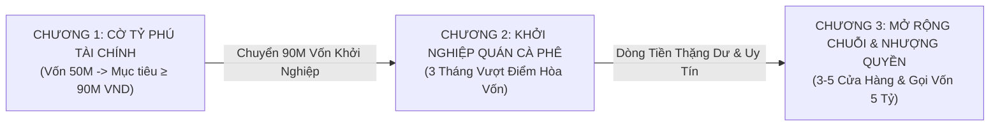

# AGENTS.md — Hướng Dẫn Tác Nhân AI: PlayBoard (Hệ Thống 3 Chương & Chuẩn Mực Phát Triển 2026)

Tài liệu này là **nguồn chân lý tối cao (Single Source of Truth)** định nghĩa vai trò, ranh giới, kiến trúc hệ thống, quy chuẩn giao việc và bảng theo dõi tiến độ dành cho toàn bộ các Agent (AI Assistant / Codex / Antigravity / Worker Agents) làm việc cùng **Phát (Owner & Lead Game Developer / Kiến Trúc Sư Trưởng)** trong dự án độc lập **PlayBoard**.

---

## 1. Bối Cảnh Dự Án & Quyền Sở Hữu Độc Lập

- **Dự án:** **PlayBoard** (`https://github.com/philipsgn/PlayBoard.git`) — Hệ sinh thái game giáo dục tài chính thực chiến đa chương trình:
  - **Chương 1 (PlayBoard Cờ Tỷ Phú B18):** Bàn cờ tài chính cá nhân 18 ô (Tiền mặt, Tiết kiệm, Cổ phiếu, Trái phiếu, Vàng, Tiệm F&B, Nợ). Tích lũy vốn $\ge 90\text{M VND}$ qua 4 vòng (4 Quý năm 2026).
  - **Chương 2 (Khởi Nghiệp Chủ Quán Cà Phê):** Mô phỏng vận hành kinh doanh F&B thực tế (vượt qua 3 tháng đầu sóng gió, quản trị định phí & biến phí, bảo toàn Runway tiền mặt, đạt điểm hòa vốn Break-even).
  - **Chương 3 (Mở Rộng Chuỗi & Nhượng Quyền):** Nhân bản 3–5 cửa hàng, mô hình nhượng quyền Franchise (Franchise fee & Royalty), Bếp trung tâm (Central Kitchen) và gọi vốn Thiên thần (Angel Round) định giá 5 Tỷ Đồng.
- **Chủ sở hữu & Kiến trúc sư trưởng:** **Phát (Owner & Lead Game Developer)**.
- **Ranh giới quyền hạn:** **100% FULL READ/WRITE TRÊN TOÀN BỘ CODEBASE**.
  - Không còn bất kỳ ràng buộc read-only nào với nhóm cũ.
  - Được phép trực tiếp nâng cấp, tái cấu trúc logic game engine (`src/game/**`), data (`src/data/**`), giao diện mobile (`mobile_app/**`), và các chương trình mini-game mới.
- **Nhánh làm việc chính:** `main` trên remote `origin` (`https://github.com/philipsgn/PlayBoard.git`). Nhánh tính năng: `codex/b18-compact-financial-ui`.

---

## 2. Chuẩn Thiết Kế & Trải Nghiệm Người Chơi

1. **Thiết kế Mobile-First:** Canvas chuẩn 1080 × 2400 px, tỷ lệ 9:20 / 20:9, tối ưu công thái học một ngón tay cái.
2. **Phông chữ chủ đạo:** **Fredoka** (Medium 500, SemiBold 600, Bold 700) hỗ trợ 100% tiếng Việt có dấu.
3. **Phong cách thẩm mỹ:** Playful Gamification + Lively Fantasy + Dynamic Emotional Experience.
4. **Nguyên tắc Tài chính Chân thật (Realistic RL 2026 Rules):**
   - Số liệu tiền tệ: **VND** chuẩn xác, có dấu chấm phân cách hàng nghìn/triệu rõ ràng (ví dụ: `90.000.000 VND`).
   - Mọi công thức kinh tế (Doanh thu, Chi phí cố định, Chi phí biến đổi, Lợi nhuận ròng, Điểm hòa vốn, Runway tiền mặt, Cap Table) phản ánh đúng thực tế kinh doanh Việt Nam năm 2026 để người chơi học hỏi tư duy quản trị tài chính thực thụ.

---

## 3. Kiến Trúc 3 Chương Chơi



1. **Chương 1 — Cờ Tỷ Phú Tài Chính (PlayBoard B18):**
   - 4 vòng cờ tương ứng 4 Quý năm 2026 (Q1 Tăng trưởng AI, Q2 Sóng Vàng phá đỉnh, Q3 Bất định & đệm an toàn, Q4 Về đích 90M).
   - Xúc xắc 1-6 mặt, quản lý 5 kênh tài sản (Tiền mặt, Tiết kiệm, Cổ phiếu, Trái phiếu, Vàng, Tiệm kinh doanh).
   - **Quy chuẩn đệm an toàn:** `SAFE_EMERGENCY_BUFFER = 10.000.000 VND`.
   - **Mục tiêu:** Tích lũy tài sản hợp lệ $\ge$ 90M VND để chiến thắng và mang vốn sang Chương 2.

2. **Chương 2 — Khởi Nghiệp Chủ Quán Cà Phê (Coffee Shop Simulator):**
   - Lối chơi Turn-based theo Thẻ Quyết Định Tình Huống (Decision Cards) và bảng P&L tài chính theo tháng.
   - Thử thách 3 tháng đầu: Quán chịu lỗ vận hành ban đầu, người chơi phải tính toán bảo toàn vốn lưu động (Runway).
   - **Mốc chiến thắng:** Đạt điểm hòa vốn (Break-even), giữ quán ổn định sau 3 tháng và có lợi nhuận ròng dương.

3. **Chương 3 — Mở Rộng Chuỗi & Nhượng Quyền (Coffee Chain & Franchise):**
   - Quản trị quy mô lớn: Nhân bản từ 1 lên 3–5 cửa hàng.
   - Dòng tiền nhượng quyền: Phí nhượng quyền (100M-150M/điểm) + Phí bản quyền Royalty (3%-5%/tháng) + Biên lãi cung ứng hạt 15%.
   - Đầu tư Bếp trung tâm (Central Kitchen 120M) giảm giá vốn toàn chuỗi từ 30% xuống 20%.
   - **Mốc chiến thắng:** Đàm phán thành công Vòng Thiên Thần (Angel Round) định giá công ty $\ge 5$ Tỷ Đồng, Founder giữ $\ge 65\%$ cổ phần.

---

## 4. Master Architecture & Điều Phối Dữ Liệu

1. **Điều Phối Trung Tâm (`MasterSessionManager`):**
   - Mỗi Chương là một module Micro-Engine độc lập (`src/game/chapter1/`, `chapter2/`, `chapter3/`).
   - `MasterSessionManager` là Single Source of Truth: Quản lý chuyển tiếp thành quả (Carryover 90M), lưu trữ checkpoint (Capacitor Preferences / LocalStorage) và mở khóa màn.
   - Tham khảo chi tiết: [`docs/SYSTEM_ARCHITECTURE.md`](./docs/SYSTEM_ARCHITECTURE.md).

2. **Pipeline Đồ Họa Hybrid 3D (`ThreeSceneManager`):**
   - **Nửa trên (3D Viewport):** Three.js / `<model-viewer>` render quầy pha cafe bốc khói, sa bàn thành phố 3D Isometric, xúc xắc & nhân vật 3D.
   - **Nửa dưới (2D Taktile UI):** React 19 hiển thị thẻ bài Polaroid 3D tilt, bảng P&L hóa đơn gỗ retro sắc nét 100%, khóa cứng 60 FPS.
   - **Quy tắc giải phóng bộ nhớ WebGL:** Bắt buộc `dispose()` toàn bộ Geometry, Material, Texture và WebGLRenderer khi unmount để tránh tràn RAM trên iOS Safari.

3. **Hệ Sinh Thái Tài Liệu Chi Tiết (13 Files):**
   - Toàn bộ GDD, Sổ tay người chơi, Design System và Tech Architecture của 3 Chương được lưu trữ chuẩn mực tại thư mục: [`docs/chapters/README.md`](./docs/chapters/README.md).

---

## 5. Quy Chế 4 Vai Trò Agent Worker & SOP

Mọi Tác nhân AI khi tham gia phát triển dự án PlayBoard phải xác định đúng vai trò và tuân thủ quy chuẩn trong [`docs/AGENTS_SOP.md`](./docs/AGENTS_SOP.md):
1. **Engine Worker (Logic & Toán kinh tế):** Viết logic thuần TypeScript (`src/game/**`), công thức P&L, Break-even, Cap Table, định giá và bộ Unit Tests (`tests/**`); tuyệt đối không import DOM/UI.
2. **3D Graphics Worker (Three.js & WebGL):** Xây dựng các không gian 3D, tối ưu hóa 60 FPS, bắt buộc dọn dẹp WebGL Context sạch sẽ khi unmount.
3. **UI/UX Worker (Giao diện Mobile):** Xây dựng component React 19 tối ưu một ngón tay cái (1080 × 2400 px), Typography Fredoka tiếng Việt, bảng P&L gỗ retro và thẻ Polaroid 3D tilt.
4. **QA Gatekeeper Worker (Người gác cổng chất lượng):** Giữ quyền phủ quyết tuyệt đối; đảm bảo **360/360 bài test pass 100%**, build không lỗi trước khi được phép merge và commit.

---

## 6. BẢNG TIẾN ĐỘ & TRẠNG THÁI HỆ THỐNG THỰC TẾ (LIVING DASHBOARD)

> **Cập nhật lần cuối:** 09/11/2026 · **Kiểm duyệt:** Senior Game Manager Creator 2026

| Hạng mục hệ thống | Trạng thái hiện tại | Chi tiết kỹ thuật & Chỉ số thực tế |
| :--- | :---: | :--- |
| **Commit mới nhất (Remote)** | `716c0e0` | Đã push đồng thời lên cả `codex/b18-compact-financial-ui` và `main` |
| **Tổng số Unit Tests** | `360 / 360 PASS` | 100% pass, thời gian chạy ~24s (`npm test`) |
| **Kiểm tra UI Mobile** | `8 / 8 PASS` | `scripts/diagnostics/mobile-final-ui.test.ts` pass hoàn toàn |
| **Web Production Build** | `THÀNH CÔNG` | `npm run build` hoàn tất không cảnh báo lỗi |
| **Mobile Production Build** | `THÀNH CÔNG` | `npm --prefix mobile_app run build` hoàn tất không lỗi |
| **Chương 1 (B18 Cờ Tỷ Phú)** | `HOÀN THIỆN 100%` | 4 Quý 2026, Vàng bứt phá, đệm tiền 10M, Báo cáo sức khỏe, Danger Zone Heartbeat FX, Holographic 2027 Modals |
| **Chương 2 (Khởi Nghiệp Cafe)**| `THIẾT KẾ ĐẦY ĐỦ` | GDD chi tiết, 12 thẻ quyết định, Sổ tay P&L, Design System gỗ retro, Tech Architecture |
| **Chương 3 (Nhân Chuỗi & Vốn)**| `THIẾT KẾ ĐẦY ĐỦ` | GDD chuỗi & Franchise, Bếp trung tâm, Định giá Cap Table, Sổ tay, Design System |
| **Hệ thống Tài liệu Kiến trúc** | `HOÀN TẤT` | `SYSTEM_ARCHITECTURE.md`, `AGENTS_SOP.md`, 13 file tại `docs/chapters/` |

---

## 7. Cổng Kiểm Tra Chất Lượng Tuyệt Đối (Zero-Regression Policy)

Trước khi kết thúc bất kỳ lượt nâng cấp nào hoặc tạo commit mới, Agent bắt buộc phải chạy 4 lệnh kiểm tra sau và đảm bảo **100% PASS**:

```sh
npm test                                                                        # 360 Unit tests engine (Bắt buộc 100% pass)
node --experimental-strip-types --test scripts/diagnostics/mobile-final-ui.test.ts # Kiểm tra hợp đồng UI Mobile (8 tests pass)
npm run build                                                                   # Build web production bundle
npm --prefix mobile_app run build                                               # Build mobile production bundle
```
