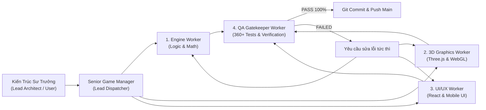

# QUY CHẾ VẬN HÀNH & GIAO VIỆC CHO ĐỘI NGŨ AGENTS (SOP)
## Standard Operating Procedures (SOP) For Autonomous Development Workers (2026 Edition)
**Kiến trúc sư trưởng:** Phát (Owner & Lead Game Developer)  
**Ban hành:** Senior Game Manager Creator 2026  
**Dự án:** PlayBoard — Game Giáo Dục Tài Chính Cá Nhân & Khởi Nghiệp  

---

## 1. MỤC ĐÍCH & PHẠM VI ÁP DỤNG

Tài liệu này xác lập **Quy chuẩn Vận hành Tiêu chuẩn (SOP)** dành cho toàn bộ các Tác nhân AI (AI Agents / Subagents / Workers / Codex / Antigravity) tham gia phát triển dự án PlayBoard.
> **Nguyên tắc tối thượng:** Mọi Agent phải thực thi công việc theo đúng vai trò chuyên môn hóa, tuân thủ nghiêm ngặt các ranh giới kiến trúc, đảm bảo đầu ra chuẩn xác và **tuyệt đối không gây hồi quy (Zero Regression)** lên hệ thống hiện hữu.

---

## 2. PHÂN ĐỊNH 4 VAI TRÒ AGENT WORKER CHUYÊN BIỆT

---

### 2.1. Agent 1: ENGINE WORKER (Chuyên Gia Cỗ Máy Logic & Toán Kinh Tế)
- **Nhiệm vụ trọng tâm:**
  - Viết logic mô phỏng tài chính thuần túy bằng TypeScript (State Reducers, Math Formulas, Deterministic RNG).
  - Triển khai các công thức tính toán: P&L theo tháng, Điểm hòa vốn, Runway, Bảng Cap Table, Định giá Pre-money/Post-money.
  - Viết Unit Tests toàn diện cho các cỗ máy tính toán.
- **Ranh giới nghiêm ngặt:**
  - ❌ **TUYỆT ĐỐI KHÔNG** import các thư viện UI (React, JSX, DOM, CSS, HTML, Three.js).
  - ❌ **TUYỆT ĐỐI KHÔNG** lưu trữ số thực trôi nổi (Float drift); mọi số tiền tệ bắt buộc phải làm tròn số nguyên VND (`Math.round()` hoặc `Math.floor()`).
- **Đầu ra bắt buộc:**
  - File logic trong thư mục `src/game/**`.
  - File kiểm thử tự động trong `tests/**.test.ts`.

---

### 2.2. Agent 2: 3D GRAPHICS WORKER (Chuyên Gia Đồ Họa Three.js & WebGL)
- **Nhiệm vụ trọng tâm:**
  - Thiết kế và tối ưu hóa các không gian 3D: Quầy bar & máy pha cafe bốc khói (Chương 2), Sa bàn thành phố 3D Isometric (Chương 3), Xúc xắc & Nhân vật 3D (Chương 1).
  - Quản lý vòng đời WebGL (Lazy Mount, On-Demand RAF, Pausing khi mở modal).
  - Tối ưu hóa hiệu năng khóa cứng ở **60 FPS** trên màn hình điện thoại (Mobile-First).
- **Ranh giới nghiêm ngặt:**
  - ❌ **TUYỆT ĐỐI KHÔNG** để xảy ra rò rỉ bộ nhớ (Memory Leak); mọi Texture, Material, Geometry và WebGLRenderer phải được `dispose()` sạch sẽ khi unmount.
  - ❌ **TUYỆT ĐỐI KHÔNG** can thiệp trực tiếp vào logic tính toán tiền tệ của Engine; chỉ nhận dữ liệu hiển thị từ Engine qua props.
- **Đầu ra bắt buộc:**
  - Component 3D trong `mobile_app/src/components/3d/**` hoặc `Character3D.tsx`.
  - Chỉ số FPS ổn định $\ge 55$ FPS, không gây crash tab trên iOS Safari.

---

### 2.3. Agent 3: UI/UX COMPONENT WORKER (Chuyên Gia Giao Diện & Trải Nghiệm Mobile)
- **Nhiệm vụ trọng tâm:**
  - Xây dựng giao diện React 19 tối ưu cho kích thước chuẩn **1080 × 2400 px** (tỷ lệ 9:20 / 20:9), thao tác mượt mà bằng một ngón tay cái.
  - Sử dụng đồng nhất phông chữ **Fredoka** hỗ trợ 100% tiếng Việt có dấu.
  - Triển khai các component độc đáo: Thẻ tình huống Polaroid nghiêng 3D (Tilt CSS), Bảng kẹp bill gỗ P&L dạng kéo thả (Pull-up Sheet), Bánh xe phân bổ cổ phần Cap Table tương tác.
- **Ranh giới nghiêm ngặt:**
  - ❌ **TUYỆT ĐỐI KHÔNG** dùng sai mã màu thiết kế quy định trong `DESIGN_SYSTEM.md`.
  - ❌ **TUYỆT ĐỐI KHÔNG** nhúng text cứng không có dấu; toàn bộ nội dung hiển thị phải là tiếng Việt chuẩn mực.
  - ❌ **TUYỆT ĐỐI KHÔNG** để nút bấm bị che khuất bởi Dynamic Island hoặc thanh điều hướng vuốt dưới đáy màn hình iOS/Android (`safe-area-inset`).
- **Đầu ra bắt buộc:**
  - File component React trong `mobile_app/src/components/**`.

---

### 2.4. Agent 4: QA GATEKEEPER WORKER (Người Gác Cổng Chất Lượng & Chặn Hồi Quy)
- **Nhiệm vụ trọng tâm:**
  - Kiểm duyệt độc lập mọi dòng code trước khi được phép gộp (merge) vào nhánh chính.
  - Chạy toàn bộ hệ thống test suite và build pipeline.
  - Đảm bảo 100% không có hồi quy kỹ thuật (Zero Regression).
- **Ranh giới nghiêm ngặt:**
  - ❌ **CÓ QUYỀN PHỦ QUYẾT TUYỆT ĐỐI:** Bất kỳ pull request / commit nào làm hỏng dù chỉ 1 bài test trong số 360 bài test cũ đều bị REJECT ngay lập tức.
  - ❌ **KHÔNG ĐƯỢC PHÉP CHÂM CHƯỚC:** Không chấp nhận commit có cảnh báo đỏ (Error) hoặc warning nghiêm trọng từ linter/compiler.
- **Quy trình nghiệm thu bắt buộc (Verification Checklist):**
  1. `npm test`: **360/360 tests PASS 100%**.
  2. `node --experimental-strip-types --test scripts/diagnostics/mobile-final-ui.test.ts`: **8/8 tests PASS**.
  3. `npm run build`: Web bundle build thành công.
  4. `npm --prefix mobile_app run build`: Mobile bundle build thành công.

---

## 3. TIÊU CHUẨN COMMIT & QUẢN TRỊ MÃ NGUỒN

- **Nhánh làm việc chính:** `main` và nhánh tính năng đồng bộ `codex/b18-compact-financial-ui`.
- **Cú pháp commit chuẩn (Semantic Commits):**
  - `feat(ch1|ch2|ch3): ...` — Tính năng mới của từng chương.
  - `fix(engine|ui|3d): ...` — Sửa lỗi logic, giao diện hoặc đồ họa 3D.
  - `docs(arch|sop): ...` — Cập nhật tài liệu thiết kế và quy chế.
  - `test(pnl|cap-table): ...` — Bổ sung bài test kiểm thử tự động.
- **Đồng bộ remote:** Mọi thay đổi sau khi được QA Gatekeeper phê duyệt phải được đẩy đồng thời lên cả nhánh tính năng và nhánh `main` trên `https://github.com/philipsgn/PlayBoard.git`.
