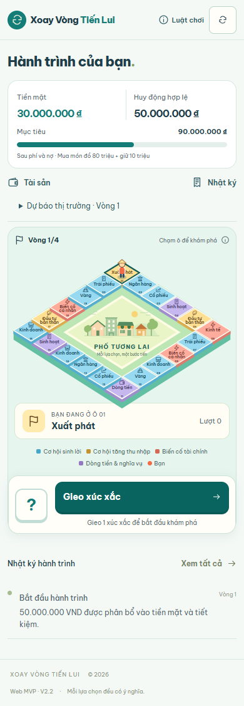
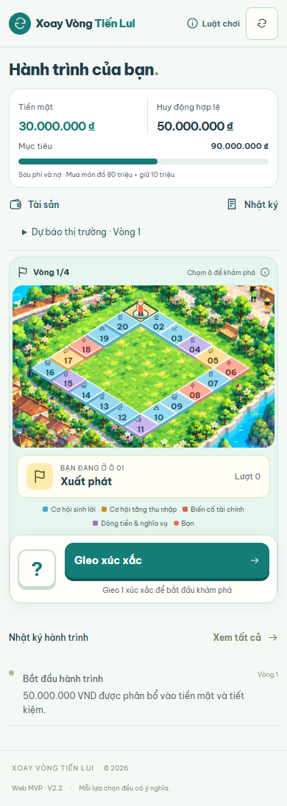
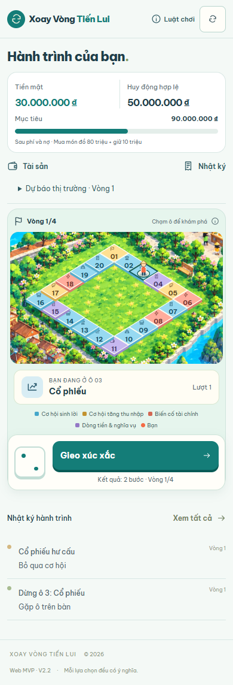
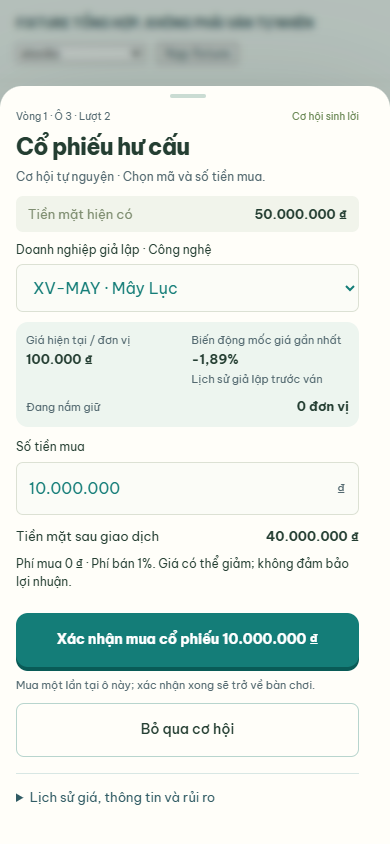
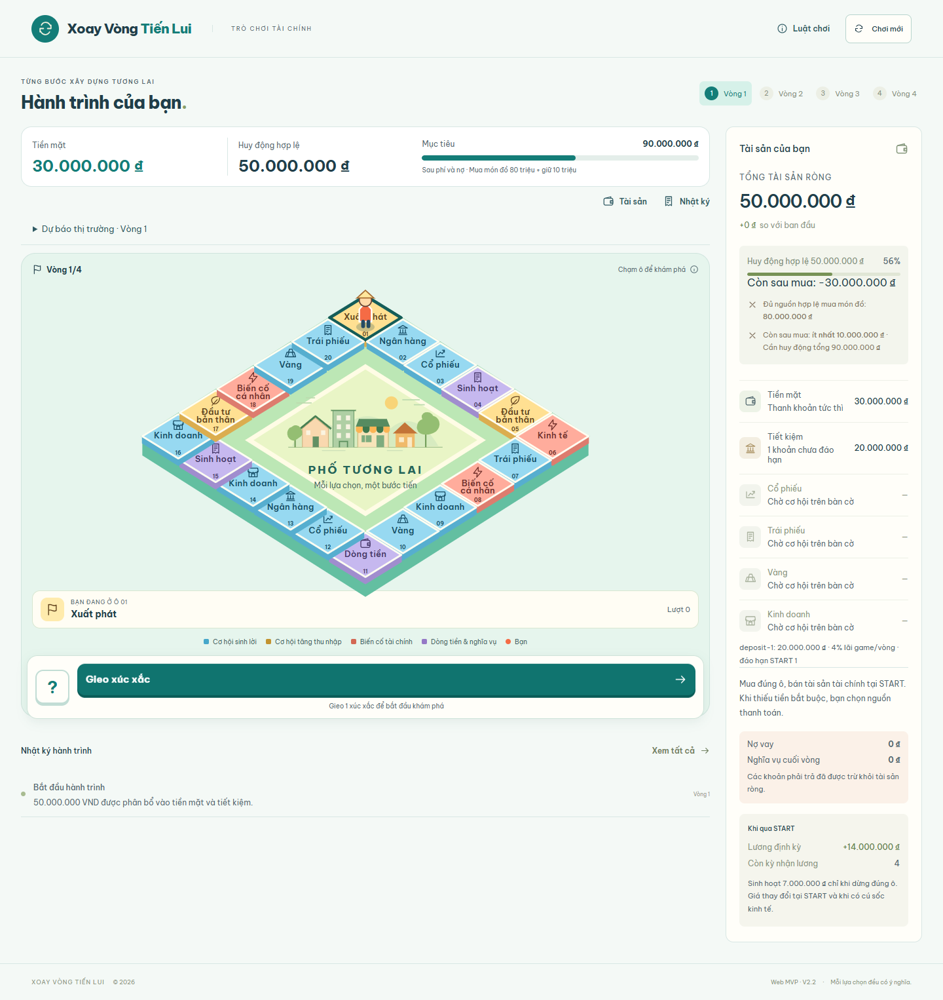
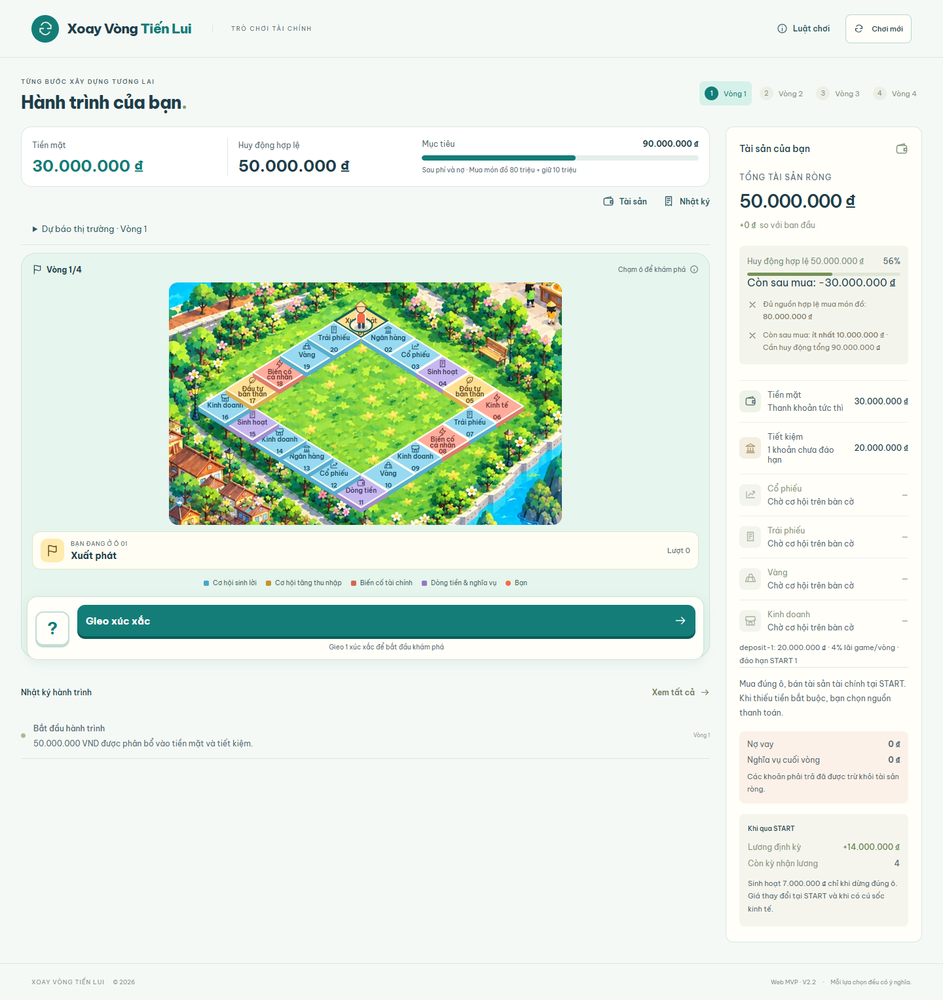

# Tích hợp artwork GD vào bàn cờ

Ngày kiểm chứng: 12/10/2026 (Asia/Bangkok). Nhánh: `feat/gd-artwork-board-scene`.

## Nền tảng và phạm vi

Đã `git fetch origin` và xác nhận commit Business V2.4 `ea984e8` là tổ tiên của `origin/main`. Nhánh tính năng được tạo từ `65017d6`, merge PR #5 chứa customer preferences và atomic business purchases. Nhánh `main` cục bộ cũ hơn nên không dùng làm điểm xuất phát.

Chỉ thay cách trình bày bàn cờ và bổ sung kiểm chứng. Không thay `src/game/`, `src/data/board.ts`, RNG, thứ tự C20, công thức tài chính, settlement, replay hoặc cấu hình phiên bản. `City.tsx` vẫn phục vụ màn hình thiết lập; bàn cờ không còn render `<City board />` hay các path thành phố cũ. Không thêm dependency, xúc xắc hoặc số liệu gameplay trang trí. Không merge hoặc triển khai.

## Artwork và các lớp

Asset gốc: `public/art/city-background.webp`, **941 × 1672**, **396.558 byte**. SHA-256 trước và sau tích hợp:

```text
6ff42846a0567ed0ba2c14525edb2c7c6bfa7f17c11a622769be6630b68139a6
```

Ảnh được giữ nguyên byte, không cắt file, không vẽ lại và không nhúng base64. SVG `<image>` dùng kích thước gốc, `preserveAspectRatio="xMidYMid meet"` và URL `${import.meta.env.BASE_URL}art/city-background.webp`. Vite chép file vào `dist/art/`; Chrome kiểm chứng HTTP 200 với MIME WebP trên bản production preview.

Một SVG chứa toàn bộ cảnh theo thứ tự:

1. Nền màu nhẹ để cảnh không trống lúc tải ảnh; artwork GD ở tọa độ `(0,0)`.
2. Hai mươi ô SVG độc lập, lấy loại, thứ tự và nội dung từ `boardFor(game)`.
3. Pawn vẽ sau tất cả các ô, lấy vị trí từ `game.position` và dùng chính hàm tọa độ của ô. Giữ chuyển động CSS nhẹ và chế độ giảm chuyển động sẵn có.
4. Ô đang đứng có viền và pawn có vòng sáng; inspection là dialog phía trên cảnh. Bàn phím Enter/Space hoạt động; đóng inspection trả focus về ô vừa xem.

HUD, thẻ vị trí, chú giải và một xúc xắc vẫn là UI bên ngoài artwork. Khi ảnh lỗi, nền xanh và thông báo tiếng Việt xuất hiện; 20 ô, inspection và lượt gieo vẫn dùng được. Kiểm chứng bằng cách chặn request WebP trong Chrome, không thay asset trong repository.

## Tọa độ và responsive

`src/components/board-scene.ts` là nguồn tọa độ dùng chung cho ô và pawn:

```text
x = 461 + (col - row) × 56
y = 705 + (col + row - 2) × 35
tileScale = 1.16
viewBox = "65 625 810 500"
```

`row` và `col` đến từ dữ liệu bàn cờ hiện có. Crop là cửa sổ nhìn trong hệ tọa độ artwork 941 × 1672; cả ảnh, ô và pawn cùng được SVG crop/scale. Không có CSS `background-size: cover`, offset độc lập theo màn hình hoặc kéo giãn ảnh.

Đường đi được thu vào phía trong thảm cỏ sau khi xem ảnh chụp; hoa, hàng cây và lối đi xung quanh còn làm khung cảnh. Crop bỏ phần trời xa để giữ các ô và nút gieo trong tầm nhìn. Desktop căn giữa cảnh, giới hạn rộng 600px. Mobile tăng icon/số ô, ẩn tên dài trên mặt ô; tên đầy đủ vẫn có trong thẻ vị trí, aria-label và dialog.

| Ô | Tâm x | Tâm y | Ô | Tâm x | Tâm y |
| --- | ---: | ---: | --- | ---: | ---: |
| 01 | 461 | 705 | 11 | 461 | 1055 |
| 02 | 517 | 740 | 12 | 405 | 1020 |
| 03 | 573 | 775 | 13 | 349 | 985 |
| 04 | 629 | 810 | 14 | 293 | 950 |
| 05 | 685 | 845 | 15 | 237 | 915 |
| 06 | 741 | 880 | 16 | 181 | 880 |
| 07 | 685 | 915 | 17 | 237 | 845 |
| 08 | 629 | 950 | 18 | 293 | 810 |
| 09 | 573 | 985 | 19 | 349 | 775 |
| 10 | 517 | 1020 | 20 | 405 | 740 |

Các check đo cả bounds thực của 20 ô, số lượng, thứ tự, tọa độ, clipping, tràn ngang và vị trí nút gieo tại **320×740, 390×844, 430×932, 1440×1000**. Kích thước bounds mỗi ô lần lượt khoảng **38,5×27,4 / 47,9×34,2 / 53,3×38,0 / 80,8×57,6 px**. Đây là ô hình thoi, không phải nút vuông 44px; ở 320px nên đọc tên qua thẻ vị trí hoặc chạm để xem. Tất cả target đều được click bằng Chrome, gồm ô bị pawn phủ lên; pawn không chặn pointer.

Mép dưới nút gieo ở bốn viewport lần lượt là **691,5 / 783,8 / 810,4 / 971,4 px**, đều nằm trong chiều cao màn hình. Kết quả development và production trùng nhau. Review cuối đã đối chiếu ảnh 320px, 390px trước/sau lượt gieo, dialog tài chính, fallback và desktop với artwork gốc; không có vấn đề bắt buộc sửa còn mở.

## File thay đổi

| File | Nội dung |
| --- | --- |
| `public/art/city-background.webp` | Đưa WebP GD có sẵn vào commit, giữ nguyên file |
| `src/components/board-scene.ts` | Kích thước artwork, crop và mapping tọa độ dùng chung |
| `src/components/Board.tsx` | Lớp ảnh, ô/pawn theo native coordinates, fallback và trả focus inspection |
| `src/mobile.css` | Khung cảnh crop, icon/số mobile, vòng sáng và spacing để tiếp cận nút gieo |
| `tests/board-scene.test.ts` | 20 vị trí, giới hạn crop, các góc và cạnh liên tiếp ở A20/C20 |
| `scripts/playtest-harness.tsx` | 20 vị trí pawn tổng hợp chỉ trong development |
| `scripts/verify-gd-artwork.mjs` | Check responsive, tap/keyboard, pawn, dialog, fallback và production |
| `scripts/verify-business-v2_4.mjs` | Cho phép chọn thư mục evidence qua biến môi trường |
| `scripts/verify-business-purchase.mjs` | Tương tự, giữ evidence lịch sử |
| `scripts/verify-transaction-inputs.mjs` | Tương tự, giữ evidence lịch sử |
| `docs/playtests/gd-artwork/` | Ảnh chụp, manifests và hai nhật ký gzip của ván thật |
| `docs/GD_ARTWORK_INTEGRATION_REPORT.md` | Báo cáo này |

## Kiểm thử

Áp dụng test-driven-development cho mapping trước khi có module, rồi kiểm chứng runtime và review theo code-review-and-quality. Không thay engine để phục vụ hình ảnh.

| Kiểm chứng | Kết quả |
| --- | --- |
| `npm test` | **157/157 pass**, gồm 155 test sản phẩm cũ và 2 test scene |
| `node --experimental-strip-types --test scripts/diagnostics/*.test.ts` | **19/19 pass** |
| `npm run lint` | Pass |
| `npm run build` | Pass, bao gồm TypeScript app và Vite |
| Typecheck harness riêng | Pass với `tsc --ignoreConfig --noEmit --jsx react-jsx --module esnext --target es2023 --moduleResolution bundler --allowImportingTsExtensions --types vite/client --skipLibCheck scripts/playtest-harness.tsx` |
| `verify-gd-artwork.mjs` trên Vite | Pass tại 4 kích thước; 20 tap mỗi kích thước, Enter/Space, focus, 20 pawn endpoints, không tràn ngang/lỗi console |
| `verify-gd-artwork.mjs` trên production preview | Pass tại 4 kích thước; tải WebP, tương tác và fallback |
| `verify-mobile-ui.mjs` | Pass, **121 ảnh** tạo trong thư mục cache; bank/stocks/bonds/gold/business/funding/START/result |
| `verify-business-v2_4.mjs` | Pass tại 320/390/430/768/1024/1440; **38 ảnh**, đầy đủ ba specialization và điều khiển radio bằng bàn phím |
| `verify-business-purchase.mjs` | Pass, double-tap chỉ mua một lần, encounter tự hoàn tất, focus về nút gieo |
| `verify-transaction-inputs.mjs` | Pass, nhập chính xác VND, chỉnh giữa chuỗi, paste không hợp lệ, viewport 320×460 |
| Asset gốc và phạm vi | SHA-256 không đổi; không có diff trong engine/data/App/City/package files |

Hai ván **thật qua production App trên Vite**, không inject state:

| Seed | Lượt gieo | Vòng hoàn tất | Huy động hợp lệ cuối ván | Bằng chứng |
| --- | ---: | --- | ---: | --- |
| `XVTL-V2-6` | 26 | 1, 2, 3, 4 | 103.921.205 ₫ | [Manifest](playtests/gd-artwork/regression-verification.json), [log gzip](playtests/gd-artwork/bank-stock-game-log.json.gz) |
| `XVTL-V2-0` | 25 | 1, 2, 3, 4 | 85.128.031 ₫ | [Manifest V2.4](playtests/gd-artwork/business-v2_4-verification.json), [log gzip](playtests/gd-artwork/business-v2_4-game-log.json.gz) |

Ván thứ nhất giữ đúng đường đi/xúc xắc/RNG so với log V2.2, gồm gửi ngân hàng ở các encounter khác nhau và mua cổ phiếu atomic. Ván thứ hai có **1 mua cơ sở, 1 nâng cấp, 1 bán cơ sở, 3 mua cổ phiếu atomic**; preferences theo vòng lần lượt `budget / budget / checkin / budget`. Log tải từ browser được replay đầy đủ snapshot và khớp state; đường đi/xúc xắc/RNG khớp V2.3. Ván thứ hai không đủ mục tiêu chiến thắng; đó là kết quả thực của engine.

Các fixture `board-0`…`board-19` và financial panels là **trạng thái tổng hợp development**, chỉ dùng kiểm chứng vị trí/UI; không dùng làm bằng chứng hoàn tất ván thật. File harness không nằm trong output production.

Chi tiết hình học và console: [development manifest](playtests/gd-artwork/artwork-verification.json), [production manifest](playtests/gd-artwork/production-verification.json). Kết quả nhập tiền và mua atomic: [input manifest](playtests/gd-artwork/input-verification.json), [purchase manifest](playtests/gd-artwork/purchase-verification.json).

## Ảnh trước và sau

Trước — SVG city cũ, 390px:



Sau — artwork GD với bàn chơi trên thảm cỏ, 390px:



Sau lượt gieo thật; đã chọn bỏ qua cơ hội cổ phiếu để nhìn rõ pawn ở ô mới:



Dialog tài chính ở lớp trên cùng (fixture stocks được ghi rõ trong harness):



Desktop trước và sau:





Các ảnh bổ sung: [320px](playtests/gd-artwork/320-board.png), [430px](playtests/gd-artwork/430-board.png), [focus bàn phím](playtests/gd-artwork/390-keyboard-focus.png), [fallback khi ảnh lỗi](playtests/gd-artwork/390-asset-fallback.png), [kết quả ván bốn vòng](playtests/gd-artwork/390-four-lap-result.png).

Chỉ giữ những ảnh đại diện và manifests/logs trong Git; toàn bộ ảnh từ suite hồi quy nằm ở `.npm-cache/gd-verification/` và có thể tạo lại bằng scripts với `MVP_EVIDENCE_DIR`.

## Giới hạn và asset GD có thể bổ sung

Không còn lỗi lệch tọa độ, clipping góc hoặc tràn ngang ở bốn viewport kiểm chứng. Ở mobile, tên dài trên mặt ô được chủ động ẩn để giữ số/icon rõ; thẻ vị trí và inspection cung cấp nội dung đầy đủ. Cảnh là crop tập trung thảm cỏ nên không trình bày toàn bộ skyline/biển của bản gốc. Chuyển động pawn giữ CSS hiện có, chưa có animation bước chân lần lượt qua từng ô trung gian.

Kiểm chứng dùng Chrome desktop tự động với viewport tương ứng, chưa chạy thiết bị iOS/Android vật lý hoặc Safari. Viewport bàn phím 320×460 là mô phỏng, không phải kiểm chứng bàn phím thiết bị thật. Bản Vite production đã chạy local preview; không triển khai Vercel trong task này. Không sửa bộ checksum artifact V2.2 lịch sử đã được README ghi nhận là cũ; 19 behavior diagnostics hiện tại pass.

GD có thể cung cấp thêm bộ tile nền trong suốt theo bốn category, icon tối ưu cho 320px và pawn hoạt họa phù hợp nét minh họa. Các asset đó là cải tiến về sau; bản hiện tại dùng tiles/pawn SVG nhẹ và không phụ thuộc vào chúng.
