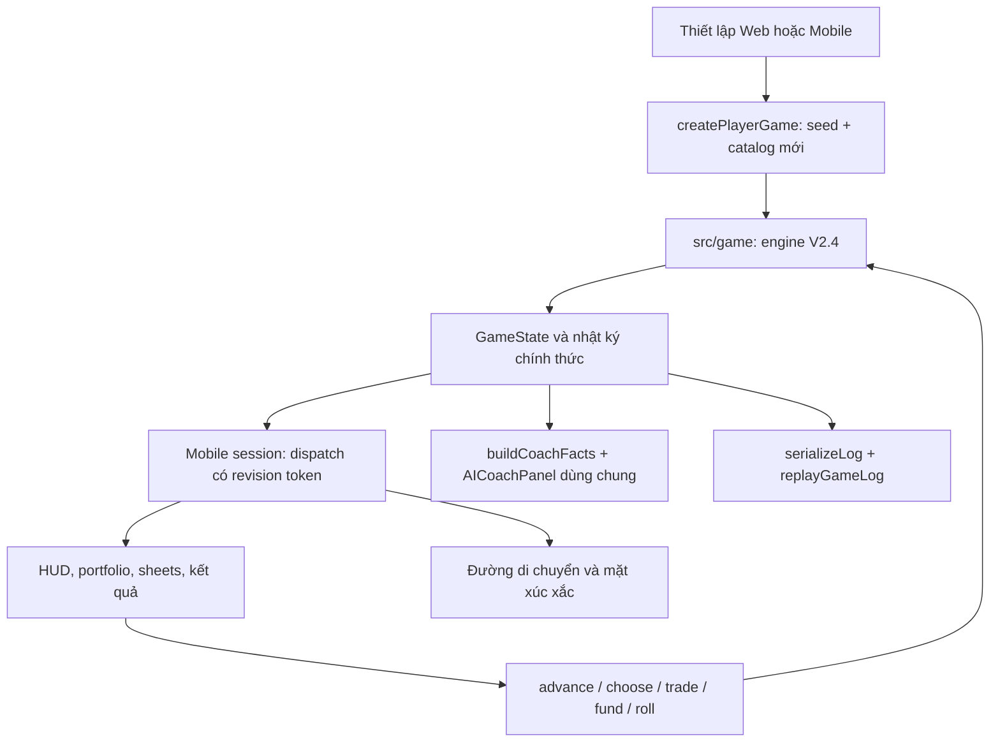

> **HISTORICAL** — Báo cáo tích hợp và nghiên cứu 180.000 ván ngày 13/10/2026; các giới hạn clean install/hosting đã có follow-up PR #8. Nguồn chuẩn hiện tại: [CURRENT_MVP.md](CURRENT_MVP.md). Các phương pháp, kết quả và nội dung gốc bên dưới được giữ nguyên; lệnh lịch sử không được thực thi lại trong audit này.

# Báo cáo tích hợp Mobile với engine V2.4

Ngày xác minh: **13/10/2026**. Nhánh: `feat/mobile-v2-4-engine-integration`.

## 1. Kết quả và phạm vi

Mobile minh họa đã dùng `GameState` và các chuyển trạng thái của engine chính thức. Đã bỏ trạng thái tài chính riêng, bảng giá cố định và các công thức kết quả riêng của Mobile. Giữ nền thành phố, ảnh bàn cờ, mô hình nhân vật, hoạt ảnh, xúc xắc CSS 3D và âm thanh tổng hợp sẵn có. Không merge vào main, không push, không triển khai.

Đã đo đối chiếu Web/Mobile ở hai lớp: ba ván qua controller, so sánh toàn trạng thái sau từng quyết định; một ván bốn vòng qua giao diện trình duyệt thật, tải JSON và so sánh toàn bộ trạng thái với lượt chạy engine độc lập. Đây là bằng chứng cho các đường chạy đã kiểm tra, không phải chứng minh mọi chuỗi quyết định có thể có.

Chưa kiểm tra trên điện thoại vật lý. Một số biểu tượng nằm trong ảnh bàn cờ cần nhà thiết kế xuất lại; danh sách chính xác ở mục 9. Phản hồi thành công từ nhà cung cấp AI thật cần cấu hình backend và khóa hợp lệ; đã kiểm tra hợp đồng dùng chung và tình huống API lỗi không chặn kết thúc ván.

## 2. Git và bảo toàn công việc

- Điểm bắt đầu: `feat/ai-mobileapp-ui`, HEAD `b410b20`; có thay đổi chưa commit trong `mobile_app/package.json` và `mobile_app/package-lock.json`.
- `main` cục bộ là tổ tiên của Mobile: 0 commit riêng phía main, 19 phía Mobile. Sau `git fetch origin`, `origin/main` và Mobile có 2 commit riêng mỗi phía.
- Tạo nhánh tích hợp từ HEAD Mobile. Cherry-pick `edfbeb4` và `406d36b` từ origin/main thành `b906bf8`, `ab2083a`, bảo toàn artwork và kiểm tra Web mới nhất. Giữ hai commit Mobile/AI sẵn có.
- Hai thay đổi dependency ban đầu được bảo toàn suốt triển khai. Theo yêu cầu bàn giao cuối, chúng được review và lưu thành commit dependency riêng; không reset, stash hoặc ghi đè.
- Các commit chính: `36b644d` tích hợp engine; `f860f6c` catalog có phiên bản; `aa15266` seed ngẫu nhiên; `9fb9488` chống gửi funding lặp và hiển thị tiền mặt đã dùng. Kiểm chứng/mô phỏng và sửa kích thước điều khiển được tách tiếp để dễ xem xét.

## 3. Kiến trúc trước và sau

Trước: `mobile_app/src/App.tsx` giữ cash/debt/netWorth, số lô tài sản, quyền sở hữu và lương riêng. Xúc xắc dùng `Math.random()`. START tự cộng lương rồi trừ sinh hoạt; tài sản mua/bán bằng giá cố định; màn kết quả và payload AI tự diễn giải tài chính.

Sau:



`session.ts` là lớp điều phối mỏng, không giữ một portfolio thứ hai hoặc tính thu nhập, giá, phí, lãi, khả năng huy động. React dùng `useSyncExternalStore` với snapshot engine bất biến. State React riêng chỉ phục vụ hoạt ảnh, âm thanh, overlay và phản hồi thao tác.

Engine xử lý roll **một lần trước hoạt ảnh**. Xúc xắc lấy `game.dice`; `movementPath()` đi đúng số bước trên `boardFor()`, gồm START. Callback hoạt ảnh chỉ cập nhật vị trí trình bày; không dispatch giao dịch/quyết toán/RNG. Cleanup đánh dấu generation để không hoàn thành hoạt ảnh của component đã bị hủy.

Ánh xạ pha rõ ràng: forecast → dự báo; rolling → bàn chơi; event → sự kiện; funding → chọn nguồn bắt buộc; summary → tổng kết START; rebalancing → quyền bán; finished → kết quả. Gieo bị khóa khi đang hoạt ảnh, mở overlay hoặc engine không ở rolling. Funding không đóng bằng Escape để bỏ qua nghĩa vụ.

## 4. API chính thức sử dụng

| API / module | Công dụng |
|---|---|
| `createGame`, qua `createPlayerGame` | Khởi tạo đúng mode, luật kinh doanh, encounter và catalog |
| `advance`, `roll`, `decide` | Chuyển pha, xúc xắc, sự kiện đúng ô dừng |
| `transact` | Gửi tiền, mua/bán, nâng cấp, trả nợ; kiểm tra quyền từ engine |
| `fundPayment`, `fundingSources`, `borrowingAvailable` | Nguồn thanh toán bắt buộc và hạn mức |
| `totalWorth`, `liquidatableFunds`, `victory` | HUD, tiến độ huy động, portfolio và kết quả |
| `saleQuote`, `stockQuote`, `purchasePreview`, `depositPreview` | Báo giá, phí/spread, số tiền và dự kiến gửi tiền |
| `businessOverview`, `businessUpgradeUnlocked`, `currentCustomerPreference` | Business V2.4 và lựa chọn chuyên môn |
| `savingsProfileForGame`, `encounterActionUsed` | Lãi suất theo phiên bản, giới hạn encounter |
| `boardFor`, `C20_BOARD`, `RULES`, `ECONOMY`, `EVENTS` | Dữ liệu chính thức, không lấy luật từ JSON Mobile |
| `serializeLog`, `snapshot`, `replayGameLog` | Xuất và xác minh trạng thái/journal |
| `buildCoachFacts`, `AICoachPanel` | Gửi facts có bằng chứng và dùng hợp đồng backend hiện có |

Ván người chơi mới dùng Experimental B / C20 / 20 ô / 4 vòng / vốn 50M / lương 14M / mục tiêu mua 80M + dự phòng 10M. Tiết kiệm 4/5/6% theo kỳ hạn 1/2/3 START. Không sửa công thức `transactions`, `settlement`, `business`, `savings`, customer preferences hay selectors để phục vụ UI.

Business giữ vốn mua 20M, nền 3M, nâng cấp 5M, cộng cố định 700k/tầng và 1M/tầng trùng sở thích. Sở thích theo seed/lap độc lập scenario. Cú sốc đổi giá thu hồi, không đổi thu nhập vận hành V2.4. Mua cơ sở hoàn tất encounter; nâng cấp từ lần gặp sau, tối đa một lần; chỉ bán tại ô Kinh doanh, không bán khẩn cấp.

## 5. Sửa lỗi Mobile và tiết kiệm

- Bỏ phí sinh hoạt tự động mỗi START: 7M chỉ xuất hiện trong sự kiện Living khi dừng đúng ô.
- Bỏ đơn vị tài sản giả và giá mua/bán 10M/6M/8M cố định; holdings và báo giá lấy từ engine.
- Bỏ phép cộng riêng cho salary, business income, debt interest, net worth và kết quả.
- Gửi mới tạo lot độc lập; nhiều lot vẫn được hỗ trợ, kỳ hạn và đáo hạn riêng. Không top-up, tự tái tục hoặc rút sớm tự nguyện.
- Stock purchase sử dụng `completeEncounter: true`; Bank gửi mới và Business mua ban đầu cũng hoàn tất đúng quy tắc engine.
- Revision token từ snapshot chống gọi lại callback cũ; khóa 300ms bổ sung chống click thứ hai khi funding cùng pha đã render sheet mới. Điều này không đổi quy tắc hoặc RNG engine.
- Khi parent từ chối một tap quá nhanh, TradingPanel mở lại khóa submit; thao tác hợp lệ sau đó vẫn thực hiện được. Browser fixture vàng kiểm tra mua 6 đơn vị, từ chối tap kế tiếp, rồi mua thêm 6 đơn vị sau khoảng khóa.
- Thông báo lỗi dùng native dialog để không bị top layer của sheet che mất.
- HUD và điều khiển đặt ngoài canvas artwork được scale; sheet dùng CSS pixel để giữ chữ và vùng bấm ở màn nhỏ. Giữ hình ảnh và bố cục bàn cờ.
- Màn kết quả gọi `victory()` và `liquidatableFunds()`. Tiến độ HUD dựa trên nguồn huy động hợp lệ; tài sản ròng vẫn hiển thị riêng.
- Thay payload AI tự dựng bằng `AICoachPanel` dùng facts/log thật. Lỗi AI cho phép thử lại và không khóa chơi mới/xuất log.

Không thêm banner chứng khoán, popup disclaimer, footer cảnh báo hoặc đoạn khuyến cáo trong giao dịch. Giữ thông tin phí, spread, lãi mất, nợ và thanh khoản Business. Câu mô phỏng trung tính chỉ ở mục Luật chơi. Disclaimer sẵn có của AI được ẩn trong giao diện Mobile.

## 6. Catalog cổ phiếu và tương thích lịch sử

| Mã | Định danh | Sàn đã đối chiếu | Nhóm rộng trong game | Nguồn |
|---|---|---|---|---|
| FPT | Công ty Cổ phần FPT | HOSE | Công nghệ | [VSDC 2026](https://vsdc.vn/vi/ad/191575), [FPT](https://fpt.com/en) |
| CMG | Tập đoàn Công nghệ CMC | HOSE | Công nghệ | [VSDC 2026](https://vsdc.vn/en/ad/197149), [CMC](https://www.cmc.com.vn/files/AR_CMC%202015.pdf) |
| VCB | Ngân hàng TMCP Ngoại thương Việt Nam | HOSE | Ngân hàng | [VSDC](https://vsdc.vn/vi/s-detail/63), [Vietcombank](https://vietcombank.com.vn/vi-VN/Ve-Vietcombank) |
| TCB | Ngân hàng TMCP Kỹ thương Việt Nam | HOSE | Ngân hàng | [Techcombank, thông tin doanh nghiệp và HOSE](https://techcombank.com/content/dam/techcombank/public-site/documents/techcombank-6m25-results-press-release.pdf) |
| HPG | Tập đoàn Hòa Phát | HOSE | Sản xuất | [Hòa Phát: mã, sàn và ngành](https://file.hoaphat.com.vn/hoaphat-com-vn/2020/04/bao-cao-thuong-nien-hpg-2019.pdf), [thông tin 2026 từ Bộ Công Thương](https://asemconnectvietnam.gov.vn/default.aspx?ID1=1&ID8=149838&ZID1=17) |
| BMP | Công ty Cổ phần Nhựa Bình Minh | HOSE | Sản xuất | [Nhựa Bình Minh](https://binhminhplastic.com.vn/en-US/about-binh-minh), [VSDC 2026](https://vsdc.vn/en/ad/193554) |

Nhóm ngành là phân loại rộng để dùng cơ chế sector trong game, không phải sao chép một bộ phân ngành sàn. Nguồn xác minh là công bố doanh nghiệp/VSDC; đây không phải kiểm tra thời gian thực mọi trạng thái cảnh báo, tạm ngừng giao dịch hoặc thành phần chỉ số. Không dùng giá xuất hiện trên các trang nguồn.

Catalog mới `vn-v1` được lưu trong `market.catalogVersion`, snapshot và metadata log. Catalog cũ `fictional-v1` giữ nguyên `STOCKS` và định danh `XV-MAY`, v.v. Thiếu metadata vẫn mang nghĩa lịch sử, không đổi tên holdings hoặc diễn giải doanh nghiệp cũ thành doanh nghiệp thật.

`createGame` giữ mặc định catalog lịch sử phục vụ API/replay/diagnostic có sẵn. Hai entry point người chơi gọi `createPlayerGame` để chọn `vn-v1`; `createGame` nhận thêm tham số catalog tùy chọn ở cuối. Muốn viết entry point người chơi mới phải dùng factory này hoặc chỉ định catalog rõ ràng.

Giữ nguyên sáu vị trí, thứ tự sector và volatility hiệu chỉnh cũ: vì thế identity mới không đổi số lượng/thứ tự draw, lịch sử giá hay cập nhật thị trường. Test so sánh history, normal market, macro shock và roll giữa hai catalog. Replay kiểm tra catalog đầu/cuối và metadata thống nhất, rồi so khớp từng snapshot; không hỗ trợ catalog không biết.

Giá hiện tại, biểu đồ, transaction quote, portfolio và phí đều do simulated market cũ tạo; không tích hợp API giá hoặc dữ liệu VN30 trực tiếp.

## 7. Randomness và replay

`generateGameSeed()` dùng `crypto.getRandomValues(new Uint32Array(4))`: 128 bit, biểu diễn hex 32 ký tự. Tạo seed ở thời điểm người chơi bắt đầu mỗi ván, gồm chơi lại. Trường seed mặc định trống; seed cố định chỉ nằm trong phần tùy chỉnh kiểm thử. Không có fallback `Math.random()` hoặc seed cố định cho gameplay thường.

Seed đi vào RNG chính thức không sửa đổi. Cùng seed + catalog + phiên bản luật + allocation/kỳ hạn + quyết định vẫn tạo cùng trạng thái. JSON giữ seed/rules/catalog và holdings/snapshot thật. Không hiển thị seed ở HUD.

Test khởi tạo 100 ván xác nhận 100 seed khác nhau đúng định dạng; đối chiếu fixed-seed Web/Mobile chính xác. Browser bổ sung kiểm tra hai ván mới qua UI, xuất log và replay từng ván để xác minh đường khởi tạo thực tế.

Tham khảo kỹ thuật: [React `useSyncExternalStore`](https://react.dev/reference/react/useSyncExternalStore), [Web Crypto `getRandomValues`](https://developer.mozilla.org/en-US/docs/Web/API/Crypto/getRandomValues). Không đưa entropy mới vào replay lịch sử.

## 8. Mandatory payment và kết quả kiểm tra

| Kịch bản | Kết quả đo |
|---|---|
| Living 7M, cash 2M | Cash về 0; funding còn thiếu 5M; không gieo tiếp |
| Rút một phần lot 3M | Engine từ chối; phải rút toàn lot |
| Rút lot 3M, kỳ hạn 3 START ở 6% | Trả 3M; thiếu còn 2M; ghi mất lãi 540.000đ đúng một lần |
| Bán vàng gross 2M | Spread 60.000đ + phí 19.400đ; net 1.920.600đ; thiếu 79.400đ |
| Vay 79.400đ | Thanh toán đủ; cash 0; debt 79.400đ; trở lại rolling |
| START sau khoản vay trên | Lãi 7.940đ; trả gốc/lãi một lần, cash 13.912.660đ |
| Rút lot 8M để trả thiếu 5M | Cash dư 3M; lot khác 4M giữ nguyên; lãi mất 1.440.000đ |
| Lot khác 4M, kỳ hạn 1 START | Đáo hạn trả 4.160.000đ; không tái đầu tư; cash sau START 21.160.000đ |
| Bán cổ phiếu / trái phiếu gross 6M | Nhận đúng `saleQuote`, giữ tiền dư sau trả khoản thiếu; phí 1% / 1,5% |
| Debt 28M, thiếu 5M, có Business chưa bán | Cho vay thêm 2M; còn thiếu 3M thì insolvent khi hết nguồn; không bán Business |
| Bấm funding hai lần nhanh | Browser ghi đúng một funding; shortfall vẫn 2M sau rút lot đầu |
| Escape trong funding | Sheet giữ mở; gieo bị disabled |

Các kiểm tra này gồm unit/controller và fixture UI riêng. Fixture thay đổi trạng thái đầu để tạo ca biên; **không gọi đó là một ván replay từ đầu**. Ván bốn vòng riêng ở mục 10 được chơi từ setup thật và replay đầy đủ.

Không phát hiện lỗi công thức funding/savings cần thay engine. Thay đổi tập trung ở UI chống thao tác lặp, dùng đúng API và hiển thị tiền mặt đã dùng.

## 9. Audit artwork / C20

Kiểm tra trực tiếp `mobile_app/public/assets/playboard.PNG`, đối chiếu tọa độ `tiles.json`. Kho asset có nền, playboard, sectionplay, ảnh xúc xắc, character GLB; không có layer icon rời để sửa chính xác ảnh ghép.

Số ô dưới đây là **1-based**; tọa độ là pixel canvas thiết kế 940×1672.

| Ô (index) | Tâm | C20 chính thức | Icon trong ảnh | Đánh giá / yêu cầu |
|---|---|---|---|---|
| 1 (0) | 470,1120 | START | Ô trống/lỗ vuông | Cần xuất lại ký hiệu START/cờ rõ ràng |
| 2 (1) | 394,1065 | Ngân hàng | Tòa nhà ngân hàng | Khớp |
| 3 (2) | 318,1010 | Cổ phiếu | Biểu đồ | Khớp |
| 4 (3) | 242,955 | Sinh hoạt | Người chạy màu xanh | Đổi thành hóa đơn/chi phí sinh hoạt |
| 5 (4) | 166,900 | Đầu tư bản thân | Hộp quà xanh | Chưa rõ nghĩa khóa học; đề nghị sách/học tập |
| 6 (5) | 90,845 | Kinh tế | Heo tiết kiệm hồng | Đổi thành biểu tượng biến cố kinh tế |
| 7 (6) | 166,791 | Trái phiếu | Chứng từ/hóa đơn hồng | Có thể dùng, nên phân biệt với Living |
| 8 (7) | 242,737 | Biến cố cá nhân | Dấu chấm than đỏ | Khớp nhóm biến cố |
| 9 (8) | 318,683 | Kinh doanh | Cửa hàng cam | Khớp |
| 10 (9) | 394,629 | Vàng | Đồng vàng | Khớp |
| 11 (10) | 470,575 | Dòng tiền | Ô vàng nhạt trống | Cần biểu tượng ví/dòng tiền |
| 12 (11) | 543,629 | Cổ phiếu | Biểu đồ | Khớp |
| 13 (12) | 616,683 | Ngân hàng | Tòa nhà ngân hàng | Khớp |
| 14 (13) | 689,737 | Kinh doanh | Heo tiết kiệm hồng | Đổi thành cửa hàng; giữ nguyên loại Business của C20 |
| 15 (14) | 762,791 | Sinh hoạt | Người chạy màu xanh | Đổi thành hóa đơn/chi phí sinh hoạt |
| 16 (15) | 835,845 | Kinh doanh | Cửa hàng cam | Khớp |
| 17 (16) | 762,900 | Đầu tư bản thân | Hộp quà xanh | Đề nghị sách/học tập giống ô 5 |
| 18 (17) | 689,955 | Biến cố cá nhân | Dấu chấm than đỏ | Khớp nhóm biến cố |
| 19 (18) | 616,1010 | Vàng | Đồng vàng | Khớp |
| 20 (19) | 543,1065 | Trái phiếu | Chứng từ/hóa đơn hồng | Có thể dùng, nên phân biệt với Living |

Các lệch rõ cần sửa: ô 4, 6, 11, 14, 15; ký hiệu START và khóa học cũng cần nhà thiết kế xác nhận/xuất lại. Giữ ảnh nguyên vẹn, không vẽ đè tùy tiện. UI ghép coordinates với `C20_BOARD`, nên dữ liệu chính thức luôn quyết định loại ô; không đổi thứ tự để khớp artwork sai.

## 10. Đối chiếu Web/Mobile và browser

`tests/mobile-integration.test.ts` chạy ba seed `mobile-parity-1/2/3` với allocation 10M, kỳ hạn 2. So sánh **toàn GameState sau mỗi command**, gồm RNG/dice, vị trí/lap, cash/debt, deposits, holdings, Business/preferences/upgrades, giá/history, log và summaries. Kiểm tra stale command bị từ chối và path hoạt ảnh qua START. Cả ba ván hoàn thành 4 vòng và replay JSON chính xác.

`scripts/verify-mobile-engine.mjs` dùng trang Mobile thật từ setup, không chèn state hoặc bỏ thời gian hoạt ảnh. Seed `mobile-browser-v24`, allocation 20M, kỳ hạn 1. Ghi nhận 26 roll, 4 Bank deposits, 1 stock purchase, 1 business purchase. Ván thật này không gặp nâng cấp phù hợp theo chiến lược; upgrade được xác minh thêm bằng fixture UI và ba trajectory controller.

| START | Cash sau quyết toán | Huy động hợp lệ |
|---|---:|---:|
| 1 | 60.000.000đ | 64.057.168đ |
| 2 | 37.200.000đ | 41.305.629đ |
| 3 | 67.192.833đ | 71.857.069đ |
| 4 | 84.592.833đ | 89.450.169đ |

Kết quả: `wealth=true`, `liquidity=false`, `won=false`; UI hiện chưa đạt mục tiêu, đúng `victory()`. JSON tải từ UI khớp toàn bộ state engine độc lập và `replayGameLog()` khớp toàn trạng thái. Không suy luận parity chỉ từ suite engine.

Browser kiểm tra ở **320 / 390 / 430 / 1440px**, gồm setup, board, event, funding, Business và kết quả. Vùng gieo ít nhất 44×44 CSS pixel; hỗ trợ Enter khởi tạo, Escape không bỏ qua funding, native dialog giữ focus. Xúc xắc chạy 800ms, nghỉ 400ms và nhảy 280ms/bước; test không bỏ hoạt ảnh.

Fixture bổ sung: combined funding savings→gold→debt, double click không trả hai lần; upgrade một lần theo preference đang chọn, thu nhập đúng 4.700.000đ; Bank tạo lot thứ hai độc lập và trở về rolling.

Fixture rebalancing xác nhận dropdown chỉ có stocks/bonds/gold; bán cổ phiếu và vàng qua UI khớp toàn trạng thái `transact()` sau từng lệnh, giữ Business và lot tiết kiệm, rồi được kết thúc từ START vòng 4.

Kiểm tra source còn thấy `Math.random()` trong synthesizer âm thanh để đổi tần số hiệu ứng. Nó không được dùng cho dice, thị trường, khách hàng hoặc tài chính và được giữ để bảo toàn audio.

Không có `pageerror` hoặc console error ngoài HTTP **503 được cố ý mock** để kiểm tra AI. Coach báo chưa sẵn sàng, vẫn tải log/chơi lại được. Không kiểm tra khóa AI hoặc gọi nhà cung cấp thật. Một lần trước đó Vite/model-viewer báo warning `rAF timed out in updateSource`; không có lỗi này trong lần browser kiểm chứng cuối và không phải lỗi tài chính.

Chứng cứ: `docs/playtests/mobile-v2-4/browser-verification.json`, các PNG theo breakpoint, `browser-game-log.json.gz`. JSON của ván thật được nén để tránh commit file snapshot lặp quá lớn.

## 11. Nghiên cứu Policy A so với Policy B

Chạy **10.000 seed ghép cặp** `XVTL-LOTS-V24-0..9999` cho từng tổ hợp 3 strategy × 3 allocation × 2 policy = **180.000 ván**; 257,83 giây trong môi trường kiểm tra. Mỗi tổ hợp dùng cùng seed, initial term 3 và V2.4/B/C20/catalog `vn-v1`. Cả 9 tổ hợp có 10.000 cặp đường dice giống nhau. Không sửa cấu hình global hay engine để chạy B.

- A: nhiều lot độc lập như production.
- B: decision policy bỏ qua gửi mới tại Bank khi còn bất kỳ lot active. Sau khi lot đáo hạn hoặc bị rút hợp lệ mới gửi tiếp. Đây là restriction mô phỏng, không được app import.
- `reserve-saver`: giữ 10M, gửi 85% tiền vượt reserve, term tối đa 3 START nhưng không vượt số START còn lại.
- `mixed-investor`: giữ 10M, gửi 50% phần vượt reserve, term tối đa 2; mua tài sản tài chính 40% phần vượt reserve, tránh stocks khi scenario uncertain và bonds không kịp đáo hạn; Business chỉ mua vòng 1 khi đủ tiền sau reserve, nâng cấp tối đa một lần ở encounter hợp lệ vòng 1–2, bán ở vòng 3–4 khi gặp lại.
- `aggressive-saver`: reserve 2M, gửi toàn bộ phần vượt reserve, term tối đa 3 trong thời hạn ván; không đầu tư khác.
- Cả ba mua course nếu chưa sở hữu, đủ tiền và ở vòng 1–3; trả option bắt buộc đầu tiên, không hoãn. Funding rút lot active đầu tiên, rồi bán tài sản theo thứ tự engine, cuối cùng vay; bán gross nhỏ nhất đủ net nếu có thể. Không mua/gửi tại START; giữ tài sản tài chính đến kết quả và định giá bằng selector chính thức.

Chỉ số tiền trong bảng là **triệu đồng/ván**; A/B trong cùng ô. Rút sớm là số lần trung bình; lãi mất là tổng lãi bị forfeited trung bình. Cash nhàn rỗi lấy trung bình trước mỗi roll, không phải bình quân theo thời gian thực.

| Strategy | Gửi đầu | Thắng A/B | Huy động A/B | Rút sớm A/B | Lãi mất A/B | Cash nhàn rỗi A/B |
|---|---:|---:|---:|---:|---:|---:|
| Reserve | 0 | 53,74% / 52,09% | 90,603 / 89,982 | 0,089 / 0,025 | 0,531 / 0,153 | 31,653 / 35,528 |
| Reserve | 20 | 57,79% / 48,89% | 91,915 / 89,197 | 0,116 / 0,002 | 0,411 / 0,004 | 25,756 / 37,312 |
| Reserve | 40 | 56,13% / 55,66% | 91,315 / 90,992 | 0,408 / 0,321 | 2,883 / 2,299 | 22,476 / 25,853 |
| Mixed | 0 | 55,35% / 54,30% | 91,633 / 91,295 | 0,012 / 0,007 | 0,015 / 0,009 | 26,608 / 27,832 |
| Mixed | 20 | 57,87% / 55,86% | 92,081 / 91,467 | 0,034 / 0,014 | 0,122 / 0,050 | 23,671 / 26,068 |
| Mixed | 40 | 56,85% / 56,47% | 91,712 / 91,557 | 0,355 / 0,329 | 2,542 / 2,366 | 21,146 / 22,276 |
| Aggressive | 0 | 40,46% / 45,24% | 86,822 / 87,995 | 1,245 / 0,970 | 8,455 / 6,603 | 36,937 / 37,611 |
| Aggressive | 20 | 49,59% / 47,08% | 89,594 / 88,693 | 1,245 / 0,329 | 4,844 / 0,985 | 23,618 / 38,354 |
| Aggressive | 40 | 46,24% / 53,96% | 88,439 / 90,194 | 1,503 / 0,784 | 8,364 / 4,412 | 23,261 / 27,285 |

Tỷ lệ insolvent **0% ở cả hai policy trong mọi tổ hợp**. Kết quả này chỉ áp dụng các strategy trên: khoản gửi có thể huy động nguyên gốc và có hạn mức vay; không chứng minh mọi cách chơi tránh insolvency.

| Strategy / gửi đầu | Tận dụng Bank A/B | Cơ hội được gửi tại Bank A/B mỗi ván |
|---|---:|---:|
| Reserve / 0 | 93,94% / 51,81% | 2,178 / 1,129 |
| Reserve / 20 | 92,81% / 22,38% | 2,178 / 0,487 |
| Reserve / 40 | 72,56% / 28,29% | 2,169 / 0,616 |
| Mixed / 0 | 97,96% / 62,41% | 2,178 / 1,368 |
| Mixed / 20 | 95,87% / 22,65% | 2,178 / 0,493 |
| Mixed / 40 | 73,37% / 31,23% | 2,168 / 0,681 |
| Aggressive / 0 | 93,67% / 72,63% | 2,168 / 1,582 |
| Aggressive / 20 | 93,68% / 24,43% | 2,168 / 0,532 |
| Aggressive / 40 | 92,36% / 35,12% | 2,158 / 0,765 |

Tận dụng Bank = tổng gửi mới / tổng encounter Bank. “Cơ hội được gửi” đếm encounter có tiền mặt và được policy cho phép; chưa yêu cầu số tiền vượt reserve. Tổng bước quyết định event/funding/rebalancing cũng được lưu trong JSON; nó không bằng số lựa chọn có ý nghĩa và có thể cao hơn vì phải xử lý thiếu tiền.

Ví dụ Reserve/20M: A − B tăng huy động trung bình **2,718M**, khoảng tin cậy paired-normal 95% **[2,679; 2,756]M**; tăng thắng **8,90 điểm phần trăm**, khoảng **[8,34; 9,46]**. Aggressive/40M lại giảm thắng **7,72 điểm phần trăm** và giảm huy động **1,755M** dưới A. Vì vậy không kết luận A luôn tốt hơn.

**Khuyến nghị:** giữ Policy A đã duyệt. A mở thêm quyết định ở Bank và giảm cash không đầu tư; reserve/mixed tăng tỷ lệ thắng ở cả ba allocation. Đồng thời cần hướng dẫn người chơi duy trì tiền mặt vì gửi quá mạnh tạo nhiều rút sớm và lãi mất. Policy B hạn chế hành vi đó nhưng loại bỏ nhiều cơ hội gửi; chưa có lý do thay luật production trên cơ sở ba heuristic này.

Giới hạn: không mô hình người chơi học dần, thời gian suy nghĩ hay mức hiểu luật; không tìm chiến lược tối ưu riêng cho B. A/B có cùng thuật toán decision ngoại trừ giới hạn lot, nhưng cash khác nhau có thể khiến các quyết định đầu tư sau khác. Allocation 40M cùng kỳ hạn 3 làm tăng nguy cơ rút sớm so với 20M ở nhiều strategy. CI là mô tả paired-normal, không hiệu chỉnh nhiều phép so sánh; seed dùng lại qua strategy/allocation nên các nhóm không độc lập.

Để tránh chi phí log lớn trong 180.000 ván, mô phỏng chỉ giữ log cùng turn sau khi thu metrics. Test so sánh compact/full ở 48 ván xác nhận snapshot tài chính, summaries, metrics và dice giống hệt. Lưu ý log compact không dùng để xuất replay; replay bằng ván full riêng.

Mã và kết quả: `scripts/diagnostics/savings-lot-policy.ts`, `scripts/compare-savings-lot-policies.ts`, `tests/savings-policy-simulation.test.ts`, `docs/simulations/v2_4-savings-lot-comparison.json`.

## 12. Kiểm tra, build và cách chạy lại

| Kiểm tra | Kết quả |
|---|---|
| `npm test` | 186/186 pass, gồm V2.1–V2.4 và các replay lịch sử có sẵn |
| `node --experimental-strip-types --test scripts/diagnostics/*.test.ts` | 19/19 pass |
| `npm run lint` | Pass, bao gồm source root và Mobile; bỏ qua dist lồng nhau |
| TypeScript root | Pass qua `tsc -b` trong root build |
| TypeScript Mobile | Pass `tsc -p mobile_app/tsconfig.json --noEmit` và mobile build |
| `npm run build` | Pass root |
| `npm run build --prefix mobile_app` | Pass Mobile |
| `node --experimental-strip-types scripts/verify-mobile-engine.mjs` | Browser/full-game parity/replay/funding/upgrades/multiple lots pass |
| `node --experimental-strip-types scripts/compare-savings-lot-policies.ts 10000` | 180.000 ván hoàn tất; global config không đổi |

Browser runner cần module `playwright` có sẵn hoặc chỉ rõ `PLAYWRIGHT_MODULE`, Chrome cài trên máy, và quyền truy cập localhost. Nó tự tạo Vite server ở 5186; có thể dùng `UI_URL` cho server khác. Trong sandbox hạn chế mạng, cần chạy kiểm tra browser ở môi trường cho phép localhost. Không tải dependency mới hoặc sửa package của người dùng để chạy test.

Evidence ở `docs/playtests/mobile-v2-4/`: `product-tests.txt`, `diagnostic-tests.txt`, `lint.txt`, `root-build.txt`, `mobile-build.txt`, `mobile-typecheck.txt`, `funding-tests.txt`, `seed-tests.txt`, `catalog-parity-tests.txt`, `browser-verification.json`, ảnh breakpoint và log nén. Output của một số lần kiểm tra thử trước được thay bằng kết quả cuối; số liệu simulation chính thức ở JSON 10.000 seed, không dùng smoke run 10 seed.

`browser-verification.json` giữ kết quả ván đầy đủ và regression rapid taps đã pass. Lượt chạy bổ sung sau đó bị ngắt trước khi ghi đè JSON này; `browser-output.txt` chỉ chứa phần mở đầu của lượt bị ngắt, không được dùng làm bằng chứng pass. Ca START sales còn lại được hoàn tất riêng, lưu ở `rebalancing-verification.json` và `rebalancing-output.txt`; không chạy lại suite đã xác minh khi bàn giao.

## 13. File thay đổi

- Điều phối: `mobile_app/src/App.tsx`, `mobile_app/src/game/session.ts`, `mobile_app/src/components/GamePhase.tsx`, `GameSetup.tsx`.
- Financial views Mobile: `EventModal.tsx`, `FundingDialog.tsx`, `LapSummaryModal.tsx`, `RebalanceModal.tsx`, `PortfolioDrawer.tsx`, `GameResultModal.tsx` dùng state/panel chính thức.
- Trình bày: `MobileContainer.tsx`, `TopHud.tsx`, `BottomControls.tsx`, `Dice3D.tsx`, `mobile_app/src/engine-ui.css`, `mobile_app/tsconfig.json`.
- Dependency gốc được bảo toàn và commit riêng: `mobile_app/package.json`, `mobile_app/package-lock.json`.
- Bỏ hai nguồn luật/bảng giá riêng: `mobile_app/src/data/economy.json`, `events.json`; giữ tọa độ `tiles.json`, loại ô lấy C20 chính thức.
- Catalog/khởi tạo/replay: `src/data/stock-catalog.ts`, `src/game/new-game.ts`, `seed.ts`, `market.ts`, `types.ts`, `engine.ts`, `log.ts`, `scripts/diagnostics/replay-game-log.ts`.
- Shared UI: `src/App.tsx`, `src/components/Setup.tsx`, `TradingPanel.tsx`, `MarketDetails.tsx`, `FundingDialog.tsx`; `eslint.config.js`.
- Kiểm chứng: `tests/mobile-integration.test.ts`, `stock-catalog.test.ts`, `new-game-seed.test.ts`, `mobile-funding.test.ts`, `savings-policy-simulation.test.ts`; browser runner/harness và mã simulation tách riêng.
- Tài liệu/evidence: báo cáo này, kết quả nghiên cứu, log và screenshots. Hai cherry-pick còn giữ các file artwork/report/test mới từ main.

## 14. Phần hoàn tất và việc cần làm tiếp

**Hoàn tất:** engine authoritative cho Mobile, catalog mới/historical replay, seed mới mỗi ván, funding/savings qua đúng API, nhiều lot độc lập, kết quả chính thức, giữ presentation và AI integration, đo parity controller/browser, toàn suite và builds, nghiên cứu 180.000 ván, không đưa B vào production.

**Cần làm tiếp:** nhà thiết kế sửa các icon đã chỉ ra; playtest trên iOS/Android vật lý để kiểm tra WebGL/audio/touch và viewport; xác minh AI thành công với backend/khóa triển khai thật. Nếu phát hành Mobile, hosting cần phục vụ cùng origin `/api/ai-coach` hoặc reverse proxy tới backend hiện có; Vite proxy đang trỏ tới server root ở 5173 trong development. Không đặt khóa AI trong frontend.

Dependency Mobile có sẵn trước tác vụ được giữ nguyên và commit riêng theo yêu cầu bàn giao: `three` chốt `0.183.2`, `@types/three` chốt `0.183.0`. Manifest, lockfile và phiên bản đã cài đồng nhất; build/browser đã chạy với các phiên bản này. Lockfile còn có thay đổi transitive `meshoptimizer` về `1.0.1`, thêm `@webgpu/types`, và bỏ trường `libc` trên một số package native optional từ bản lock ban đầu. Đã review các khác biệt và giữ nguyên sửa đổi gốc; chưa thực hiện clean install hoặc kiểm chứng Linux/macOS trong tác vụ này.

Rà soát cuối xác nhận cả 12 dependency trực tiếp/dev trong Mobile có phiên bản đã cài khớp lockfile và `npm ls --prefix mobile_app --depth=0` không báo lỗi. Chi tiết ở `mobile-dependency-audit.json`, `mobile-dependencies.txt`. `delivery-audit.json` lưu kết quả diff rỗng đối với artwork, nhân vật, âm thanh và các module công thức tài chính được bảo vệ so với `b410b20`.

Không tuyên bố đã thử điện thoại thật, AI provider thật hoặc mọi đường gameplay. Không có thay đổi cân bằng tài chính hay tự động phát hành.

## 15. Chạy Mobile và trạng thái bàn giao

Từ thư mục repository, cài dependency theo lockfile khi cần:

```powershell
npm ci
npm ci --prefix mobile_app
```

Chạy Mobile:

```powershell
npm run dev --prefix mobile_app
```

Mở URL Vite in ra, mặc định `http://localhost:5174/`; nếu cổng đang bận Vite có thể chọn cổng kế tiếp. Để dùng AI Coach trong development, chạy thêm `npm run dev` từ root ở terminal khác; Mobile proxy `/api` tới root `http://localhost:5173`. Nếu không có API/khóa AI hợp lệ, phần tài chính, kết quả và chơi lại vẫn hoạt động.

Build Mobile: `npm run build --prefix mobile_app`. Không đưa `.env`, khóa AI, `node_modules` hoặc `dist` vào commit.

Nhánh sẵn sàng mở **pull request để review**; các giới hạn artwork, thiết bị thật, nhà cung cấp AI và kiểm chứng cài mới vẫn được công khai ở trên. Điều này không đồng nghĩa xác nhận sẵn sàng phát hành production. Không merge, push hoặc deploy trong tác vụ.

Các commit bàn giao bổ sung đã lưu: `7fb3ac2` regression rapid trade taps; `867492a` HUD/xúc xắc; `01e8ec3` mô phỏng 180.000 ván; `f6d24ec` dependency gốc; `38ca5d4` setup đọc savings profile chính thức; `ed3387c` harness, screenshots, replay và bằng chứng regression. Commit tài liệu cuối chứa báo cáo này; xem `git log` để lấy HEAD bàn giao.
