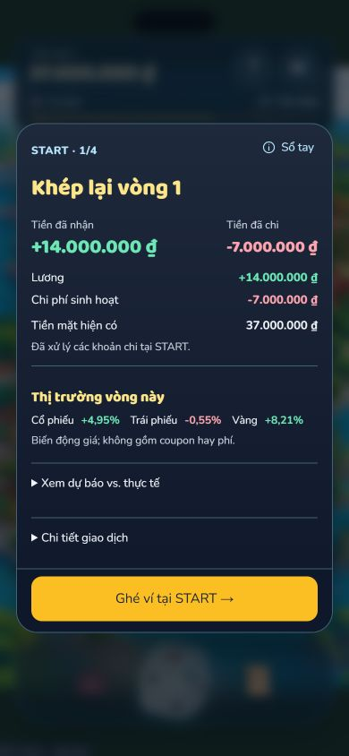
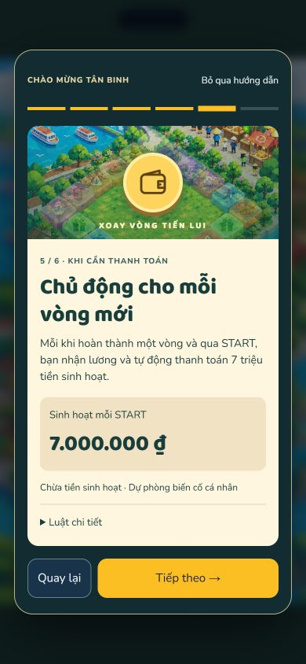
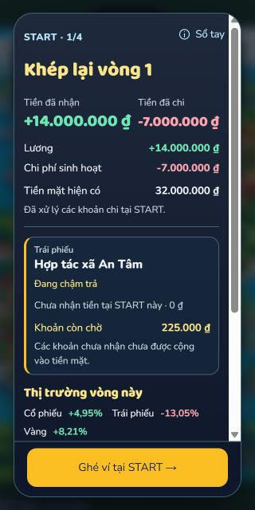
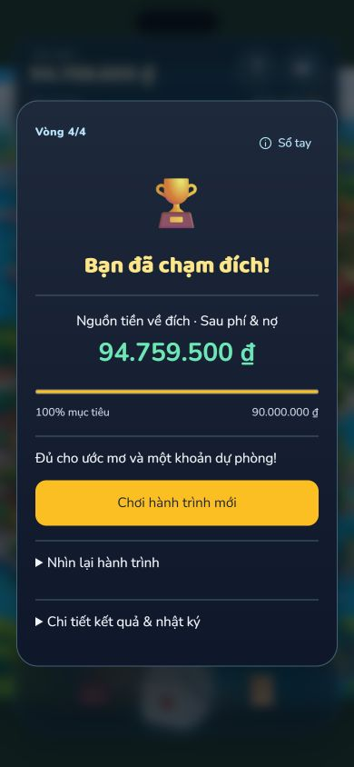

> **CURRENT** — Bàn giao candidate local ngày 15/10/2026; chưa merge; chưa xác minh deployment. [CURRENT_MVP](CURRENT_MVP.md) là nguồn sản phẩm hiện hành.

# Triển khai sinh hoạt tại START và Candidate C20 A

Đã triển khai `v2.6-periodic-start` trên nhánh [codex/periodic-living-expenses](https://github.com/Tig0nn/boardgame_EXE/tree/codex/periodic-living-expenses), từ đúng `34f91eaa8e04fd0e98b62b15ab2b408477e6a2ff`. Ván Mobile mới trả 7.000.000 ₫ tại mỗi START hoàn tất; ô 4 thành Stocks, ô 15 thành Gold. Setup không thu; personal 8/18 giữ nguyên. Đây là candidate để review, không tự coi 7M/A là luật cân bằng cuối đã duyệt.

## Thay đổi và quyết định UX

- [Policy](../src/game/living-expenses.ts), [board](../src/data/board.ts), [types](../src/game/types.ts), [engine](../src/game/engine.ts), [state](../src/game/state.ts), [export](../src/game/log.ts): metadata độc lập; legacy thiếu metadata giữ bàn và luật gốc. Không sửa C20 gốc hoặc migrate session.
- [Settlement](../src/game/settlement.ts): chèn sinh hoạt sau salary/Business/maturity, trước debt/deferred; cursor tiến trước funding; ghi số thực chi, không trừ trong React. Lãi nợ, final interest, victory và insolvency giữ công thức cũ.
- [START selector](../mobile_app/src/game/start-summary.ts) hiểu năm financial schedules legacy/sáu periodic; nhận − chi khớp ví. [Modal](../mobile_app/src/components/LapSummaryModal.tsx) thêm một hàng sinh hoạt, giữ cards Bond/claims/loss, zero trung tính, details và CTA ví ngoài vùng cuộn.
- [App](../mobile_app/src/App.tsx), [BoardView](../mobile_app/src/components/BoardView.tsx), [Tutorial](../mobile_app/src/components/Tutorial.tsx): bàn active quyết định label/category/effect; nhãn tạm cho 4/15; sáu bước gọn, Skip và Sổ tay lại hoạt động. Help lịch sử vẫn on-landing. Artwork gốc/GLB/audio/dice không đổi; [designer handoff](PERIODIC_LIVING_EXPENSES_DESIGN.md) ghi tọa độ và việc cần duyệt.
- Root Web giữ mặc định on-landing; chỉ shared engine được bổ sung khả năng đọc policy mới. Không đổi Bond V2.5 params, Business Customer Preferences, AI Coach, RNG hoặc công thức giá/phí.

## Kiểm chứng đã chạy

| Check | Kết quả thực tế | Evidence |
| --- | --- | --- |
| Product tests | **304/304**, 0 fail | [log](playtests/periodic-living-v26/product-tests.txt) |
| Diagnostics | **57/57**, 0 fail | [log](playtests/periodic-living-v26/diagnostics.txt) |
| Lint | PASS, 0 lỗi | [log](playtests/periodic-living-v26/lint.txt) |
| Web build | PASS | [log](playtests/periodic-living-v26/web-build.txt) |
| Mobile build | PASS; bundle `index-CxPvW0KK.js` | [log](playtests/periodic-living-v26/mobile-build.txt) |
| Documentation checker mặc định | PASS; 37 Markdown, không link/path hỏng | [log](playtests/periodic-living-v26/documentation-check.txt) |
| Bond V2.5 và lịch sử | 12.000 raw rows được kiểm lại; 12 full-state V2.5 + 13 historical replays; không chạy lại study | [log](playtests/periodic-living-v26/historical-bond.txt) |
| START UX lịch sử | 4 saved games, 16 START, 30 layouts/52 ảnh | [log](playtests/periodic-living-v26/historical-start-ux.txt) |
| Economic Event UX lịch sử | 23 rolls/4 laps, 3 shocks, 7 panel giá, replay exact | [log](playtests/periodic-living-v26/historical-event-ux.txt) |
| Atomic / Economic News | Full-state saved game replay PASS; chạy verifier trên bản sao tạm | [Atomic](playtests/periodic-living-v26/historical-atomic.txt), [News](playtests/periodic-living-v26/historical-news.txt) |
| V2.1 / V2.2 | Original/A/B saved logs và C20 profile replay PASS | [V2.1](playtests/periodic-living-v26/historical-v21.txt), [V2.2](playtests/periodic-living-v26/historical-v22.txt) |
| Candidate verification | 18.000 raw rows, 12 deterministic spot checks, 2 browser replays, 8 START đối chiếu | [log](playtests/periodic-living-v26/verification.txt), [manifest](playtests/periodic-living-v26/verification.json) |
| Scope preservation | Frozen config, Bond, Business, RNG, AI, source artwork và evidence cũ không có diff | [scope](playtests/periodic-living-v26/scope-check.txt) |

Node local 22.14.0. Dependencies hiện có được dùng lại; không sửa package/lockfiles hoặc chạy clean install không cần thiết khi Vite đang hoạt động. Chưa xác minh Actions của HEAD nhánh mới. **186 product tests + 21 diagnostics** là CI lịch sử tại mốc V2.4, không gán run cũ cho candidate này. Không gọi provider AI, không đổi Vercel hoặc deploy.

29 test mới nằm trong [version](../tests/periodic-living-version.test.ts), [settlement](../tests/periodic-living-settlement.test.ts), [integration](../tests/periodic-living-integration.test.ts), cùng một diagnostic render START mới. Bao phủ setup không thu; 7M/START/bốn lần; summary/wallet/next/rapid taps không lặp; partial funding/full savings/debt/resume; insolvency không thu vòng tương lai; maturity/coupon, Business/course/debt/deferred; personal 8/18; replacement 4/15/20 ô; atomic buys; phí cuối trước thắng; totals/sign/neutral; metadata/tamper rejection; ba full-game deterministic replay; UI không mutate cash; Event UX và News không lộ tương lai. Suite cũ và verifiers chứng minh replay lịch sử; không thay assertion tài chính cũ để hợp thức hóa rule mới, mà pin fixture cũ về on-landing.

## Browser — phân biệt ván thật với fixture

Đã chơi qua UI bản production build local, không sửa state/RNG/dice để ép kết quả:

| Ván | Seed / phân bổ | Thực tế |
| --- | --- | --- |
| Thắng | PERIODIC-V26-39; 20M savings kỳ hạn 3; Bank-first | 23 rolls, 4 START, **94.759.500 ₫**; sinh hoạt tổng 28M |
| Thua, Bond/personal | BOND-V25-59; savings 0; khóa học; hai An Tâm 5M; ba personal defer | 23 rolls, 4 START, **63.272.313 ₫**; default ở START 2, recovery START 3; sinh hoạt 28M riêng khỏi nghĩa vụ cá nhân |

[Export thắng](playtests/periodic-living-v26/browser-win-full.json.gz), [export thua](playtests/periodic-living-v26/browser-defeat-full.json.gz) replay **toàn trạng thái chính xác**, gồm snapshots, lots, market/credit/RNG, summaries và log. Hai trace [thắng](playtests/periodic-living-v26/browser-win.json)/[thua](playtests/periodic-living-v26/browser-defeat.json) ghi bundle và thao tác. Không tự thanh lý mọi tài sản để báo thắng. Các START thực nhận − thực chi = cashAfter − cashBefore; cả tám bảng đối chiếu nằm trong verification JSON.

Ván thắng chơi ở 390×844, ván Bond/personal ở 320×640. DEV harness kiểm summary, delay Bond, deferred personal, funding, insolvency, board ở **320×640 / 390×844 / 430×932**; help/rulebook theo phiên, first tutorial/skip/returning setup, ví/vòng kế và rapid double taps. **44 phép đo layout / 43 JPEG** đúng kích thước, không tràn ngang; CTA START trong viewport; vùng nội dung dài cuộn riêng. Console error/warn = 0 trong hai ván thật và harness. 3D model/assets tải trên ván thật; không thử Android/iOS vật lý.

**Giới hạn acceptance browser:** không có ván tự nhiên cần funding riêng cho 7M sinh hoạt, vì lương ≥14M đã vào trước đó. Funding và insolvency của khoản này chỉ được kiểm qua [DEV fixture](../mobile_app/src/periodic-living-harness.tsx) salary=0 có nhãn trên ảnh và unit state-machine tests, không phải kết quả game hợp lệ. Không tuyên bố đã chơi một ván thật insolvent: ảnh insolvency là fixture phòng vệ. Thăm dò bổ sung 1.000 seed dồn vốn/rủi ro và personal defer cũng không tìm thấy insolvency, nhưng không dùng để chứng minh mọi chiến lược đều an toàn; [record thăm dò](playtests/periodic-living-v26/stress-search.json) tách khỏi study 18.000 ván. Không sửa lương, thứ tự, debt limit hay RNG để làm đạt danh mục bằng chứng.









## Balance và việc chờ owner

[Báo cáo cân bằng](PERIODIC_LIVING_EXPENSES_BALANCE_REPORT.md) ghi đủ win/95% CI, proceeds, cash, actual living/emergency expenses, funding/vay/rút savings, cơ hội, exposure muộn và strategy×layout. Pool 7M/A **5,40%** so legacy **50,33%**; 5M/A **31,50%**, 6M/A **14,40%**, B **5,43%**, C **4,20%**. Không có insolvency trong tập heuristic có reserve. Không coi heuristic là tối ưu; study cũ không chứng minh balance mới. Tập seed ghép cặp có cùng D6 trong run này nhưng encounter/cashflow khác.

Hướng recurring START đã duyệt; implementation correctness đã kiểm; **mức 7M, layout A và artwork cuối vẫn cần owner review**. Candidate sẵn sàng review kỹ thuật, **chưa xác nhận cân bằng để release/merge chính thức**. Owner cần quyết độ khó và cách xử lý yêu cầu funding tự nhiên vốn bất khả thi với sequence hiện tại. Không merge/main, force-push, deploy hay sửa Vercel.

## File, commits và cách chạy

[Danh sách đầy đủ file thay đổi](playtests/periodic-living-v26/changed-files.txt) gồm source/test/harness/research/docs/evidence; các ảnh là evidence mới, không thay source artwork.

1. `b07726a` — version và bàn.
2. `edbaca0` — settlement START.
3. `971b53e` — Mobile/Sổ tay/nhãn tạm.
4. `926a5b2` — tests, replay và pin fixture lịch sử.
5. `290b5c3` — nghiên cứu 18.000 ván.
6. Commit bàn giao docs/evidence: SHA được ghi trong final handoff sau commit, tránh tự tham chiếu SHA của chính file.

Từ root, Node 22.14+:

```sh
npm ci
npm ci --prefix mobile_app
npm run dev --prefix mobile_app
```

Mở URL Vite in ra (thường localhost:5174). Không cần key AI để chơi. Root API dev tùy chọn chạy `npm run dev` ở terminal riêng; static preview không tự chạy Function AI. Muốn xem build đã kiểm: `npm run preview --prefix mobile_app -- --host 127.0.0.1 --port 5188`; localhost 5188 của phiên kiểm chứng đang phục vụ **Mobile**, không phải root Web. Đây không phải URL Vercel/deployment mới.

```sh
node --experimental-strip-types scripts/verify-periodic-living.ts
```

Verifier đọc artifacts đã lưu, không chạy lại 18.000 ván. Các branch nguồn giữ nguyên. Push chỉ isolated candidate branch để review theo yêu cầu, không mở/merge PR hoặc triển khai tự động.
