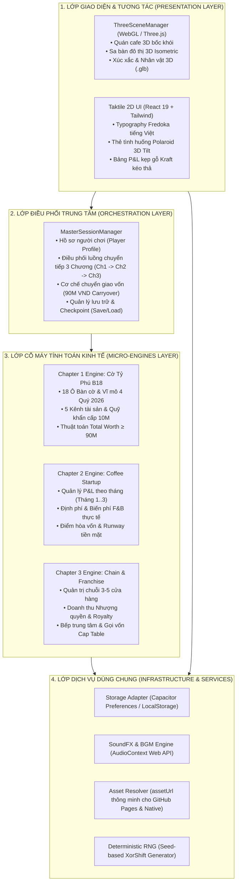
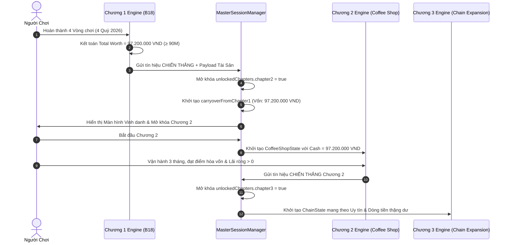
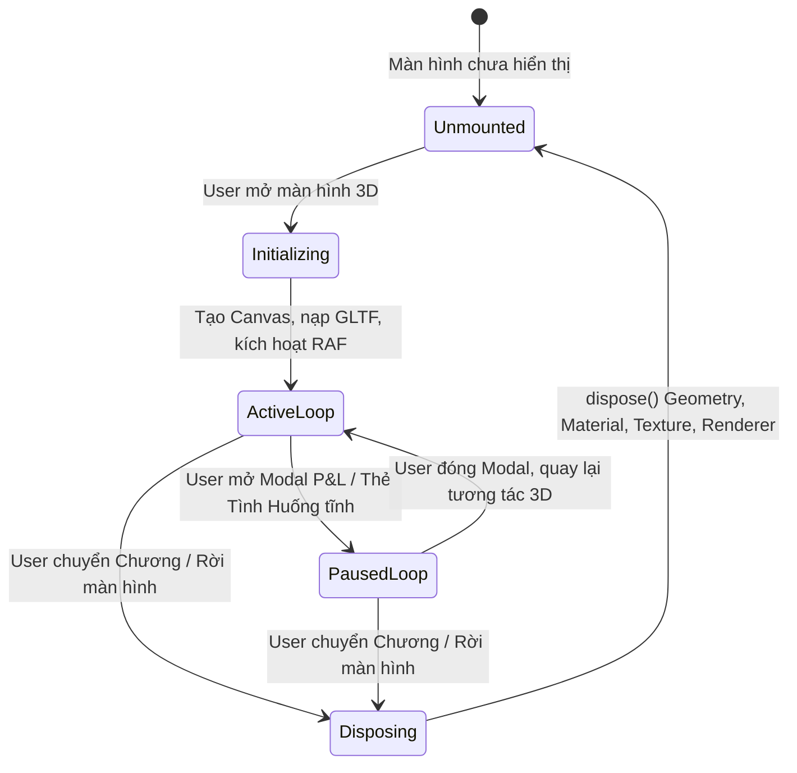

# PLAYBOARD: MASTER SYSTEM ARCHITECTURE DOCUMENT (SAD)
## Kiến Trúc Hệ Thống Tổng Thể Toàn Diện Cho Game App 3 Chương (2026 Edition)
**Kiến trúc sư trưởng:** Phát (Owner & Lead Game Developer)  
**Biên soạn & Thiết kế:** Senior Game Manager Creator 2026  
**Dự án:** PlayBoard (`https://github.com/philipsgn/PlayBoard.git`)  
**Tiêu chuẩn:** Mobile-First Canvas 1080 × 2400 px · Hybrid 3D Three.js + React 19 · TypeScript 5.6+  

---

## 1. TỔNG QUAN KIẾN TRÚC HỆ THỐNG (SYSTEM OVERVIEW)

PlayBoard là ứng dụng game giáo dục tài chính đa chương trình thế hệ mới, vận hành trên nền tảng Mobile Web / PWA và đóng gói Native (Capacitor iOS & Android). Ứng dụng kết hợp giữa logic tính toán kinh tế thực tế chuẩn xác (100% bằng VND) và trải nghiệm thị giác sống động với mô hình **Hybrid 3D Three.js + Taktile 2D UI**.

### 1.1. Sơ Đồ Khối Kiến Trúc Phân Tầng (Layered Architecture)



---

## 2. LỚP ĐIỀU PHỐI TRUNG TÂM (`MasterSessionManager`)

`MasterSessionManager` là đầu mối điều phối dữ liệu duy nhất (Single Source of Truth) trong toàn bộ ứng dụng, đảm bảo tính liên kết xuyên suốt giữa 3 Chương mà không làm phát sinh sự phụ thuộc chéo (Circular Dependencies).

### 2.1. Cấu Trúc Dữ Liệu Hồ Sơ Toàn Ván (Master Session Schema)

```typescript
export interface MasterPlayerProfile {
  playerId: string;
  playerName: string;
  createdAt: number;
  lastActive: number;
  
  // Trạng thái mở khóa & Tiến độ
  unlockedChapters: {
    chapter1: boolean;           // Mặc định: true
    chapter2: boolean;           // Mở khóa khi Thắng Ch1 (Total Worth >= 90M)
    chapter3: boolean;           // Mở khóa khi Thắng Ch2 (Hòa vốn & Lãi dương)
  };
  activeChapter: 1 | 2 | 3;
  
  // Dữ liệu chuyển giao thành quả (Carryover Data)
  carryoverFromChapter1?: {
    finalNetWorth: number;       // Số tiền tích lũy được (>= 90.000.000 VND)
    startingCapitalForCh2: number; // Vốn khởi nghiệp chuyển sang Chương 2
    financialHealthGrade: 'S' | 'A' | 'B' | 'C' | 'D';
    completedAt: number;
  };
  
  carryoverFromChapter2?: {
    finalMonthlyCashflow: number; // Dòng tiền thặng dư hàng tháng
    accumulatedCash: number;     // Tiền mặt dự trữ chuyển sang làm vốn mở chuỗi
    brandReputation: number;     // Điểm uy tín thương hiệu ban đầu cho Ch3
    completedAt: number;
  };
  
  // Trạng thái lưu trữ từng chương
  savedStates: {
    chapter1?: Chapter1SavedState;
    chapter2?: Chapter2SavedState;
    chapter3?: Chapter3SavedState;
  };
}
```

### 2.2. Cơ Chế Chuyển Giao Dòng Vốn Giữa Các Chương (Carryover Flow)



---

## 3. PIPELINE ĐỒ HỌA HYBRID 3D TỐI ƯU MOBILE (`ThreeSceneManager`)

Để giải quyết bài toán hiệu năng, chống tràn RAM và tránh tình trạng mất ngữ cảnh đồ họa (WebGL Context Loss) trên iOS Safari / Android WebView, toàn bộ phần hiển thị 3D được quản trị qua một kiến trúc tập trung.

### 3.1. Vòng Đời Render Có Kiểm Soát (Controlled Lifecycle)



### 3.2. Quy Tắc Giải Phóng Bộ Nhớ WebGL Bắt Buộc (Disposal Contract)
Mọi component 3D trong dự án (máy pha cà phê, thành phố 3D, xúc xắc 3D) bắt buộc phải triển khai hàm dọn dẹp bộ nhớ:
```typescript
export function cleanUpThreeScene(
  scene: THREE.Scene, 
  renderer: THREE.WebGLRenderer
) {
  scene.traverse((object) => {
    if (object instanceof THREE.Mesh) {
      object.geometry?.dispose();
      if (Array.isArray(object.material)) {
        object.material.forEach((mat) => mat.dispose());
      } else if (object.material) {
        object.material.dispose();
      }
    }
  });
  renderer.dispose();
  renderer.forceContextLoss();
}
```

---

## 4. BẢO MẬT & KIỂM SOÁT TÍNH TOÀN VẸN DỮ LIỆU

1. **Chống Sai Số Số Thực (Zero Floating-Point Drift):** Mọi phép tính tiền tệ đều được làm tròn về số nguyên VND (`Math.round()` hoặc `Math.floor()`) trước khi lưu vào State, tuyệt đối không lưu số lẻ như `35.00000000001 VND`.
2. **Deterministic Seed-based Replay:** Cùng một chuỗi hạt giống (`seed`), thứ tự ra xúc xắc, biến cố vĩ mô và giá cả thị trường sẽ tái hiện chuẩn xác 100%, phục vụ cho việc kiểm thử tự động và chống gian lận.
3. **Quy Chuẩn Kiểm Thử Khép Kín (Regression Testing Gate):**
   - Bộ 360 unit tests hiện hữu phải pass 100% trước bất kỳ thay đổi nào.
   - Thêm bộ test độc lập cho Chapter 2 (`tests/chapter2_pnl.test.ts`) và Chapter 3 (`tests/chapter3_chain.test.ts`).
