# HỆ SINH THÁI TÀI LIỆU THIẾT KẾ GAME PLAYBOARD (CHƯƠNG 1, 2, 3)
### Chuẩn Mực Game Design, Player Handbook, Design System & Tech Architecture 2026
**Tác giả & Kiểm duyệt:** Senior Game Manager Creator 2026  
**Chủ sở hữu & Giám đốc Dự án:** Phát (Owner & Lead Game Developer)  
**Codebase:** `https://github.com/philipsgn/PlayBoard.git`  

---

## 1. Bản Đồ Tổng Quan Hệ Thống Tài Liệu

PlayBoard là game giáo dục tài chính thực chiến đa chương trình trên nền tảng Mobile Web / PWA / iOS Native (Canvas chuẩn 1080 × 2400 px, Typography Fredoka tiếng Việt). Người chơi trải qua hành trình tài chính từ cá nhân, khởi nghiệp đơn lẻ, đến nhân bản chuỗi quy mô lớn:

```mermaid
flowchart LR
    subgraph C1["CHƯƠNG 1: CỜ TỶ PHÚ TÀI CHÍNH"]
        C1A["01 GDD & Logic Tình Huống"]
        C1B["02 Sổ Tay Người Chơi"]
        C1C["03 Design System"]
        C1D["04 Tech Architecture"]
    end

    subgraph C2["CHƯƠNG 2: KHỞI NGHIỆP QUÁN CÀ PHÊ"]
        C2A["01 GDD & Logic Tình Huống"]
        C2B["02 Sổ Tay Người Chơi"]
        C2C["03 Design System"]
        C2D["04 Tech Architecture"]
    end

    subgraph C3["CHƯƠNG 3: MỞ RỘNG CHUỖI & NHƯỢNG QUYỀN"]
        C3A["01 GDD & Logic Tình Huống"]
        C3B["02 Sổ Tay Người Chơi"]
        C3C["03 Design System"]
        C3D["04 Tech Architecture"]
    end

    C1 -->|Vốn 90M VND & Tư Duy Quản Lý Dòng Tiền| C2
    C2 -->|Điểm Hòa Vốn, Lợi Nhuận & Mô Hình SOP| C3
```

---

## 2. Danh Mục Thư Mục & Tài Liệu Chi Tiết

### 📘 [Chương 1: Cờ Tỷ Phú B18 (Tích Lũy 90M VND)](./chapter_1_boardgame/)
*Quản trị tài chính cá nhân, 5 kênh tài sản (Tiền mặt, Tiết kiệm, Cổ phiếu, Trái phiếu, Vàng, Tiệm F&B), vượt qua 4 vòng tương ứng 4 Quý năm 2026 để tích lũy tối thiểu 90.000.000 VND.*
- 📄 [01_GAME_DESIGN_DOCUMENT.md](./chapter_1_boardgame/01_GAME_DESIGN_DOCUMENT.md): Game Mechanics, 18 ô bàn cờ, 4 Quý vĩ mô 2026, Hệ thống Dilemma Trade-offs, Điều kiện thắng/thua.
- 📄 [02_PLAYER_HANDBOOK.md](./chapter_1_boardgame/02_PLAYER_HANDBOOK.md): Sổ tay người chơi, luật từng ô cờ, cẩm nang đầu tư thực tế (Vàng Q2, Công nghệ Q1, Đệm tiền mặt Q3), từ điển tài chính cá nhân.
- 📄 [03_DESIGN_SYSTEM.md](./chapter_1_boardgame/03_DESIGN_SYSTEM.md): Design tokens, bảng màu Cyan/Amber/Emerald, HUD năng động, Modals giao dịch, xúc xắc 3D.
- 📄 [04_TECH_ARCHITECTURE.md](./chapter_1_boardgame/04_TECH_ARCHITECTURE.md): Data models (`GameState`, `Portfolio`), cỗ máy trạng thái (State Machine), bộ sinh số giả ngẫu nhiên xác định (Deterministic RNG), kiểm thử tự động.

---

### ☕ [Chương 2: Khởi Nghiệp Quán Cà Phê (Coffee Shop Simulator)](./chapter_2_coffee_startup/)
*Mô phỏng vận hành kinh doanh F&B thực tế: Vượt qua 3 tháng đầu sóng gió, quản trị chi phí cố định/biến đổi, bảo toàn Runway tiền mặt, đạt điểm hòa vốn (Break-even) và tạo doanh thu bền vững.*
- 📄 [01_GAME_DESIGN_DOCUMENT.md](./chapter_2_coffee_startup/01_GAME_DESIGN_DOCUMENT.md): GDD F&B thực chiến, Bảng P&L theo tháng, Định phí & Biến phí, 12 Thẻ Quyết Định Tình Huống Chi Tiết (A/B/C với công thức tài chính cụ thể).
- 📄 [02_PLAYER_HANDBOOK.md](./chapter_2_coffee_startup/02_PLAYER_HANDBOOK.md): Sổ tay "Khởi Nghiệp Không Sạt Nghiệp", cách tính số ly hòa vốn mỗi ngày, quản lý tồn kho hạt/sữa, bí quyết sống sót qua tháng thứ 3.
- 📄 [03_DESIGN_SYSTEM.md](./chapter_2_coffee_startup/03_DESIGN_SYSTEM.md): Coffeehouse Aesthetic, Bảng P&L hóa đơn gỗ retro, Thẻ Polaroid tình huống, Đồng hồ đo Runway & Độ hài lòng khách hàng.
- 📄 [04_TECH_ARCHITECTURE.md](./chapter_2_coffee_startup/04_TECH_ARCHITECTURE.md): Data models (`CoffeeShopState`, `PnLStatement`, `DecisionCard`), Monthly Tick Engine, Cashflow Reducer, Unit Test Contracts.

---

### 🏢 [Chương 3: Mở Rộng Chuỗi & Nhượng Quyền (Coffee Chain & Franchise)](./chapter_3_chain_expansion/)
*Nhân bản mô hình kinh doanh từ 1 lên 3–5 cửa hàng, thiết lập quy chuẩn nhượng quyền (Franchise Fee & Royalty), tối ưu chuỗi cung ứng Bếp trung tâm (Central Kitchen) và đàm phán gọi vốn Vòng Thiên Thần (Angel Round).*
- 📄 [01_GAME_DESIGN_DOCUMENT.md](./chapter_3_chain_expansion/01_GAME_DESIGN_DOCUMENT.md): GDD Quy mô lớn, Kinh tế học nhượng quyền, Mô hình Bếp trung tâm, Định giá doanh nghiệp Pre-money/Post-money, Bảng Thẻ Tình Huống Chiến Lược.
- 📄 [02_PLAYER_HANDBOOK.md](./chapter_3_chain_expansion/02_PLAYER_HANDBOOK.md): Sổ tay "Từ Chủ Quán Đến Doanh Nhân Chuỗi", chuẩn hóa SOP, nghệ thuật đàm phán cổ phần (Cap Table) và phòng chống pha loãng (Dilution).
- 📄 [03_DESIGN_SYSTEM.md](./chapter_3_chain_expansion/03_DESIGN_SYSTEM.md): Corporate HQ & City Map Dashboard, Bảng biểu đồ tròn Cap Table cổ đông, Hợp đồng nhượng quyền cao cấp, Biểu đồ tăng trưởng chuỗi.
- 📄 [04_TECH_ARCHITECTURE.md](./chapter_3_chain_expansion/04_TECH_ARCHITECTURE.md): Data models (`ChainState`, `BranchStore`, `FranchiseContract`, `CapTable`), Multi-store Aggregation Engine, Thuật toán định giá EBITDA Multiple.

---

## 3. Quy Ước Thiết Kế Chung Toàn Dự Án
1. **Thiết kế Mobile-First:** Màn hình tiêu chuẩn 1080 × 2400 px, tỷ lệ 9:20 / 20:9, tối ưu công thái học một ngón tay cái.
2. **Typography:** Font chữ duy nhất **Fredoka** (Medium 500, SemiBold 600, Bold 700) hỗ trợ 100% tiếng Việt có dấu.
3. **Tiền tệ chuẩn:** **VND**, hiển thị phân cách dấu chấm hàng nghìn/triệu (ví dụ: `90.000.000 VND`).
4. **Nguyên tắc Tài chính Chân thật (Realistic RL Financial Rules):**
   - Mọi con số doanh thu, chi phí, biên lợi nhuận, lãi suất và rủi ro đều mô phỏng thực tế thị trường Việt Nam năm 2026, giúp người chơi học hỏi tư duy quản trị tài chính thực thụ.
