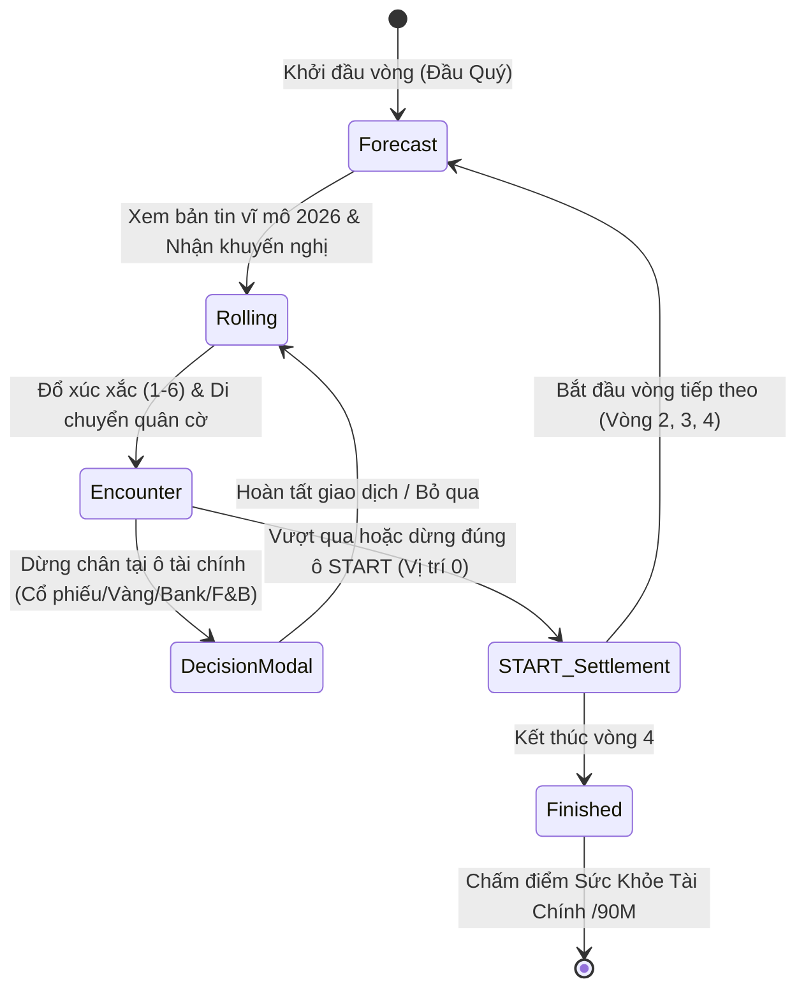

# CHƯƠNG 1: CỜ TỶ PHÚ TÀI CHÍNH (PLAYBOARD B18)
## TÀI LIỆU KIẾN TRÚC KỸ THUẬT & MÔ HÌNH DỮ LIỆU (TECH ARCHITECTURE)
**Môi trường:** TypeScript 5.6+, React 19, Vite 8, Node.js Test Runner  
**Tác giả:** Senior Game Manager Creator 2026  

---

## 1. MÔ HÌNH DỮ LIỆU CỐT LÕI (CORE DATA MODELS)

```typescript
// Cấu trúc Trạng Thái Toàn Ván (GameState)
export interface GameState {
  seed: string;
  rng: number;
  gameMode: string;
  boardLayout: 'B18' | 'C20';
  totalLaps: number;             // 4 vòng tiêu chuẩn cho B18
  lap: number;                   // Vòng hiện tại (1..4 tương ứng 4 Quý năm 2026)
  turn: number;                  // Lượt chơi hiện tại
  position: number;              // Vị trí quân cờ (0..17)
  phase: Phase;                  // 'rolling' | 'event' | 'forecast' | 'settlement' | 'finished'
  scenarioId: string;            // 'growth' | 'uncertain' | 'recovery'
  dice: number;                  // Giá trị xúc xắc vừa đổ (1..6)
  
  // Dòng tiền & Tài sản
  recurringIncome: number;       // Lương định kỳ (14M gốc; 18M sau khi học kỹ năng)
  coursePurchased: boolean;      // Đã mua khóa học nâng cấp kỹ năng hay chưa
  portfolio: Portfolio;          // Danh mục tài sản phân rã
  stockHoldings: Record<string, StockHolding>;
  goldUnits: number;             // Số lượng chỉ/cây vàng sở hữu
  goldCostBasis: number;         // Giá vốn trung bình
  bondLots: BondLot[];           // Danh sách lô trái phiếu sở hữu
  deposits: SavingsDeposit[];    // Danh sách sổ tiết kiệm ngân hàng
  business: BusinessState;       // Trạng thái cơ sở kinh doanh F&B
  
  // Nhật ký & Giám sát
  log: LogEntry[];               // Lịch sử biến động tài sản và quyết định
  market: MarketState;           // Trạng thái bảng giá thị trường
}

export interface Portfolio {
  cash: number;                  // Tiền mặt có sẵn
  savings: number;               // Tiền gửi tiết kiệm (gốc)
  stocks: number;                // Định giá cổ phiếu hiện tại
  bonds: number;                 // Định giá trái phiếu hiện tại
  gold: number;                  // Định giá vàng hiện tại
  business: number;              // Giá trị có thể thu hồi của tiệm kinh doanh
  debt: number;                  // Nợ xấu ngân hàng (chịu lãi 10%/vòng)
}
```

---

## 2. CỖ MÁY TRẠNG THÁI (STATE MACHINE WORKFLOW)



---

## 3. THUẬT TOÁN ĐỊNH GIÁ & TÍNH TOÁN TOÀN DIỆN (VALUATION ENGINE)

### 3.1. Tính Tổng Tài Sản Hợp Lệ (Total Worth)
$$\text{TotalWorth} = \text{Cash} + \text{Savings} + \text{Stocks} + \text{Bonds} + \text{Gold} + \text{Business} - \text{Debt}$$
Trong đó:
- $\text{Stocks} = \sum (\text{Units}_i \times \text{CurrentPrice}_i)$
- $\text{Gold} = \text{GoldUnits} \times \text{CurrentGoldPrice}$
- $\text{Business} = \text{RecoverableCapital} \times (1 - \text{Depreciation}) \times \text{EconomicMultiplier}$

### 3.2. Hiệu Chuẩn Thực Tế 2026 (RL Scenario Ranges)
Tại ô START, giá tài sản được cập nhật theo kịch bản vĩ mô:
```typescript
export const RL_2026_SCENARIO_RANGES: Record<string, Record<Asset, [number, number]>> = {
  growth: {
    stocks: [-0.05, 0.35],       // Sóng AI & công nghệ dẫn dắt
    bonds: [0.03, 0.07],
    gold: [-0.05, 0.15],
    business: [0.15, 0.50]
  },
  uncertain: {
    stocks: [-0.22, 0.16],       // Rung lắc điều chỉnh
    bonds: [0.02, 0.06],
    gold: [0.08, 0.26],          // Sóng Vàng phá đỉnh trú ẩn 2026
    business: [-0.08, 0.28]
  },
  recovery: {
    stocks: [-0.12, 0.25],
    bonds: [0.03, 0.08],
    gold: [0.02, 0.18],          // Vàng duy trì ở vùng đỉnh cao
    business: [0.05, 0.40]
  }
};
```

---

## 4. QUY CHUẨN KIỂM THỬ TỰ ĐỘNG (UNIT TEST CONTRACTS)
Mọi thay đổi trên logic Chương 1 bắt buộc phải vượt qua:
1. `npm test`: Đảm bảo 360/360 bài test unit pass 100%, không hồi quy (Zero Regression).
2. `tests/rl-2026-simulation.test.ts`: Xác nhận chiến lược bám sát 4 Quý năm 2026 chắc chắn đạt $\ge 90\text{M VND}$.
3. `scripts/diagnostics/mobile-final-ui.test.ts`: Kiểm tra toàn vẹn hợp đồng giao diện cảm ứng mobile.
