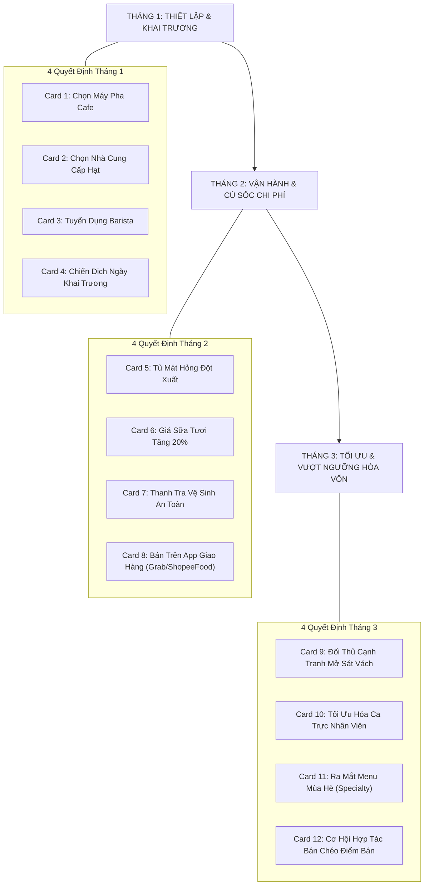

# CHƯƠNG 2: KHỞI NGHIỆP QUÁN CÀ PHÊ (COFFEE SHOP SIMULATOR)
## TÀI LIỆU THIẾT KẾ GAME & LOGIC TÌNH HUỐNG (GDD)
**Phiên bản:** 1.0 (Chuẩn Vận Hành F&B Thực Tế 2026)  
**Tác giả:** Senior Game Manager Creator 2026  
**Dự án:** PlayBoard — Game Giáo Dục Tài Chính Cá Nhân & Khởi Nghiệp  

---

## 1. TỔNG QUAN GAME & MỤC TIÊU CỐT LÕI

### 1.1. Tuyên Bố Sứ Mệnh (Game Vision)
Chương 2 mô phỏng chân thực bài toán khởi nghiệp F&B: **"Vượt qua 3 tháng đầu sóng gió để không sạt nghiệp"**.
Người chơi sử dụng số vốn tích lũy được từ Chương 1 (**90.000.000 VND**) để mở một quán cà phê specialty/take-away. Khác với những game quản lý nông trại hay clicker nhàn rỗi, Chương 2 đặt người chơi vào vị trí một **Chủ Quán Cà Phê thực thụ** phải đối mặt với áp lực dòng tiền hàng tháng, tiền thuê mặt bằng, biến phí nguyên liệu hạt/sữa, sự cố hỏng hóc thiết bị và rủi ro cạn kiệt tiền mặt (Runway Depletion).

### 1.2. Mốc Chiến Thắng & Thất Bại (Win/Lose Conditions)
- **Thời lượng thử thách:** **3 Tháng Đầu Tiên** (Tháng 1: Thiết lập & Khai trương, Tháng 2: Vận hành & Cú sốc chi phí, Tháng 3: Tối ưu & Vượt ngưỡng).
- **Điều kiện CHIẾN THẮNG (Victory):**
  1. Quán duy trì hoạt động đến hết Tháng thứ 3 mà không bị phá sản ($\text{Tiền mặt} > 0$).
  2. Tại Tháng thứ 3, quán đạt **Điểm Hòa Vốn (Break-even)** hoặc có lãi ròng dương:
     $$\text{Lợi nhuận ròng Tháng 3} \ge 0\text{ VND}$$
  3. Chỉ số Hài Lòng Khách Hàng (Customer Satisfaction) $\ge 70/100$.
  $\rightarrow$ *Phần thưởng:* Mở khóa **Chương 3: Mở Rộng Chuỗi & Nhượng Quyền**.
- **Điều kiện THẤT BẠI (Game Over):**
  - Hết sạch tiền mặt tại bất kỳ thời điểm nào ($\text{Cash} \le 0$) và không thể chi trả tiền thuê mặt bằng hoặc lương nhân viên.
  - Điểm hài lòng khách hàng rơi xuống dưới 30/100 (quán bị tẩy chay vì chất lượng quá tệ).

---

## 2. CÔNG THỨC KINH TẾ HỌC F&B THỰC CHIẾN (FINANCIAL FORMULAS)

### 2.1. Doanh Thu Bán Hàng (Monthly Revenue)
$$\text{Doanh thu} = \text{Số lượng ly bán ra / ngày} \times \text{Giá bán trung bình (AOV)} \times 30\text{ ngày}$$
- *Ví dụ chuẩn:* 80 ly/ngày $\times$ 35.000 VND/ly $\times$ 30 ngày = `84.000.000 VND/tháng`.

### 2.2. Chi Phí Hoạt Động (Cost Structure)
Tổng chi phí chia làm 2 phần rõ rệt:
1. **Chi phí cố định (Fixed Costs - Định phí):**
   $$\text{Định phí} = \text{Tiền thuê mặt bằng} + \text{Lương cứng nhân viên} + \text{Khấu hao máy móc} + \text{Internet/Phí quản lý}$$
   - *Đặc điểm:* Dù bán được 0 ly hay 1.000 ly thì cuối tháng vẫn phải thanh toán đủ 100%.
2. **Chi phí biến đổi (Variable Costs / COGS - Biến phí):**
   $$\text{Biến phí} = \text{Chi phí nguyên vật liệu (Hạt cafe, sữa tươi, siro, ly, ống hút, đá)} + \text{Điện nước theo công suất} + \text{Phí ứng dụng giao hàng}$$
   - *Tỷ lệ biến phí tiêu chuẩn ngành cafe:* Thường chiếm **28% – 35%** trên giá bán 1 ly cafe.

### 2.3. Lợi Nhuận Gộp & Lợi Nhuận Ròng (Gross & Net Profit)
- **Lợi nhuận gộp (Gross Profit):**
  $$\text{Gross Profit} = \text{Doanh thu} - \text{Biến phí (COGS)}$$
- **Lợi nhuận ròng (Net Profit):**
  $$\text{Net Profit} = \text{Gross Profit} - \text{Định phí}$$

### 2.4. Điểm Hòa Vốn (Break-even Point)
Số doanh thu tối thiểu phải đạt để bù đắp toàn bộ chi phí mà không bị lỗ:
$$\text{Doanh thu hòa vốn} = \frac{\text{Định phí}}{1 - \text{Tỷ lệ biến phí}}$$
- *Ví dụ:* Định phí 30.000.000 VND/tháng, tỷ lệ biến phí 30% (tức tỷ lệ lợi nhuận gộp là 70%):
  $$\text{Doanh thu hòa vốn} = \frac{30.000.000}{0.7} \approx 42.857.000\text{ VND/tháng}$$
  $$\text{Số ly cafe cần bán mỗi ngày} = \frac{42.857.000}{35.000 \times 30} \approx 41\text{ ly/ngày}$$
  $\rightarrow$ Người chơi chỉ cần bán từ ly thứ 42 trở đi trong ngày là bắt đầu có lãi ròng!

### 2.5. Chỉ Số Runway Tiền Mặt (Cash Runway)
$$\text{Runway (Tháng)} = \frac{\text{Tiền mặt dự trữ}}{\text{Mức lỗ ròng hàng tháng (Monthly Burn Rate)}}$$
- Nếu quán đang lỗ 15M/tháng và tiền mặt chỉ còn 30M, Runway là `2 tháng` $\rightarrow$ Báo động đỏ! Người chơi phải cắt giảm định phí hoặc tăng doanh thu khẩn cấp.

---

## 3. DANH MỤC THẺ QUYẾT ĐỊNH TÌNH HUỐNG CHI TIẾT (DECISION CARDS)

Mỗi tháng người chơi sẽ rút 4 thẻ quyết định tình huống theo thứ tự: **Cơ sở hạ tầng & Trang thiết bị $\rightarrow$ Vận hành & Nhân sự $\rightarrow$ Biến cố bất ngờ $\rightarrow$ Tiếp thị & Bán hàng**.

---

### BẢNG CHI TIẾT 12 THẺ QUYẾT ĐỊNH TÌNH HUỐNG (DATA SHEETS)

#### THẺ 01: CHỌN MÁY PHA CÀ PHÊ (THÁNG 1)
- **Bối cảnh:** Bạn cần trang bị máy pha cafe espresso cho quán. Đây là khoản đầu tư Capex lớn nhất ban đầu.
- **Lựa chọn A (Máy pha 2 Group của Ý - Mới 100%):**
  - *Chi phí:* Trả ngay `-45.000.000 VND`.
  - *Tác động:* Công suất pha 200 ly/ngày, chất lượng ổn định tuyệt hảo, Độ hài lòng $+15$, không hỏng vặt trong 12 tháng.
- **Lựa chọn B (Máy 1 Group đã qua sử dụng - Second-hand):**
  - *Chi phí:* Trả ngay `-22.000.000 VND`.
  - *Tác động:* Công suất 80 ly/ngày, tiết kiệm được 23M tiền mặt để giữ Runway, nhưng có 25% rủi ro hỏng hóc ở Tháng 2. Độ hài lòng $+5$.
- **Lựa chọn C (Thuê máy pha cafe trọn gói):**
  - *Chi phí:* Cọc `-10.000.000 VND`, phí thuê cộng vào Định phí `-3.500.000 VND/tháng`.
  - *Tác động:* Giữ tối đa tiền mặt ban đầu, được bên cho thuê bảo trì miễn phí.
- **Bài học kinh tế:** Cân nhắc giữa Chi phí đầu tư ban đầu (Capex) và Chi phí vận hành định kỳ (Opex) để bảo toàn Runway.

#### THẺ 02: CHỌN NHÀ CUNG CẤP HẠT CÀ PHÊ (THÁNG 1)
- **Bối cảnh:** Hạt cafe quyết định hương vị cốt lõi và giá vốn (COGS) trên từng ly.
- **Lựa chọn A (Hạt Specialty Arabica Cầu Đất cao cấp):**
  - *Tác động:* Giá vốn nguyên liệu cao (`12.000 VND/ly`), giá bán được định vị cao (`45.000 VND/ly`), Độ hài lòng $+20$, thu hút khách sành cafe.
- **Lựa chọn B (Hạt Blend Robusta & Arabica chuẩn gu Việt):**
  - *Tác động:* Giá vốn cân bằng (`7.500 VND/ly`), giá bán phổ thông (`32.000 VND/ly`), phù hợp dân văn phòng, lượng bán ra tăng $+30\%$.
- **Lựa chọn C (Hạt thương mại giá rẻ):**
  - *Tác động:* Giá vốn cực thấp (`4.000 VND/ly`), giá bán (`25.000 VND/ly`), nhưng Độ hài lòng giảm $-15$, khách không quay lại lần 2.
- **Bài học kinh tế:** Giá vốn hàng bán (COGS) thấp không đồng nghĩa với lợi nhuận cao nếu làm mất giá trị vòng đời khách hàng (Customer Lifetime Value).

#### THẺ 03: TUYỂN DỤNG & ĐÀO TẠO BARISTA (THÁNG 1)
- **Bối cảnh:** Nhân sự là gương mặt của quán nhưng chiếm tỷ trọng lớn trong định phí.
- **Lựa chọn A (Thuê Barista trưởng giàu kinh nghiệm):** Lương cứng `-9.000.000 VND/tháng`, chất lượng đồng đều, giảm tỷ lệ hao hụt nguyên liệu $-5\%$.
- **Lựa chọn B (Thuê sinh viên làm part-time & tự chủ quán đào tạo):** Tổng lương `-4.500.000 VND/tháng`, tiết kiệm chi phí nhưng tốn thời gian kèm cặp, tỷ lệ đổ bỏ nguyên liệu $+8\%$.
- **Bài học kinh tế:** Đánh đổi giữa chi phí lương cứng và tỷ lệ hao hụt vận hành.

#### THẺ 04: CHIẾN DỊCH NGÀY KHAI TRƯƠNG (THÁNG 1)
- **Bối cảnh:** Ngày khai trương quyết định độ nhận diện ban đầu tại khu vực.
- **Lựa chọn A ("Mua 1 Tặng 1" trong 3 ngày):** Chi phí nguyên liệu khuyến mãi `-4.000.000 VND`, quán đông nghẹt, tạo 120 khách quen đầu tiên.
- **Lựa chọn B (Giảm giá 20% toàn menu + Tặng voucher lần sau):** Chi phí `-2.000.000 VND`, giữ được biên lợi nhuận gộp, kích thích khách quay lại tuần sau.
- **Lựa chọn C (Khai trương mộc mạc, không khuyến mãi lớn):** Tiết kiệm chi phí, nhưng lượng khách tăng trưởng rất chậm.
- **Bài học kinh tế:** Chi phí thu hút khách hàng mới (CAC - Customer Acquisition Cost).

#### THẺ 05: SỰ CỐ TỦ MÁT HỎNG ĐỘT XUẤT (THÁNG 2)
- **Bối cảnh:** Tủ mát chứa toàn bộ sữa tươi thanh trùng bị chập điện vào đêm chủ nhật. Toàn bộ 40 lít sữa bị hỏng.
- **Lựa chọn A (Gọi thợ sửa khẩn cấp & Mua lại sữa mới ngay sáng sớm):** Chi phí `-3.500.000 VND`, quán mở cửa đúng giờ, khách hàng không nhận ra sự cố.
- **Lựa chọn B (Tự mày mò sửa, quán tạm đóng cửa buổi sáng):** Chi phí linh kiện `-800.000 VND`, nhưng mất doanh thu cả buổi sáng `-2.500.000 VND` và Độ hài lòng $-10$.
- **Bài học kinh tế:** Chi phí cơ hội (Opportunity Cost) và tầm quan trọng của Quỹ dự phòng vận hành.

#### THẺ 06: GIÁ SỮA TƯƠI TĂNG 20% DO LẠM PHÁT (THÁNG 2)
- **Bối cảnh:** Nhà cung cấp sữa thông báo giá nguyên liệu đầu vào tăng 20%, đe dọa trực tiếp biên lợi nhuận của các món Latte, Cappuccino.
- **Lựa chọn A (Tăng giá bán các món có sữa thêm 3.000 VND/ly):** Bù đắp 100% chi phí, có thể mất một vài khách nhạy cảm về giá.
- **Lựa chọn B (Giữ nguyên giá bán, chấp nhận giảm biên lợi nhuận gộp):** Bảo vệ lượng khách trung thành, chịu giảm lợi nhuận ròng `-2.000.000 VND/tháng`.
- **Lựa chọn C (Thay đổi công thức sang loại sữa thanh trùng thay thế):** Giữ nguyên giá và biên lợi nhuận, nhưng độ ngon giảm nhẹ.
- **Bài học kinh tế:** Độ co giãn của cầu theo giá (Price Elasticity of Demand) trong kinh doanh đồ uống.

#### THẺ 07: THANH TRA VỆ SINH AN TOÀN THỰC PHẨM (THÁNG 2)
- **Bối cảnh:** Đoàn kiểm tra liên ngành ghé kiểm tra chứng nhận VSATTP và nguồn gốc hạt/syrup.
- **Lựa chọn A (Hồ sơ đầy đủ, tem nhãn chuẩn chỉnh từ đầu):** Không mất phí phạt, được cấp giấy chứng nhận chuẩn sao, Độ hài lòng $+10$.
- **Lựa chọn B (Thiếu hóa đơn VAT của một số phụ liệu mua trôi nổi):** Bị phạt hành chính `-5.000.000 VND` và yêu cầu khắc phục trong 7 ngày.
- **Bài học kinh tế:** Chi phí tuân thủ pháp lý (Compliance Cost) luôn rẻ hơn chi phí bị xử phạt.

#### THẺ 08: BÁN HÀNG QUA APP GIAO HÀNG (GRAB / SHOPEEFOOD) (THÁNG 2)
- **Bối cảnh:** Đăng ký gian hàng online để bán cafe mang đi.
- **Lựa chọn A (Ký hợp đồng chiết khấu 25% cho App):** Doanh số tăng vọt $+40$ ly/ngày, nhưng biên lợi nhuận trên mỗi ly giao hàng chỉ còn 10% - 15%.
- **Lựa chọn B (Chỉ tập trung bán tại quán và tự giao hàng bán kính 1km):** Giữ 100% lợi nhuận, nhưng lượng đơn hàng phụ thuộc hoàn toàn vào khách vãng lai.
- **Bài học kinh tế:** Cân bằng giữa Quy mô doanh thu (Volume) và Tỷ suất lợi nhuận gộp (Margin).

#### THẺ 09: ĐỐI THỦ CẠNH TRANH MỞ SÁT VÁCH (THÁNG 3)
- **Bối cảnh:** Một chuỗi trà sữa - cafe lớn mở chi nhánh cách quán bạn 3 căn nhà, tung khuyến mãi giảm 50%.
- **Lựa chọn A (Tung combo bữa sáng: Cafe + Bánh mì giá hấp dẫn):** Tạo sự khác biệt về trải nghiệm ăn sáng văn phòng, giữ chân 85% khách ruột.
- **Lựa chọn B (Cuộc chiến giảm giá khô máu):** Giảm giá theo đối thủ, doanh thu tăng nhưng lợi nhuận ròng âm nặng, Runway cạn kiệt.
- **Lựa chọn C (Nâng cấp chất lượng dịch vụ: Nhớ tên khách, tặng thiệp cảm ơn):** Chi phí `-1.000.000 VND`, tạo sự gắn kết tình cảm chân thành mà chuỗi lớn không làm được.
- **Bài học kinh tế:** Tránh bẫy "Cuộc chiến giá cả" (Price War); cạnh tranh bằng Giá trị gia tăng (Value Proposition).

#### THẺ 10: TỐI ƯU HÓA CA TRỰC NHÂN VIÊN (THÁNG 3)
- **Bối cảnh:** Dữ liệu bán hàng cho thấy quán chỉ đông vào khung giờ 7h - 9h sáng và 12h - 13h30 trưa; buổi chiều khá vắng.
- **Lựa chọn A (Cắt giảm ca chiều, áp dụng lịch làm việc linh hoạt):** Tiết kiệm định phí lương `-3.000.000 VND/tháng`, đưa quán về sát điểm hòa vốn ngay lập tức!
- **Lựa chọn B (Giữ nguyên nhân sự cả ngày để sẵn sàng đón khách):** Duy trì sự thuận tiện nhưng lãng phí nguồn lực lao động.
- **Bài học kinh tế:** Năng suất lao động theo giờ (Labor Productivity) và tối ưu hóa định phí.

#### THẺ 11: RA MẮT MENU SPECIALTY THEO MÙA (THÁNG 3)
- **Bối cảnh:** Khách hàng bắt đầu quen thuộc menu cũ, cần một cú hích mới mẻ để tăng giá trị đơn hàng trung bình (AOV).
- **Lựa chọn A (Ra mắt món Cold Brew ủ lạnh & Cà phê Muối):** Chi phí R&D và bình ủ `-3.000.000 VND`, giá bán cao (48.000 VND/ly), biên lợi nhuận gộp lên đến 75%!
- **Lựa chọn B (Giữ nguyên menu truyền thống để tránh tồn kho):** Không tốn chi phí mới, doanh thu đi ngang.
- **Bài học kinh tế:** Đổi mới sáng tạo sản phẩm (Product Innovation) để nâng cao biên lợi nhuận.

#### THẺ 12: ĐÀM PHÁN BÁN CHÉO VỚI TIỆM BÁNH BÊN CẠNH (THÁNG 3)
- **Bối cảnh:** Tiệm bánh mì ngọt bên cạnh đề xuất hợp tác: Khách mua bánh được voucher giảm 10% cafe, và ngược lại.
- **Lựa chọn A (Ký thỏa thuận hợp tác ngay):** Không tốn chi phí mặt bằng hay nhân sự mới, lập tức tăng thêm $+25$ ly/ngày từ nguồn khách tiệm bánh. Quán chính thức vượt điểm hòa vốn!
- **Lựa chọn B (Từ chối vì sợ phức tạp trong việc đối soát doanh thu):** Bỏ lỡ cơ hội cộng hưởng hệ sinh thái.
- **Bài học kinh tế:** Hợp tác kinh doanh đôi bên cùng có lợi (Cross-Promotion Partnership).
