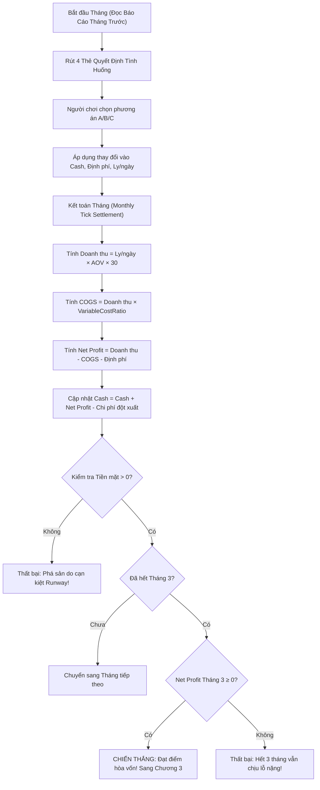

# CHƯƠNG 2: KHỞI NGHIỆP QUÁN CÀ PHÊ (COFFEE SHOP SIMULATOR)
## TÀI LIỆU KIẾN TRÚC KỸ THUẬT & MÔ HÌNH DỮ LIỆU (TECH ARCHITECTURE)
**Môi trường:** TypeScript 5.6+, React 19, Immutable State Reducer  
**Tác giả:** Senior Game Manager Creator 2026  

---

## 1. MÔ HÌNH DỮ LIỆU (DATA MODELS)

```typescript
// Trạng thái Quán Cà Phê (CoffeeShopState)
export interface CoffeeShopState {
  month: number;                 // 1, 2, 3
  cash: number;                  // Tiền mặt dự trữ lưu động (VND)
  capitalInvested: number;       // Vốn ban đầu (90.000.000 VND)
  equipmentValue: number;        // Giá trị tài sản máy móc thiết bị
  runwayMonths: number;          // Số tháng runway còn lại
  customerSatisfaction: number;  // Thang điểm 0..100
  dailyCupsSold: number;         // Lượng ly bán ra trung bình mỗi ngày
  averageOrderValue: number;     // Giá bán trung bình mỗi ly (35.000 VND)
  
  // Cấu trúc chi phí
  fixedCosts: FixedCostBreakdown;
  variableCostRatio: number;     // Tỷ lệ biến phí (0.28..0.35)
  
  // Lịch sử P&L
  monthlyPnL: MonthlyPnLStatement[];
  activeDecisions: string[];     // Danh sách ID các quyết định đã đưa ra
  phase: 'briefing' | 'decisions' | 'monthly_settlement' | 'chapter_result';
}

export interface FixedCostBreakdown {
  rent: number;                  // Tiền thuê mặt bằng hàng tháng
  labor: number;                 // Tổng lương cứng nhân viên
  utilities: number;             // Điện, nước, internet cơ bản
  equipmentDepreciation: number; // Khấu hao thiết bị hàng tháng
  equipmentRental: number;       // Phí thuê máy móc nếu chọn phương án thuê
}

export interface MonthlyPnLStatement {
  month: number;
  revenue: number;
  cogs: number;                  // Giá vốn hàng bán (Biến phí)
  grossProfit: number;           // Lợi nhuận gộp
  fixedCosts: number;            // Tổng định phí
  netProfit: number;             // Lợi nhuận ròng
  cashEnding: number;            // Tiền mặt cuối kỳ
  breakEvenCupsDaily: number;    // Số ly cần bán/ngày để hòa vốn
  isBreakEven: boolean;          // Đã đạt điểm hòa vốn hay chưa
}

export interface DecisionCard {
  id: string;
  month: number;
  title: string;
  context: string;
  category: 'equipment' | 'operations' | 'marketing' | 'emergency';
  options: DecisionOption[];
}

export interface DecisionOption {
  id: 'A' | 'B' | 'C';
  label: string;
  cashImpactImmediate: number;   // Tác động tiền mặt tức thời (Capex hoặc chi phí phạt)
  fixedCostDelta: number;        // Tác động lên định phí hàng tháng
  dailyCupsDelta: number;        // Thay đổi lượng ly bán ra mỗi ngày
  satisfactionDelta: number;     // Thay đổi độ hài lòng khách hàng
  cogsRatioDelta: number;        // Thay đổi tỷ lệ biến phí
  takeawayLesson: string;        // Bài học tài chính rút ra
}
```

---

## 2. CỖ MÁY MÔ PHỎNG THÁNG (MONTHLY SIMULATION ENGINE)



---

## 3. THUẬT TOÁN KẾT TOÁN THÁNG (SETTLEMENT REDUCER)

```typescript
export function settleMonth(state: CoffeeShopState): CoffeeShopState {
  const daysInMonth = 30;
  const revenue = Math.round(state.dailyCupsSold * state.averageOrderValue * daysInMonth);
  const cogs = Math.round(revenue * state.variableCostRatio);
  const grossProfit = revenue - cogs;
  
  const totalFixed = state.fixedCosts.rent 
    + state.fixedCosts.labor 
    + state.fixedCosts.utilities 
    + state.fixedCosts.equipmentDepreciation 
    + state.fixedCosts.equipmentRental;
    
  const netProfit = grossProfit - totalFixed;
  const cashEnding = state.cash + netProfit;
  
  // Tính điểm hòa vốn
  const grossMargin = (state.averageOrderValue * (1 - state.variableCostRatio));
  const breakEvenDailyCups = Math.ceil((totalFixed / daysInMonth) / grossMargin);
  const isBreakEven = netProfit >= 0;
  
  const pnlRecord: MonthlyPnLStatement = {
    month: state.month,
    revenue,
    cogs,
    grossProfit,
    fixedCosts: totalFixed,
    netProfit,
    cashEnding,
    breakEvenCupsDaily: breakEvenDailyCups,
    isBreakEven
  };
  
  // Tính Runway tháng nếu lỗ
  const burnRate = netProfit < 0 ? Math.abs(netProfit) : 0;
  const runwayMonths = burnRate > 0 ? Number((cashEnding / burnRate).toFixed(1)) : 99;
  
  return {
    ...state,
    cash: cashEnding,
    runwayMonths,
    monthlyPnL: [...state.monthlyPnL, pnlRecord],
    phase: state.month === 3 ? 'chapter_result' : 'monthly_settlement'
  };
}
```

---

## 4. CHIẾN LƯỢC KIỂM THỬ (UNIT TEST CONTRACTS)
1. **Bảo toàn định luật P&L:** Doanh thu trừ COGS trừ Định phí phải chính xác từng đồng VND, không có sai số trôi nổi (Float rounding).
2. **Kiểm tra biên giới hòa vốn:** Với số ly bán ra = `breakEvenDailyCups`, `netProfit` phải $\ge 0$.
3. **Phát hiện cạn kiệt Runway:** Nếu `cashEnding <= 0`, engine phải kích hoạt trạng thái `insolvency` tức thì, không cho phép chơi tiếp vào tháng sau.
