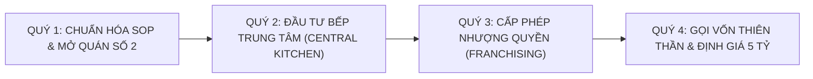

# CHƯƠNG 3: MỞ RỘNG CHUỖI & NHƯỢNG QUYỀN (COFFEE CHAIN & FRANCHISE)
## TÀI LIỆU THIẾT KẾ GAME & LOGIC TÌNH HUỐNG (GDD)
**Phiên bản:** 1.0 (Quy Chuẩn Nhân Bản & Quản Trị Chuỗi 2026)  
**Tác giả:** Senior Game Manager Creator 2026  
**Dự án:** PlayBoard — Game Giáo Dục Tài Chính Cá Nhân & Khởi Nghiệp  

---

## 1. TỔNG QUAN GAME & MỤC TIÊU CỐT LÕI

### 1.1. Tuyên Bố Sứ Mệnh (Game Vision)
Sau khi chứng minh được mô hình 1 quán cà phê đã sinh lời ổn định ở Chương 2, người chơi bước vào nấc thang cao nhất của một doanh nhân: **"Từ Người Làm Chủ Một Cửa Hàng Trở Thành Nhà Sáng Lập Một Chuỗi Thương Hiệu"**.
Chương 3 giải quyết bài toán:
- Nhân bản hệ thống từ **1 lên 3–5 cửa hàng**.
- Mô hình **Nhượng Quyền Thương Hiệu (Franchising)**: Thu phí nhượng quyền ban đầu (Franchise Fee) và phí bản quyền định kỳ hàng tháng (Royalty Fee).
- Xây dựng **Bếp Trung Tâm (Central Kitchen)** để tối ưu chi phí nguyên liệu và đồng nhất chất lượng trên toàn hệ thống.
- Đàm phán với các **Nhà Đầu Tư Thiên Thần (Angel Investors)**: Định giá doanh nghiệp Pre-money / Post-money, chia tỷ lệ cổ phần (Cap Table) và bảo vệ quyền kiểm soát công ty trước nguy cơ bị pha loãng (Dilution).

### 1.2. Mốc Chiến Thắng & Thất Bại (Win/Lose Conditions)
- **Thời lượng:** **4 Quý (1 Năm tài chính mở rộng)**.
- **Điều kiện CHIẾN THẮNG (Victory):**
  1. Phát triển thành công hệ thống đạt quy mô tối thiểu **3 Cửa Hàng Trực Thuộc + 2 Cửa Hàng Nhượng Quyền**.
  2. Tổng doanh thu toàn chuỗi đạt $\ge 500.000.000\text{ VND/tháng}$.
  3. Chỉ số Sức Khỏe Thương Hiệu (Brand Reputation) $\ge 80/100$.
  4. Đàm phán thành công Vòng Gọi Vốn Thiên Thần với định giá công ty $\ge 5.000.000.000\text{ VND}$ (5 Tỷ VND), người sáng lập vẫn giữ quyền chi phối $\ge 65\%$ cổ phần.
- **Điều kiện THẤT BẠI (Game Over):**
  - Mất kiểm soát chất lượng nhượng quyền (Brand Reputation $< 40/100$) dẫn đến khủng hoảng truyền thông.
  - Vỡ nợ dòng tiền do mở rộng chi nhánh mới quá nhanh (Over-expansion) khi chưa đủ vốn lưu động.
  - Bị nhà đầu tư thâu tóm mất quyền điều hành công ty (Tỷ lệ sở hữu $< 50\%$).

---

## 2. KINH TẾ HỌC NHÂN CHUỖI & NHƯỢNG QUYỀN (FRANCHISE & CHAIN ECONOMICS)

### 2.1. Hai Trục Dòng Tiền: Cửa Hàng Trực Thuộc vs Nhượng Quyền
1. **Cửa Hàng Trực Thuộc (Company-Owned Store):**
   - *Chi phí đầu tư:* Tự bỏ vốn 100% Capex (`120.000.000 VND / điểm`).
   - *Quyền lợi:* Hưởng 100% lợi nhuận ròng của cửa hàng.
   - *Rủi ro:* Tự gánh chịu 100% chi phí cố định mặt bằng và nhân sự.
2. **Cửa Hàng Nhượng Quyền (Franchise Store):**
   - *Chi phí đầu tư:* Đối tác nhận quyền tự bỏ 100% tiền mở quán và mặt bằng.
   - *Khoản thu về cho Chủ Chuỗi:*
     - **Phí Nhượng Quyền Ban Đầu (Franchise Fee):** Thu ngay `100.000.000 – 150.000.000 VND` khi ký hợp đồng (tiền mặt bổ sung ngay lập tức vào vốn lưu động).
     - **Phí Bản Quyền Thương Hiệu (Royalty Fee):** Thu đều đặn `3% – 5%` trên tổng doanh thu mỗi tháng của đối tác.
     - **Lợi nhuận cung ứng nguyên vật liệu:** Độc quyền phân phối hạt cafe và syrup từ Bếp trung tâm cho đối tác với biên lãi 15%.

### 2.2. Bài Toán Đầu Tư Bếp Trung Tâm (Central Kitchen ROI)
- **Chi phí đầu tư Capex:** `120.000.000 VND` (mua máy rang công nghiệp, kho lạnh, máy đóng gói).
- **Lợi ích kinh tế:**
  - Nhập nguyên liệu số lượng lớn (Bulk Purchasing) giúp giảm giá vốn nguyên vật liệu toàn hệ thống từ **30% xuống còn 20%**.
  - Đồng nhất 100% chất lượng mẻ rang hạt trên toàn bộ các chi nhánh.
  - Công thức hòa vốn đầu tư Bếp trung tâm:
    $$\text{Thời gian hoàn vốn} = \frac{\text{Vốn đầu tư Bếp Trung Tâm}}{\text{Tiền tiết kiệm nguyên liệu toàn chuỗi / tháng}}$$
    *(Khi chuỗi đạt từ 4 quán trở lên, tiền tiết kiệm nguyên liệu đạt 25M/tháng $\rightarrow$ Hoàn vốn chỉ sau 4.8 tháng!).*

### 2.3. Mô Hình Gọi Vốn & Bảng Phân Bổ Cổ Phần (Cap Table & Valuation)
- **Định giá Pre-money:** Giá trị công ty trước khi nhận tiền đầu tư.
  $$\text{Định giá Pre-money} = \text{EBITDA 1 năm} \times \text{Hệ số định giá ngành F&B (Multiple 6x – 8x)}$$
- **Số tiền gọi vốn (Investment Amount):** Số tiền nhà đầu tư rót vào công ty (ví dụ: `1.000.000.000 VND`).
- **Định giá Post-money:**
  $$\text{Định giá Post-money} = \text{Pre-money} + \text{Investment Amount}$$
- **Tỷ lệ cổ phần nhà đầu tư nhận được:**
  $$\text{Tỷ lệ cổ phần mới} = \frac{\text{Investment Amount}}{\text{Post-money}}$$
- **Tỷ lệ cổ phần còn lại của Người sáng lập (Dilution):**
  $$\text{Cổ phần Founder sau gọi vốn} = \text{Cổ phần cũ} \times (1 - \text{Tỷ lệ cổ phần mới})$$

---

## 3. DANH MỤC THẺ TÌNH HUỐNG CHIẾN LƯỢC CHƯƠNG 3

---

### BẢNG CHI TIẾT CÁC THẺ CHIẾN LƯỢC CHƯƠNG 3

#### THẺ 01: LỰA CHỌN MẶT BẰNG QUÁN THỨ 2 (QUÝ 1)
- **Bối cảnh:** Quán 1 đã quá tải, bạn cần mở chi nhánh thứ 2 để mở rộng tầm ảnh hưởng.
- **Lựa chọn A (Mặt tiền phố đi bộ sầm uất):**
  - *Chi phí:* Tiền cọc và thuê cao `-28.000.000 VND/tháng`. Capex `-140.000.000 VND`.
  - *Tác động:* Doanh số khủng $+180$ ly/ngày. Nâng tầm nhận diện thương hiệu $+25$ điểm.
- **Lựa chọn B (Khu dân cư đông đúc ven đô):**
  - *Chi phí:* Tiền thuê rẻ `-12.000.000 VND/tháng`. Capex `-80.000.000 VND`.
  - *Tác động:* Doanh số ổn định $+90$ ly/ngày. Dễ hòa vốn nhưng ít giá trị định vị thương hiệu.
- **Bài học kinh tế:** Chiến lược địa điểm (Location Strategy): Mặt bằng đắt chưa chắc lỗ nếu lưu lượng khách (Foot Traffic) đủ lớn.

#### THẺ 02: CHUẨN HÓA QUY TRÌNH VẬN HÀNH (SOP) (QUÝ 1)
- **Bối cảnh:** Khi mở quán thứ 2, bạn không thể có mặt ở cả hai nơi cùng một lúc.
- **Lựa chọn A (Thuê chuyên gia F&B viết tài liệu SOP chuẩn mực):**
  - *Chi phí:* Trả ngay `-20.000.000 VND`.
  - *Tác động:* Đào tạo nhân viên mới chỉ mất 3 ngày, chất lượng ly cafe chuẩn vị 100% giữa các quán. Uy tín thương hiệu $+15$.
- **Lựa chọn B (Tự viết sổ tay hướng dẫn sơ sài theo trí nhớ):**
  - *Chi phí:* `0 VND`.
  - *Tác động:* Nhân viên quán 2 làm sai công thức, khách hàng phàn nàn vị cafe bị chua, Uy tín thương hiệu $-10$.
- **Bài học kinh tế:** Chi phí vô hình của việc thiếu chuẩn hóa quy trình khi mở rộng chuỗi.

#### THẺ 03: ĐẦU TƯ BẾP TRUNG TÂM (CENTRAL KITCHEN) (QUÝ 2)
- **Bối cảnh:** Chuỗi đang tiêu thụ 500kg hạt cafe và 1.200 lít sữa mỗi tháng.
- **Lựa chọn A (Đầu tư xưởng rang & Bếp trung tâm 120M VND):**
  - *Tác động:* Giảm giá vốn nguyên vật liệu toàn hệ thống từ 30% xuống còn 20%! Tăng biên lợi nhuận gộp toàn chuỗi $+10\%$.
- **Lựa chọn B (Tiếp tục mua hạt rang sẵn từ bên thứ ba):**
  - *Tác động:* Tiết kiệm 120M tiền mặt, nhưng chịu giá vốn cao và phụ thuộc lịch giao hàng của nhà cung cấp.
- **Bài học kinh tế:** Lợi thế kinh tế nhờ quy mô (Economies of Scale).

#### THẺ 04: XỬ LÝ KHỦNG HOẢNG NHƯỢNG QUYỀN (QUÝ 3)
- **Bối cảnh:** Một cửa hàng nhượng quyền tự ý nhập hạt cafe kém chất lượng bên ngoài để ăn chênh lệch giá, bị khách bóc phốt trên mạng xã hội.
- **Lựa chọn A (Phạt nặng & Thu hồi quyền nhượng quyền, công khai xin lỗi):**
  - *Tác động:* Mất khoản thu Royalty từ quán này, nhưng bảo vệ toàn vẹn uy tín thương hiệu chuỗi. Điểm uy tín phục hồi $+20$.
  - **Lựa chọn B (Bỏ qua vì tiếc tiền phí bản quyền):**
  - *Tác động:* Khủng hoảng lan rộng, toàn bộ hệ sinh thái bị đánh giá 1 sao. Điểm uy tín tụt dốc $-35$.
- **Bài học kinh tế:** Uy tín thương hiệu (Brand Equity) là tài sản vô giá trong mô hình Franchise.

#### THẺ 05: ĐÀM PHÁN THUẬT NGỮ ĐẦU TƯ (TERM SHEET) VỚI QUỸ THIÊN THẦN (QUÝ 4)
- **Bối cảnh:** Quỹ đầu tư thiên thần "Saigon F&B Angels" đề nghị rót **1.500.000.000 VND (1.5 Tỷ VND)** vào chuỗi của bạn.
- **Phương Án A (Định giá Pre-money 6 Tỷ VND, nhượng 20% cổ phần):**
  - *Hậu kỳ:* Bạn giữ 80% quyền kiểm soát, nhận 1.5 Tỷ tiền mặt để mở thêm 5 quán mới trong năm sau.
- **Phương Án B (Định giá Pre-money 3 Tỷ VND, nhượng 33.3% cổ phần kèm ghế Chủ tịch):**
  - *Rủi ro:* Bị quỹ can thiệp sâu vào quyền quyết định nhân sự và văn hóa công ty.
- **Bài học kinh tế:** Nghệ thuật đàm phán định giá doanh nghiệp và bảo toàn quyền kiểm soát của người sáng lập (Founder Control).
