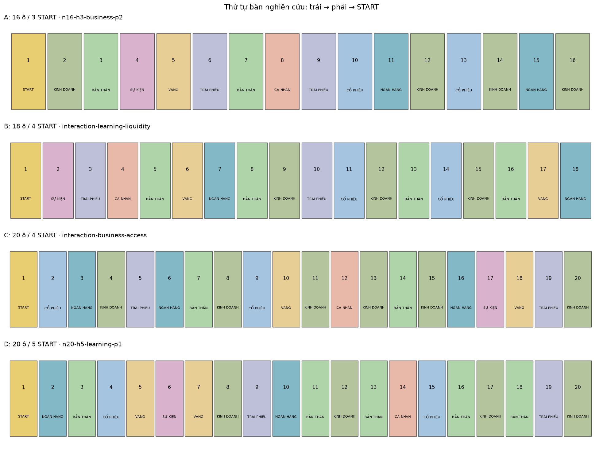
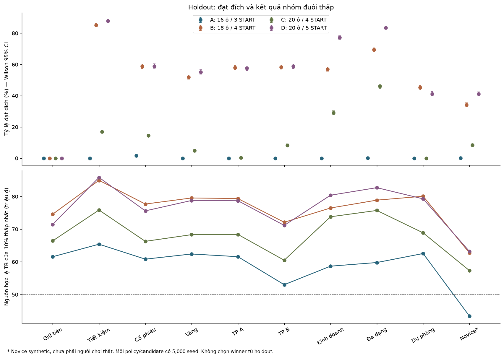
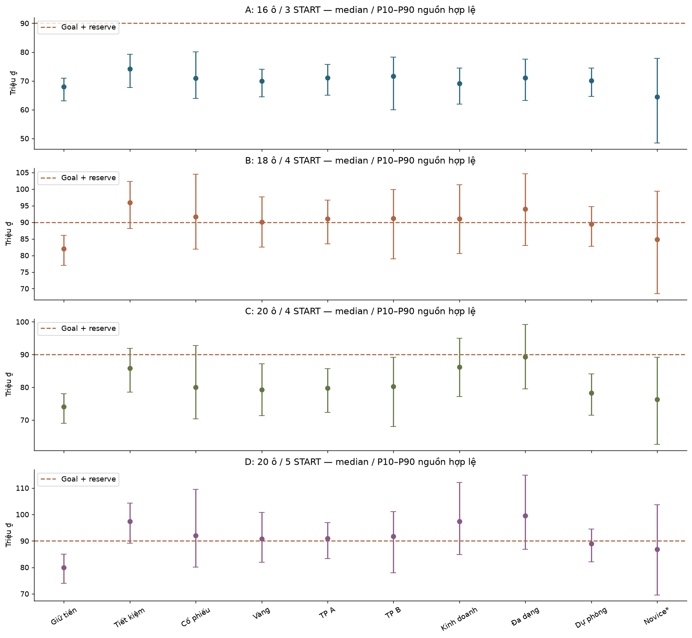
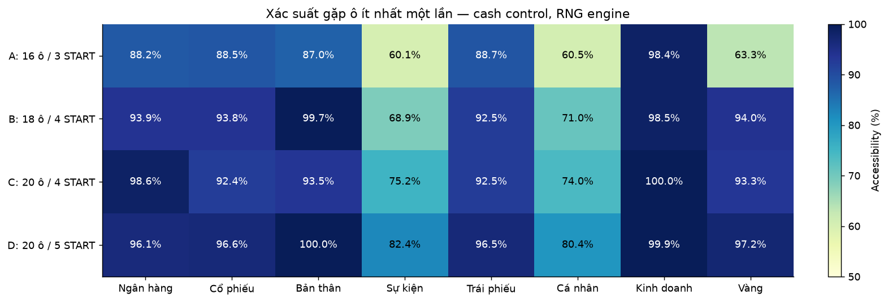
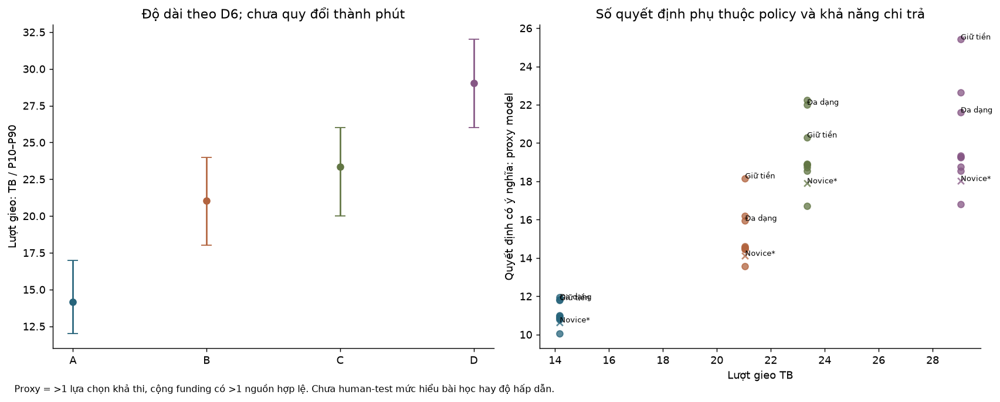
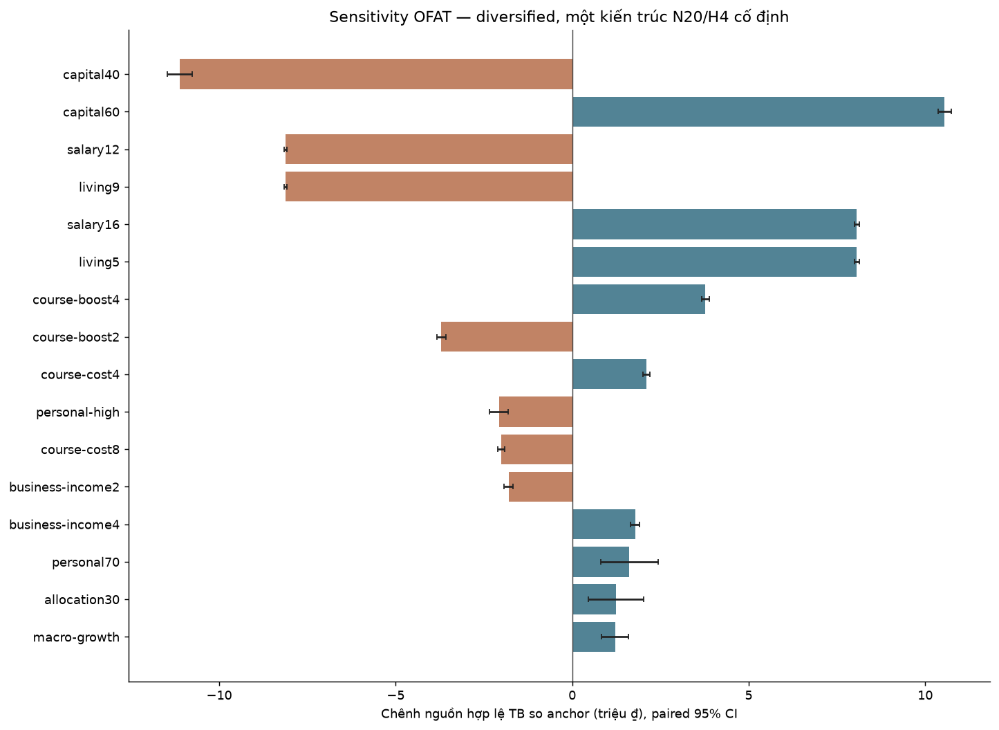

# Core Game MVP — nghiên cứu cấu hình và cân bằng

**Research only — 16/10/2026 (Asia/Bangkok). Chưa phê duyệt cấu hình, chưa sửa production, merge, push hay deploy.**

Có 4 phương án đã được khóa từ dữ liệu shortlist trước holdout. Đây là tập lựa chọn Pareto của model synthetic, không phải kết luận tối ưu tuyệt đối. Holdout có 200,000 ván mới; kết quả không được dùng để sửa thông số hay thay ứng viên. Thời lượng thực, mức hấp dẫn, khả năng học và độ khó phù hợp vẫn cần owner và playtest người thật.

## Bảng quyết định nhanh

| PA | Bàn / START | Rolls TB [P10–P90] | Quyết định TB* | Median proceeds dải policy (M) | Thắng dải policy** | Funding / khóa vốn dải | Đánh đổi để owner chọn |
|---|---|---|---|---|---|---|---|
| A | 16 ô / 3 START | 14.2 [12–17] | 10.0–12.0 | 69.16–74.12 | 0.0%–1.6% | 0.0%–2.3% / 0.0%–41.0% | Biên ngắn/khó: đa số policy gần như không đạt đích; chưa phù hợp MVP với economy/goal này |
| B | 18 ô / 4 START | 21.0 [18–24] | 13.6–18.2 | 89.48–95.95 | 45.2%–85.2% | 0.0%–1.1% / 0.0%–43.0% | Sinh hoạt 5M, course 8M/+4M: tích lũy tốt hơn; cần test cảm nhận chi phí học |
| C | 20 ô / 4 START | 23.3 [20–26] | 16.7–22.3 | 78.26–89.26 | 0.0%–46.0% | 0.0%–17.6% / 0.0%–41.2% | Business 15M/4M, nhiều lần ghé: dễ mở/nâng hơn; vẫn cần thoát vốn đúng ô |
| D | 20 ô / 5 START | 29.0 [26–32] | 16.8–25.4 | 88.91–99.59 | 41.2%–87.8% | 0.0%–19.2% / 0.0%–36.0% | Nhiều cơ hội và START để tích lũy; dài hơn, Savings có lợi thế rõ |

Ghi chú: (*) proxy encounter có >1 lựa chọn khả thi và funding có >1 nguồn hợp lệ; không coi mọi modal/acknowledge là quyết định có ý nghĩa. (**) Dải tám policy có chủ đích, loại cash và novice; dải quyết định/funding/khóa vốn gồm cả mười policy. Chi tiết nằm trong báo cáo kỹ thuật và CSV. Tiền là M VND giả lập, không quy đổi thành lợi nhuận năm/tháng.

## Phương pháp và giới hạn

- A: 30 dòng cũ tái lập chính xác trên cùng source và 3 log lịch sử replay đầy đủ. Baseline lịch sử periodic C20 vẫn có ô Dòng tiền; nguồn V2 board/length/Bond dùng luật hoặc phân bổ khác, chỉ làm tham chiếu. Không gọi chênh lệch giữa các nghiên cứu cũ là A/B cho MVP mới. Reference 9 loại ô là đối chứng do lab dựng: đổi Dòng tiền thành Course và ô thứ tư Stocks thành Bank; đây chưa phải một layout owner đã chốt.
- B: 240 layout = 5 số ô × 4 số START × 3 count profile × 4 permutation. 10,000 chuỗi D6/cặp N/H, tổng 200.000 chuỗi riêng; dùng lại cùng path giữa layout cùng N/H. 12 layout bị loại theo ngưỡng lab công khai. Count/permutation được tách; có một START, đủ tám loại còn lại, không hai loại giống nhau liên tiếp, course trong sáu ô đầu và business trong nửa đầu. Đây là khám phá có ràng buộc, chưa vét cạn không gian layout.
- C: 63 cấu hình × 8 policy × 200 seed = 100,800 ván. Một đại diện qua screening ở mỗi N/H, OFAT tại một N20/H4, hai đối chứng 9 loại ô. Không mở full factorial. Biến giữ nguyên vẫn có effective snapshot trong config JSON.
- D: 10 shortlist × 10 policy × 1.000 seed = 100,000 ván; sau đó 4 frozen candidate × 10 policy × 5.000 seed mới. Tổng tài chính chính: 400,800 ván; benchmark/trace/replay được ghi riêng, không cộng vào mẫu ước lượng.
- CI thắng/thua/phá sản/funding dùng Wilson 95% theo từng policy. Median có seed bootstrap 400 lần. Chỉ pooled win dùng seed-cluster bootstrap, không coi mười policy cùng seed là độc lập. CI chỉ đo sai số seed của model cố định, không gồm sai số heuristic, selection bias trước holdout hay người thật.
- Tất cả policy cùng candidate bắt đầu cùng vốn, cùng phân bổ và cùng kỳ hạn; cash thuần không học hoặc đầu tư. Trong broad allocation20/30 và reference20, cash là passive matched-allocation control có khoản gửi từ setup, không phải cash thuần. Dữ liệu các biến phân bổ được báo riêng trong sensitivity.
- Policy chỉ xem trạng thái hiện tại. Course học khi lợi ích các START còn lại bù học phí. Business mua khi còn ≥3 START, nâng khi còn ≥3, bán trong hai vòng cuối nếu gặp lại đúng ô. Stocks chọn độ biến động theo forecast hiện tại, không biết giá tương lai. Liquidity giữ 20M và bán tài chính tại START; novice chọn ngẫu nhiên từ lựa chọn khả thi, reserve 0, **synthetic — không đại diện người mới thật**.
- Mua/nâng/gửi chỉ đúng ô và quyền encounter; bán tài chính ở START hoặc funding, Business không bán tại START/funding. Savings rút toàn lot và mất lãi khi funding. Lãi/coupon là mỗi START, không phải tháng/năm. Settlement giữ market → salary → business → maturity/coupon → living → debt → obligations; credit giữ RNG riêng.
- Cùng seed trong một candidate ghép policy được; raw có hash dice/encounter và paired CI. Kích thước bàn, số START, activation và thứ tự sự kiện có thể làm RNG/path khác. Giữa các kiến trúc không được suy diễn là đã giữ cùng chuỗi cú sốc kinh tế. Dice-only stream là riêng, không dự báo đúng path engine theo seed.
- Scope screening: timing settlement, rút toàn lot, hạn mức/kỳ hạn và tín hiệu cơ bản được audit rồi giữ baseline; chưa khảo sát mọi cơ chế thay thế. Stock/gold range sensitivity đổi cả drift và dispersion, không phải thí nghiệm pure volatility. Chưa hiệu chỉnh xác suất credit theo dữ liệu thật. Không có UI, AI provider, Vercel hay thiết bị thật trong vòng nghiên cứu này.
- Trong hai biến thể broad vốn 40M/60M, câu mô tả setup kế thừa từ engine vẫn viết 50M; snapshot, delta ledger và config ghi đúng vốn đã thay và được dùng để tính toàn bộ số liệu. Không dùng prose setup để suy vốn. Bốn candidate cuối đều 50M nên không có sai lệch mô tả này; UI/narrative cho biến thể vốn chưa được làm trong nghiên cứu.

## Pareto và độ bền

Đã chọn từ frontier shortlist theo năm trục: giảm rolls; tăng cơ hội quyết định có thể thực hiện; tăng median gain so cash cùng điều kiện; tăng proceeds bình quân worst-decile; tăng accessibility trung bình. Win rate được báo, không tối ưu theo một tỷ lệ đích. Lấy các điểm trải dọc trục độ dài trong frontier; đây là quy tắc lab công khai, owner vẫn có thể chọn lại trước implementation.

Frontier còn lại khi đánh giá riêng holdout: n16-h3-business-p2, interaction-learning-liquidity, interaction-business-access, n20-h5-learning-p1. Không thay danh sách đã freeze nếu một điểm bị dominated sau holdout; đó là thông tin độ bền cần owner cân nhắc.

| PA | Policy | Win (Wilson 95%) | Median [P10–P90] M | Worst 10% M | Credit loss P99 M | Funding / vay | Phá sản (CI) | Khóa vốn |
|---|---|---|---|---|---|---|---|---|
| A | cash | 0.0% [0.0%–0.1%] | 68.00 [63.00–71.00] | 61.56 | 0.00 | 0.0% / 0.0% | 0.0% [0.0%–0.1%] | 0.0% |
| A | savings | 0.0% [0.0%–0.1%] | 74.12 [67.67–79.20] | 65.40 | 0.00 | 0.0% / 0.0% | 0.0% [0.0%–0.1%] | 0.0% |
| A | stocks | 1.6% [1.3%–1.9%] | 71.00 [63.87–80.08] | 60.82 | 0.00 | 0.0% / 0.0% | 0.0% [0.0%–0.1%] | 0.0% |
| A | gold | 0.0% [0.0%–0.1%] | 70.00 [64.47–74.02] | 62.40 | 0.00 | 0.0% / 0.0% | 0.0% [0.0%–0.1%] | 0.0% |
| A | bond-a | 0.0% [0.0%–0.1%] | 71.01 [65.00–75.65] | 61.57 | 3.72 | 0.0% / 0.0% | 0.0% [0.0%–0.1%] | 1.0% |
| A | bond-b | 0.0% [0.0%–0.1%] | 71.58 [59.96–78.31] | 53.01 | 19.70 | 0.0% / 0.0% | 0.0% [0.0%–0.1%] | 3.8% |
| A | business | 0.0% [0.0%–0.1%] | 69.16 [62.00–74.48] | 58.67 | 0.00 | 0.0% / 0.0% | 0.0% [0.0%–0.1%] | 4.2% |
| A | diversified | 0.2% [0.1%–0.3%] | 71.06 [63.26–77.50] | 59.78 | 1.24 | 0.0% / 0.0% | 0.0% [0.0%–0.1%] | 5.0% |
| A | liquidity | 0.0% [0.0%–0.1%] | 70.15 [64.63–74.47] | 62.55 | 1.23 | 0.0% / 0.0% | 0.0% [0.0%–0.1%] | 0.5% |
| A | novice | 0.1% [0.1%–0.3%] | 64.52 [48.45–77.81] | 43.39 | 9.32 | 2.3% / 0.0% | 0.0% [0.0%–0.1%] | 41.0% |
| B | cash | 0.0% [0.0%–0.1%] | 82.00 [77.00–86.00] | 74.58 | 0.00 | 0.0% / 0.0% | 0.0% [0.0%–0.1%] | 0.0% |
| B | savings | 85.2% [84.2%–86.2%] | 95.95 [88.14–102.24] | 84.94 | 0.00 | 0.0% / 0.0% | 0.0% [0.0%–0.1%] | 0.0% |
| B | stocks | 58.8% [57.5%–60.2%] | 91.63 [81.84–104.42] | 77.69 | 0.00 | 0.0% / 0.0% | 0.0% [0.0%–0.1%] | 0.0% |
| B | gold | 51.9% [50.5%–53.3%] | 90.13 [82.55–97.61] | 79.55 | 0.00 | 0.0% / 0.0% | 0.0% [0.0%–0.1%] | 0.0% |
| B | bond-a | 58.0% [56.6%–59.4%] | 91.00 [83.51–96.70] | 79.36 | 4.39 | 0.0% / 0.0% | 0.0% [0.0%–0.1%] | 1.0% |
| B | bond-b | 58.3% [56.9%–59.7%] | 91.20 [78.98–99.89] | 72.11 | 20.19 | 0.0% / 0.0% | 0.0% [0.0%–0.1%] | 3.8% |
| B | business | 57.0% [55.6%–58.4%] | 91.00 [80.59–101.24] | 76.48 | 0.00 | 0.0% / 0.0% | 0.0% [0.0%–0.1%] | 10.8% |
| B | diversified | 69.4% [68.1%–70.7%] | 93.94 [83.01–104.55] | 78.88 | 1.46 | 0.0% / 0.0% | 0.0% [0.0%–0.1%] | 10.7% |
| B | liquidity | 45.2% [43.9%–46.6%] | 89.48 [82.73–94.74] | 80.07 | 1.24 | 0.0% / 0.0% | 0.0% [0.0%–0.1%] | 0.6% |
| B | novice | 34.2% [32.9%–35.5%] | 84.83 [68.50–99.37] | 62.73 | 10.43 | 1.1% / 0.0% | 0.0% [0.0%–0.1%] | 43.0% |
| C | cash | 0.0% [0.0%–0.1%] | 74.00 [69.00–78.00] | 66.42 | 0.00 | 0.0% / 0.0% | 0.0% [0.0%–0.1%] | 0.0% |
| C | savings | 17.0% [16.0%–18.1%] | 85.79 [78.54–91.82] | 75.85 | 0.00 | 0.0% / 0.0% | 0.0% [0.0%–0.1%] | 0.0% |
| C | stocks | 14.5% [13.6%–15.5%] | 80.00 [70.31–92.78] | 66.28 | 0.00 | 0.0% / 0.0% | 0.0% [0.0%–0.1%] | 0.0% |
| C | gold | 4.8% [4.3%–5.4%] | 79.20 [71.38–87.18] | 68.32 | 0.00 | 0.0% / 0.0% | 0.0% [0.0%–0.1%] | 0.0% |
| C | bond-a | 0.4% [0.3%–0.6%] | 79.70 [72.32–85.71] | 68.38 | 7.31 | 0.0% / 0.0% | 0.0% [0.0%–0.1%] | 1.0% |
| C | bond-b | 8.3% [7.6%–9.1%] | 80.26 [67.99–89.20] | 60.49 | 21.00 | 0.0% / 0.0% | 0.0% [0.0%–0.1%] | 3.6% |
| C | business | 29.0% [27.8%–30.3%] | 86.15 [77.18–94.94] | 73.79 | 0.00 | 0.0% / 0.0% | 0.0% [0.0%–0.1%] | 0.8% |
| C | diversified | 46.0% [44.6%–47.4%] | 89.26 [79.55–99.14] | 75.72 | 1.73 | 0.0% / 0.0% | 0.0% [0.0%–0.1%] | 1.7% |
| C | liquidity | 0.0% [0.0%–0.1%] | 78.26 [71.45–84.02] | 68.87 | 1.24 | 0.0% / 0.0% | 0.0% [0.0%–0.1%] | 0.6% |
| C | novice | 8.5% [7.7%–9.3%] | 76.27 [62.57–89.12] | 57.32 | 9.62 | 17.6% / 0.0% | 0.0% [0.0%–0.1%] | 41.2% |
| D | cash | 0.0% [0.0%–0.1%] | 80.00 [74.00–85.00] | 71.46 | 0.00 | 0.0% / 0.0% | 0.0% [0.0%–0.1%] | 0.0% |
| D | savings | 87.8% [86.9%–88.7%] | 97.43 [89.07–104.23] | 85.83 | 0.00 | 0.0% / 0.0% | 0.0% [0.0%–0.1%] | 0.0% |
| D | stocks | 59.0% [57.6%–60.3%] | 92.02 [80.09–109.55] | 75.59 | 0.00 | 0.0% / 0.0% | 0.0% [0.0%–0.1%] | 0.0% |
| D | gold | 55.2% [53.8%–56.6%] | 90.84 [81.96–100.78] | 78.78 | 0.00 | 0.0% / 0.0% | 0.0% [0.0%–0.1%] | 0.0% |
| D | bond-a | 57.5% [56.1%–58.9%] | 91.00 [83.27–96.96] | 78.70 | 7.44 | 0.0% / 0.0% | 0.0% [0.0%–0.1%] | 1.2% |
| D | bond-b | 58.8% [57.5%–60.2%] | 91.65 [78.00–101.03] | 71.15 | 21.00 | 0.0% / 0.0% | 0.0% [0.0%–0.1%] | 3.5% |
| D | business | 77.2% [76.1%–78.4%] | 97.43 [84.88–112.14] | 80.39 | 0.00 | 0.0% / 0.0% | 0.0% [0.0%–0.1%] | 6.2% |
| D | diversified | 83.5% [82.5%–84.5%] | 99.59 [86.81–114.81] | 82.70 | 2.47 | 0.0% / 0.0% | 0.0% [0.0%–0.1%] | 6.9% |
| D | liquidity | 41.2% [39.8%–42.6%] | 88.91 [82.04–94.45] | 79.27 | 1.24 | 0.0% / 0.0% | 0.0% [0.0%–0.1%] | 0.5% |
| D | novice | 41.1% [39.7%–42.5%] | 86.89 [69.57–103.71] | 63.19 | 10.50 | 19.2% / 0.0% | 0.0% [0.0%–0.1%] | 36.0% |

Loss rate = 1 − win rate, có thể chồng với insolvency. Lock ở bảng là Business còn giữ hoặc bond default chưa có quote; không coi savings principal hoặc financial assets bán hợp lệ là vốn khóa hoàn toàn. Drawdown là từ đỉnh net worth trong log, có cả tiêu dùng/chi phí, không phải pure investment drawdown. Credit loss đã phản ánh trong trạng thái, không trừ hai lần. Zero insolvency trong mẫu không chứng minh bất khả thi.

## Điều tốt hơn baseline và khác biệt strategy

- **A (n16-h3-business-p2)**: ở tập shortlist, chênh median bình quân tám policy với reference 9 loại ô/cash allocation là -5.80M; rolls -9.0 so reference. Holdout: median cao nhất là savings (74.12M), worst-decile thấp nhất là bond-b (53.01M). Đây là đánh đổi độ dài/kinh tế/layout, không có bằng chứng tốt hơn trên mọi trục hoặc mọi seed. Tỷ lệ seed dẫn đầu proceeds (chia đều khi hòa): savings 43.1%, stocks 22.6%, gold 2.7%, bond-a 2.5%, bond-b 21.4%, business 1.5%, diversified 6.2%, liquidity 0.1%.
- **B (interaction-learning-liquidity)**: ở tập shortlist, chênh median bình quân tám policy với reference 9 loại ô/cash allocation là 15.04M; rolls -2.3 so reference. Holdout: median cao nhất là savings (95.95M), worst-decile thấp nhất là bond-b (72.11M). Đây là đánh đổi độ dài/kinh tế/layout, không có bằng chứng tốt hơn trên mọi trục hoặc mọi seed. Tỷ lệ seed dẫn đầu proceeds (chia đều khi hòa): savings 34.9%, stocks 20.4%, gold 7.4%, bond-a 0.5%, bond-b 11.9%, business 4.3%, diversified 20.5%, liquidity 0.0%.
- **C (interaction-business-access)**: ở tập shortlist, chênh median bình quân tám policy với reference 9 loại ô/cash allocation là 5.97M; rolls 0.0 so reference. Holdout: median cao nhất là diversified (89.26M), worst-decile thấp nhất là bond-b (60.49M). Đây là đánh đổi độ dài/kinh tế/layout, không có bằng chứng tốt hơn trên mọi trục hoặc mọi seed. Tỷ lệ seed dẫn đầu proceeds (chia đều khi hòa): savings 19.9%, stocks 9.3%, gold 3.7%, bond-a 0.1%, bond-b 6.3%, business 7.1%, diversified 53.7%, liquidity 0.0%.
- **D (n20-h5-learning-p1)**: ở tập shortlist, chênh median bình quân tám policy với reference 9 loại ô/cash allocation là 16.91M; rolls 5.7 so reference. Holdout: median cao nhất là diversified (99.59M), worst-decile thấp nhất là bond-b (71.15M). Đây là đánh đổi độ dài/kinh tế/layout, không có bằng chứng tốt hơn trên mọi trục hoặc mọi seed. Tỷ lệ seed dẫn đầu proceeds (chia đều khi hòa): savings 20.8%, stocks 15.4%, gold 7.2%, bond-a 0.3%, bond-b 7.5%, business 14.5%, diversified 34.2%, liquidity 0.0%.

Các layout learning/business có thể giảm mật độ Personal so reference; giảm thuế biến cố và tăng cơ hội ghé ô là một phần chênh lệch, không được gán toàn bộ cải thiện cho course hay Business economics. Vì lương luôn nhận trước sinh hoạt và lớn hơn sinh hoạt trong các candidate cuối, funding riêng bước sinh hoạt có thể bằng 0 do cấu trúc; các thiếu hụt vẫn xuất hiện giữa vòng và qua novice. Zero borrowing/insolvency cần được đọc cùng reserve và thứ tự funding, không chứng minh các cơ chế ấy không cần thiết.

Savings nhận lợi ích tái gửi khi gặp Bank và tránh biến động giá, nhưng rút sớm toàn lot mất lãi; Stocks có upside và tail risk theo market; Gold chịu spread; Bond B coupon cao nhưng default/tail loss lớn hơn A. Business cần ghé lại đúng ô để nâng và thoát, thu nhập không khiến vốn còn giữ thành tiền hợp lệ tại đích. Diversified vẫn có phí và khóa vốn; Liquidity trả phí bán để giữ tiền; cash bỏ upside và course. Độ xếp hạng này phụ thuộc heuristic, cần đọc raw và thử policy khác trước khi coi là thuộc tính tuyệt đối của tài sản.

## Thứ tự ô và thông số kinh tế



| Tham số (tiền M VND) | A | B | C | D |
|---|---|---|---|---|
| Vốn ban đầu | 50.00 | 50.00 | 50.00 | 50.00 |
| Savings đầu / kỳ | 0.00 / 3 | 0.00 / 3 | 0.00 / 3 | 0.00 / 3 |
| Lương / sinh hoạt mỗi START | 14.00 / 7.00 | 14.00 / 5.00 | 14.00 / 7.00 | 14.00 / 7.00 |
| Goal + reserve | 80.00 + 10.00 | 80.00 + 10.00 | 80.00 + 10.00 | 80.00 + 10.00 |
| Course cost / boost | 6.00 / 3.00 | 8.00 / 4.00 | 6.00 / 3.00 | 6.00 / 3.00 |
| Savings kỳ 1 / 2 / 3 | 4.0% / 5.0% / 6.0% | 4.0% / 5.0% / 6.0% | 4.0% / 5.0% / 6.0% | 4.0% / 5.0% / 6.0% |
| Business mở / income / nâng | 20.00 / 3.00 / 5.00 | 20.00 / 3.00 / 5.00 | 15.00 / 4.00 / 3.00 | 20.00 / 3.00 / 5.00 |
| Business recovery vốn/nâng / uplift/matching | 70.0%/50.0%; 0.70/1.00 | 70.0%/50.0%; 0.70/1.00 | 70.0%/50.0%; 0.70/1.00 | 70.0%/50.0%; 0.70/1.00 |
| Phí stocks / bonds / gold, spread gold | 1.0% / 1.5% / 1.0%; 3.0% | 1.0% / 1.5% / 1.0%; 3.0% | 1.0% / 1.5% / 1.0%; 3.0% | 1.0% / 1.5% / 1.0%; 3.0% |
| Coupon A/B; kỳ | 4.5% / 10.0%; 2/2 | 4.5% / 10.0%; 2/2 | 4.5% / 10.0%; 2/2 | 4.5% / 10.0%; 2/2 |
| Credit A/B default, delay, recovery | 0.5%/3.5%/80.0%; 2.5%/10.0%/50.0% | 0.5%/3.5%/80.0%; 2.5%/10.0%/50.0% | 0.5%/3.5%/80.0%; 2.5%/10.0%/50.0% | 0.5%/3.5%/80.0%; 2.5%/10.0%/50.0% |
| Personal activation / medical / repair / family | 100.0%; 5.00/6.00; 4.00/1.00/4.00; 3.00/3.50 | 100.0%; 5.00/6.00; 4.00/1.00/4.00; 3.00/3.50 | 100.0%; 5.00/6.00; 4.00/1.00/4.00; 3.00/3.50 | 100.0%; 5.00/6.00; 4.00/1.00/4.00; 3.00/3.50 |
| Macro weights | 1/1/1 | 1/1/1 | 1/1/1 | 1/1/1 |
| Hạn mức nợ / lãi START | 30.00 / 10.0% | 30.00 / 10.0% | 30.00 / 10.0% | 30.00 / 10.0% |

**A — n16-h3-business-p2**

1.START → 2.Kinh doanh → 3.Bản thân → 4.Sự kiện → 5.Vàng → 6.Trái phiếu → 7.Bản thân → 8.Cá nhân → 9.Trái phiếu → 10.Cổ phiếu → 11.Ngân hàng → 12.Kinh doanh → 13.Cổ phiếu → 14.Kinh doanh → 15.Ngân hàng → 16.Kinh doanh → START

Số lượng: START=1, Ngân hàng=2, Cổ phiếu=2, Bản thân=2, Sự kiện=1, Trái phiếu=2, Cá nhân=1, Kinh doanh=4, Vàng=1.

**B — interaction-learning-liquidity**

1.START → 2.Sự kiện → 3.Trái phiếu → 4.Cá nhân → 5.Bản thân → 6.Vàng → 7.Ngân hàng → 8.Bản thân → 9.Kinh doanh → 10.Trái phiếu → 11.Cổ phiếu → 12.Kinh doanh → 13.Bản thân → 14.Cổ phiếu → 15.Kinh doanh → 16.Bản thân → 17.Vàng → 18.Ngân hàng → START

Số lượng: START=1, Ngân hàng=2, Cổ phiếu=2, Bản thân=4, Sự kiện=1, Trái phiếu=2, Cá nhân=1, Kinh doanh=3, Vàng=2.

**C — interaction-business-access**

1.START → 2.Cổ phiếu → 3.Ngân hàng → 4.Kinh doanh → 5.Trái phiếu → 6.Ngân hàng → 7.Bản thân → 8.Kinh doanh → 9.Cổ phiếu → 10.Vàng → 11.Kinh doanh → 12.Cá nhân → 13.Kinh doanh → 14.Bản thân → 15.Kinh doanh → 16.Ngân hàng → 17.Sự kiện → 18.Vàng → 19.Trái phiếu → 20.Kinh doanh → START

Số lượng: START=1, Ngân hàng=3, Cổ phiếu=2, Bản thân=2, Sự kiện=1, Trái phiếu=2, Cá nhân=1, Kinh doanh=6, Vàng=2.

**D — n20-h5-learning-p1**

1.START → 2.Ngân hàng → 3.Bản thân → 4.Cổ phiếu → 5.Vàng → 6.Sự kiện → 7.Vàng → 8.Kinh doanh → 9.Trái phiếu → 10.Ngân hàng → 11.Bản thân → 12.Kinh doanh → 13.Bản thân → 14.Cá nhân → 15.Cổ phiếu → 16.Bản thân → 17.Kinh doanh → 18.Bản thân → 19.Trái phiếu → 20.Kinh doanh → START

Số lượng: START=1, Ngân hàng=2, Cổ phiếu=2, Bản thân=5, Sự kiện=1, Trái phiếu=2, Cá nhân=1, Kinh doanh=4, Vàng=2.

Bảng trên là phần đọc nhanh; **toàn bộ** effective EconomySpec (market ranges, macro magnitudes, credit penalties/cure/volatility, business depreciation/recovery, options chi/hoãn, policy rules và giả định) nằm trong [frozen-configs.json](frozen-configs.json). Các hằng legacy không được engine version hiện tại sử dụng vẫn được snapshot để audit, không phải tham số đang hoạt động.

## Charts











## Owner cần chốt

| Quyết định | Bằng chứng hiện có | Phần chưa xác nhận |
|---|---|---|
| Chọn bàn, thứ tự và số START | Bảng Pareto + dice/engine coverage + locked Business | Hứng thú và nhịp ván trên điện thoại |
| Chọn vốn, allocation, lương, sinh hoạt, goal/reserve | OFAT + interactions; full snapshots | Mức khó mong muốn; không có win-rate đích đã duyệt |
| Giữ hoặc đổi course/savings/market/fees/credit/Business | Strategy matched conditions + tails/CI | Policy khác, hiểu hệ quả và người chơi mới thật |
| Phê duyệt cấu hình có version trước implementation | Nguồn/seed/raw có thể tái lập, historical replay giữ nguyên | UI/replay version migration, AI provider, thiết bị thật và Vercel chỉ QA sau owner chọn |

Không có winner tự động. Các lựa chọn còn lại là quyết định sản phẩm của owner; chưa có thay đổi gameplay/board UI/artwork production trong nhánh này.

## Tái lập và dữ liệu

Chạy từ repo root với Node 22 hỗ trợ `--experimental-strip-types`. Không cần dependency mới trong package.json.

```powershell
node --experimental-strip-types --test scripts/lab.test.mjs
node --experimental-strip-types --test scripts/core-mvp-analysis.test.mjs
# Validate existing evidence without regenerating the study:
node --experimental-strip-types scripts/verify-core-mvp.mjs
# To rerun all simulations, use a new output folder first:
$env:CORE_MVP_LAB_OUT = "docs/research/core-mvp-reproduction"
node --experimental-strip-types scripts/baseline.mjs
node --experimental-strip-types scripts/run.mjs dice 10000
node --experimental-strip-types scripts/run.mjs broad 200
node --experimental-strip-types scripts/analyze-core-mvp.mjs shortlist
node --experimental-strip-types scripts/run.mjs shortlist 1000
node --experimental-strip-types scripts/analyze-core-mvp.mjs freeze
# Holdout runner refuses to overwrite an existing final holdout.
node --experimental-strip-types scripts/run.mjs holdout 5000
node --experimental-strip-types scripts/analyze-core-mvp.mjs finalize
Remove-Item Env:CORE_MVP_LAB_OUT
# Render the original saved results:
node --experimental-strip-types scripts/report-core-mvp.mjs
```

[CSV strategy](strategy-results.csv), [JSON so sánh](final-comparison.json), [sensitivity](sensitivity.json), [dice](dice-screen.json), [baseline audit](baseline-audit.json), [artifact hashes](artifact-manifest.json). Từng phase có seed list, source SHA/hash, version, thời gian UTC và config hash; đổi múi giờ báo cáo sang Asia/Bangkok. Raw từng candidate là `phase/id.rows.json.gz`; full-state examples có wrapper research riêng. Không import log candidate thành schema5 production hoặc sửa log lịch sử.

Elapsed thực: dice 70.9s; broad 513.8s; shortlist 462.9s; holdout 1089.1s. Các phase tài chính chạy tối đa bốn process nghiên cứu đồng thời, không phải agent/task mới.

Biểu đồ xuất PNG + SVG bằng matplotlib (phiên bản và dependency trong plot-manifest). Script vẽ: `scripts/plot-core-mvp.py`; thư viện chỉ được cài trong thư mục tạm, không đổi dependency dự án. Báo cáo là nghiên cứu game với tham số giáo dục, chưa human-test hoặc xác nhận production readiness.
